# Lifecycle: networking

Every state a link, a match, a socket, an HTTP request, a Gamend session and a store call moves through. [LIFECYCLE.md](LIFECYCLE.md) has the app, nodes and scripts.

## Links and sessions

### Link state

Each link to one peer holds this. Source: `crates/balaur_net/src/transport.rs`, `LinkState`, stored in `Connection.state` (`crates/balaur_websocket/src/connection.rs`) and `WebTransportLink.state` (`crates/balaur_webtransport/src/lib.rs`).

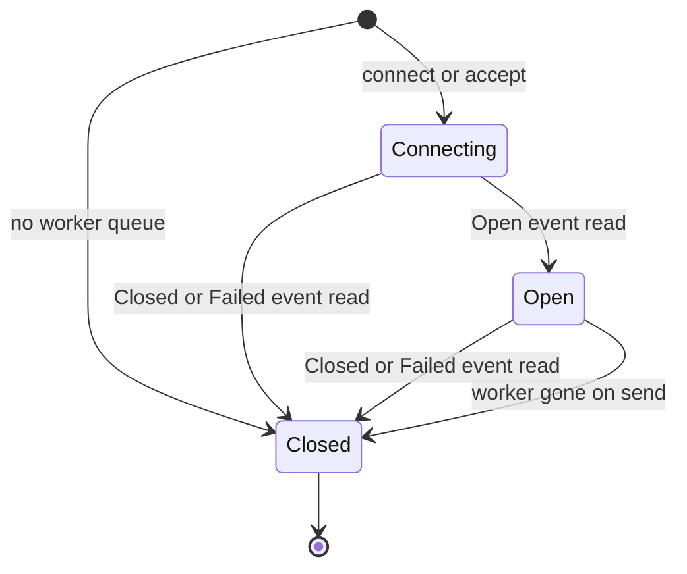

| State | What is true |
|---|---|
| `Connecting` | Not usable. Sends are refused, not queued. A link made during a replay or a re-simulated tick has no worker and stays here. |
| `Open` | Sends go to the worker's queue. |
| `Closed(String)` | Ended, with a reason. Sends are refused. |

| From | Trigger | To | What it does |
|---|---|---|---|
| none | `Connection::connect` | `Connecting` | Spawns the socket worker unless `replay::suppressed`. |
| none | `Connection::connect`, `backend::queue` fails | `Closed("no worker for the link: …")` | Spawns nothing. |
| none | `Connection::from_accepted` | `Connecting` | Wraps a peer the listener upgraded. |
| none | `WebTransportLink::connect` | `Connecting` | Runs `link::dial` on a thread, or `browser::dial`. Suppressed, `idle` makes a link with no worker. |
| none | `WebTransportLink::from_accepted` | `Connecting` | Wraps a session the server accepted. |
| `Connecting` | `Connection::receive` reads `SocketEvent::Open` | `Open` | Returns `Arrival::Opened`. |
| `Connecting`, `Open` | `Connection::receive` reads `SocketEvent::Closed` | `Closed(reason)` | Returns `Arrival::Closed`. |
| `Connecting`, `Open` | `Connection::receive` reads `SocketEvent::Failed` | `Closed(reason)` | Returns `Arrival::Failed`. |
| `Open` | `Connection::send`, worker queue gone | `Closed("the worker is gone")` | Returns an error. |
| `Connecting` | `WebTransportLink::receive` reads `LinkEvent::Open` | `Open` | Nothing else. |
| `Connecting`, `Open` | `WebTransportLink::receive` reads `LinkEvent::Closed(reason)` | `Closed(reason)` | Nothing else. |
| `Closed` | `receive` reads another closing event | `Closed(new reason)` | Replaces the reason. The browser's `die` can report more than once. |
| `Open` | `WebTransportLink::send`, worker queue gone | `Closed("the worker is gone")` | Returns an error. |

Starts in `Connecting`, or `Closed` when no worker queue could be made. Ends in `Closed`.

Refused or ignored: `send_reliable` and `send_datagram` return an error unless `Open`. A datagram over the limit returns an error and moves nothing. `Transport::close` only asks, so the state moves on a later `receive`, and a link with no worker never moves.

`Box<T>` and `Faulty<T>` answer the inner link's state. `NetSession::link_states` answers `Closed("closed")` once `Link.closed` is set.

### Session link closed

A `NetSession` holds this for each of its links. Source: `crates/balaur_net/src/netsession.rs`, `Link.closed`.

| State | What is true |
|---|---|
| `false` | The link is read and written. |
| `true` | `read_peers` and `send_bytes` skip it, and `should_wait` ignores it. |

| From | Trigger | To | What it does |
|---|---|---|---|
| `false` | `close_link`, `close_all` | `true` | Calls `Transport::close` once. |

Starts in `false`. Ends in `true`.

### Last heard on a link

A `NetSession` holds this for each link, in wall time, for noticing a silent peer. Source: `crates/balaur_net/src/netsession.rs`, `Link.heard`.

| State | What is true |
|---|---|
| `None` | Nothing has arrived. `silent_for` answers `None`. |
| `Some(Instant)` | `silent_for` answers the seconds since then. |

| From | Trigger | To | What it does |
|---|---|---|---|
| any | `read_peers` reads a payload | `Some(now)` | Sends an `Arrival` into `PeerTraffic`. |

Starts in `None`. Never ends.

Refused or ignored: the read sits inside `ExternalIo::start`, so a replay or a re-simulated tick never sets it.

### Session desync

A `NetSession` holds whether two peers disagreed about a settled tick. Source: `crates/balaur_net/src/netsession.rs`, `NetSession.desync`.

| State | What is true |
|---|---|
| `None` | No mismatch found. |
| `Some(Desync)` | The first mismatch is recorded with `tick`, `ours` and `theirs`. The session keeps running. |

| From | Trigger | To | What it does |
|---|---|---|---|
| `None` | `compare_claims` finds a claim that differs from this peer's digest | `Some(Desync)` | Logs an error. |

Starts in `None`. Ends in `Some(Desync)`: nothing clears it.

Refused or ignored: later mismatches are removed from `claimed` and change nothing.

### Own digest of a tick

A `NetSession` holds how far it has published its digests. This state is derived, by comparing a tick with `published`. Source: `crates/balaur_net/src/netsession.rs`, `NetSession.published`.

| State | What is true |
|---|---|
| `tick > published` | Not walked to yet, or not settled here. |
| `tick <= published` | Sent reliably, or passed over because the ring dropped it. |

| From | Trigger | To | What it does |
|---|---|---|---|
| `tick > published` | `exchange_digests`, `Session::confirmed(tick)` | `tick <= published` | Sends `Message::Digest` when `digest_at` has one. |
| `tick > published` | `exchange_digests`, not confirmed and older than `Session::earliest` | `tick <= published` | Sends nothing. |
| `tick > published` | `exchange_digests`, not confirmed and still in the ring | same | The walk stops here. |

Starts in `tick > published`. Ends in `tick <= published`.

Refused or ignored: nothing is published until the running tick is past `CONFIRM_LAG + 1`.

### A peer's digest claim

A `NetSession` holds what each link claimed about a tick until this peer can compare it. Source: `crates/balaur_net/src/netsession.rs`, `NetSession.claimed`.

| State | What is true |
|---|---|
| in `claimed` | Waits for this peer's own confirmed digest. |
| gone | Compared, or dropped with the ring. |

| From | Trigger | To | What it does |
|---|---|---|---|
| none | `handle` reads `Message::Digest` | in `claimed` | Keyed by tick and link. |
| in `claimed` | `compare_claims`, confirmed and a digest in hand | gone | May set `NetSession.desync`. |
| in `claimed` | `compare_claims`, not confirmed and older than `Session::earliest` | gone | Nothing else. |
| in `claimed` | `compare_claims`, not confirmed and still in the ring | same | The walk stops here, so ticks compare in order. |

Starts in `claimed`. Ends in gone.

### Ping in flight

A `NetSession` holds when each ping went out, to measure a round trip. Source: `crates/balaur_net/src/netsession.rs`, `NetSession.pinged`.

| State | What is true |
|---|---|
| in `pinged` | Sent, keyed by the tick it went out on. A `Pong` may still read it. |
| gone | Older than `PING_EVERY * 8` ticks. |

| From | Trigger | To | What it does |
|---|---|---|---|
| none | `measure`, every `PING_EVERY` ticks | in `pinged` | Sends `Message::Ping` as a datagram. |
| in `pinged` | `handle` reads `Message::Pong` | same | Writes `rtt_ms`. The row stays. |
| in `pinged` | `measure`, row too old | gone | Nothing else. |

Starts in `pinged`. Ends in gone.

### Session relay

A `NetSession` holds whether it forwards each accepted input to its other links. Source: `crates/balaur_net/src/netsession.rs`, `NetSession.relay`.

| State | What is true |
|---|---|
| `false` | Accepted inputs stop here. |
| `true` | `handle` calls `forward` for each accepted input. |

| From | Trigger | To | What it does |
|---|---|---|---|
| any | `set_relay(on)` | `on` | `begin` calls it with `true` on a host. |

Starts in `false`. Never ends.

## Multiplayer matches

### Match phase

One machine's `MultiplayerState` holds this, and scripts read it as a `State` word. Source: `crates/balaur_multiplayer/src/lib.rs`, `Phase` and `MultiplayerState::state`; `crates/balaur_multiplayer/src/vocabulary.rs`, `State`; `crates/balaur_multiplayer/src/lobby.rs`, `Joiner.said_hello` and `Joiner.welcomed`.

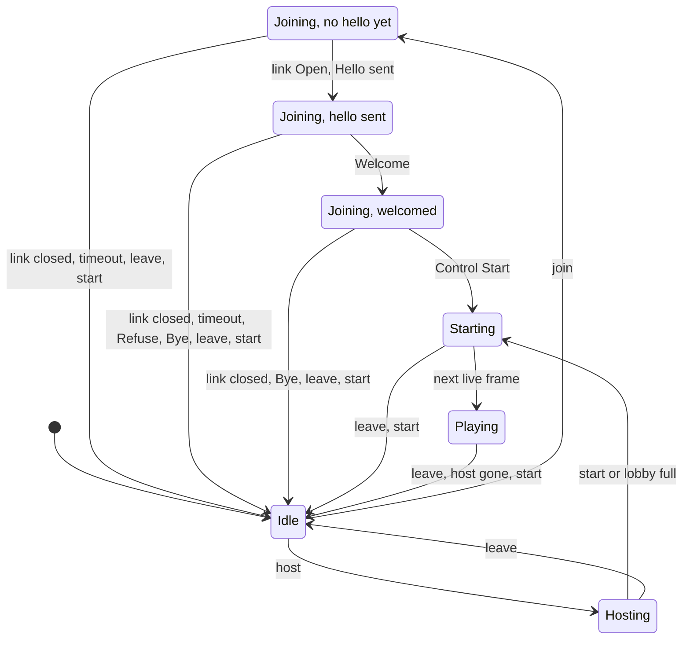

| State | What is true |
|---|---|
| `Idle` (`"idle"`, `STATE_IDLE`) | Holds nothing. `host` and `join` are allowed. |
| `Hosting(Lobby)` (`"lobby"`, `STATE_LOBBY`) | The listener is bound. `poll_host` runs each frame. |
| `Joining(Joiner)`, `said_hello == false`, `welcomed == false` (`"connecting"`, `STATE_CONNECTING`) | The link is dialed. It is not `Open`, or the Hello send failed. `poll_join` runs each frame and the `since` timeout applies. |
| `Joining(Joiner)`, `said_hello == true`, `welcomed == false` (`"connecting"`) | The Hello is queued. The `since` timeout applies. |
| `Joining(Joiner)`, `welcomed == true` (`"lobby"`) | This machine has a slot. No timeout applies. |
| `Starting(Starting)` (`"playing"`, `STATE_PLAYING`) | Holds links, scene, depth and, on a joiner, the host's world. Nothing polls. |
| `Playing` (`"playing"`) | `play::drive` takes every live frame. A frame with no tick only polls the links. |

| From | Trigger | To | What it does |
|---|---|---|---|
| `Idle` | `multiplayer.host`, `lobby::host`, bind ok | `Hosting` | Resets. Roster is slot 0. Sets role and local. Tells `connected`. Answers `url`, `cert_hash`, `transport`. |
| `Idle` | `multiplayer.join`, `lobby::join`, url scheme has a transport | `Joining`, `said_hello == false` | Resets. Sets role `Client`. Tells nothing. |
| `Joining`, `said_hello == false` | `poll_join`, link `Open`, `send_reliable` ok | `Joining`, `said_hello == true` | Sends `Control::Hello`. |
| `Joining`, `welcomed == false` | `heard` reads `Control::Welcome` | `Joining`, `welcomed == true` | Sets local and roster. Tells `connected`. |
| `Joining` | `heard` reads `Control::Roster` | same | `changed_roster` tells `joined` and `left`. |
| `Joining` | `heard` reads `Control::Start` | `Starting` | Keeps the link as slot 0 and the snapshot. Replaces the roster. Tells nothing. |
| `Joining` | `heard` reads `Control::Refuse` | `Idle` | Sends `Bye`, closes, resets. Tells `error` with the reason. |
| `Joining` | `heard` reads `Control::Bye` | `Idle` | Sends `Bye`, closes, resets. Tells `closed`, "the host closed the lobby". |
| `Joining`, `welcomed == false` | `poll_join`, link `Closed(why)` or `since` past the timeout | `Idle` | Closes, resets. Tells `error`. The timeout's reason is "the host did not answer in time". |
| `Joining`, `welcomed == true` | `poll_join`, link `Closed(why)` | `Idle` | Closes, resets. Tells `closed` with `why`. |
| `Hosting` | `multiplayer.start`, `lobby::start` | `Starting` | Each arriving link gets `Refuse`, "the match has started", and closes. Answers true. |
| `Hosting` | `poll_host`, `players > 0` and the roster is full | `Starting` | Same as `lobby::start`. |
| `Hosting`, `Joining`, `Starting` | `multiplayer.leave`, `lobby::leave` | `Idle` | Sends `Bye` and closes each link. Resets. Tells `closed`, "left". |
| `Starting` | `play::drive` calls `begin` on the next live frame | `Playing` | See the paragraph under this table. Tells `started` with the slot. |
| `Playing` | `multiplayer.leave`, session in `net` | `Idle` | Broadcasts `Bye`, `close_all`, resets. Tells `closed`, "left". |
| `Playing` | `multiplayer.leave` during a tick, the driver holds the session | `Playing`, then `Idle` | Sets `leave_asked`. `settle` broadcasts `Bye` and calls `end` with "left". |
| `Playing`, client | `settle` reads `Control::Bye` | `Idle` | `end` with "the host left". |
| `Playing`, client | `settle`, link silent or `Closed` | `Idle` | `end` with "lost the host". |
| `Joining`, `Starting`, `Playing` | `multiplayer.start`, `lobby::start` | `Idle` | Answers false. Drops held links with no `Bye`. Leaves role, local, roster and `net`. Tells nothing. |

`begin` frees every parked scene and switches to the match scene. A joiner restores the host's world. A host captures its world and sends `Control::Start` on every link. Both build the `NetSession`, and a host turns on relay and adds its bots as local players.

A silent link times out at the `timeout` option once it has been heard. A link never heard from times out at three times that, counted from `began`.

Starts in `Idle`. Never ends.

Refused or ignored: `host` and `join` return an error unless `Idle`. A failed bind or a url with no transport leaves `Idle`. `add_bot` answers nil unless `Hosting` with room. `leave` in `Idle` with no role does nothing and tells nothing. `Hello` and `Absent` are ignored while `Joining`. A host ignores `Control::Absent` while `Playing`. A joined link in a lobby has no silence timeout.

`App::advance` calls the driver only on `Step::Live`, so replay playback runs no `begin` and no match tick. `host` returns an error while a recording plays or a tick re-runs, because the listener refuses to bind.

Held by a pause, a `process` mode or a parked scene: `poll_system`, `deliver_system` and `drive` read none of them, so a paused game keeps ticking its match. `deliver_system` calls `announce`, which reaches a held script and no parked one.

### A peer arriving at a host

A host's `Lobby` holds each inbound link before play. This state is derived, from which list holds the link. Source: `crates/balaur_multiplayer/src/lobby.rs`, `Lobby.arriving`, `Lobby.links`, `Starting.links`.

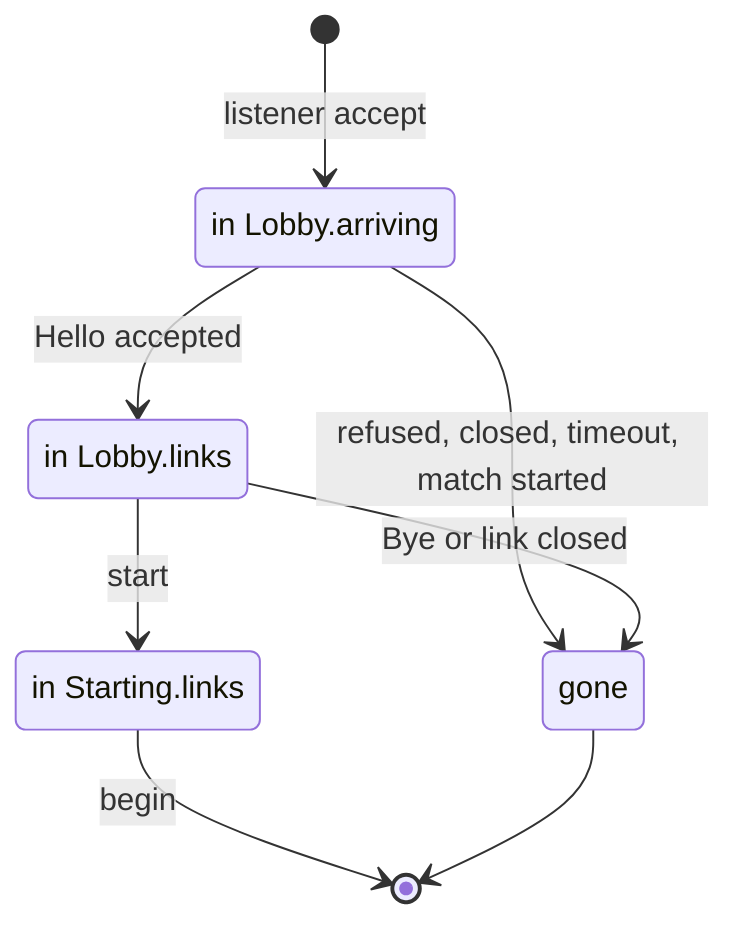

| State | What is true |
|---|---|
| in `Lobby.arriving` | Connected, with no Hello yet. Holds the time it arrived. |
| in `Lobby.links` | Has a slot and a roster row. |
| in `Starting.links` | Moves to the session in `begin`. |
| gone | Closed and dropped. |

| From | Trigger | To | What it does |
|---|---|---|---|
| none | `poll_host`, `listener.accept` | in `Lobby.arriving` | Stamps the time. |
| in `Lobby.arriving` | `admit`, protocol and token match, a slot is free | in `Lobby.links` | Roster row, `Control::Welcome`, roster broadcast. Tells `joined`. |
| in `Lobby.arriving` | `admit`, bad protocol, bad token or a full lobby | gone | `refuse` sends the reason and closes. |
| in `Lobby.arriving` | `poll_host`, link closed | gone | Dropped. |
| in `Lobby.arriving` | `poll_host`, past the timeout | gone | Closes. |
| in `Lobby.arriving` | `lobby::start` | gone | `refuse`, "the match has started". |
| in `Lobby.links` | `departures`, `Control::Bye` or link closed | gone | Closes. Removes the roster row, broadcasts the roster, tells `left`. |
| in `Lobby.links` | `lobby::start` | in `Starting.links` | Nothing else. |
| in `Starting.links` | `begin` | a `NetSession` link | `add_bound_peer` with the slot. |

Starts in `Lobby.arriving`. Ends in gone or in the session.

Refused or ignored: slots are the lowest free, capped at `players` or 64.

### Slot status

The roster reports this for each slot. It is derived in `players` from `MultiplayerState.absent`, the phase and the tick. Source: `crates/balaur_multiplayer/src/vocabulary.rs`, `Status`; `crates/balaur_multiplayer/src/lib.rs`, `MultiplayerState.absent`; `crates/balaur_multiplayer/src/api.rs`, `players`.

| State | What is true |
|---|---|
| `Present` (`"present"`, `STATUS_PRESENT`) | Not `Playing`, or no `absent` row, or `clock.tick` is before the row's tick. |
| `Absent` (`"absent"`, `STATUS_ABSENT`) | `Playing`, an `absent` row, and `clock.tick` at or past it. The slot's input is nil. |

| From | Trigger | To | What it does |
|---|---|---|---|
| `Present` | Host: `settle` reads `Control::Bye`, or a link is silent or closed, then `depart` | `Absent` from `from` | `close_link`, broadcast `Control::Absent`, `set_absent`, tells `left`. |
| `Present` | Client: `settle` reads `Control::Absent` | `Absent` from `from` | Submits the leaver's last inputs, `set_absent`, tells `left`. |
| `Absent` | `begin` clears `absent`, or `reset` | `Present` | Nothing else. |

Starts in `Present`. `Absent` lasts until the match ends.

Refused or ignored: `depart` does nothing for a slot already absent. A lobby leaver loses its roster row, so it never reads `Absent`.

### Match role

`MultiplayerState` holds which end this machine is. Source: `crates/balaur_multiplayer/src/lib.rs`, `MultiplayerState.role`; `crates/balaur_multiplayer/src/vocabulary.rs`, `Role`.

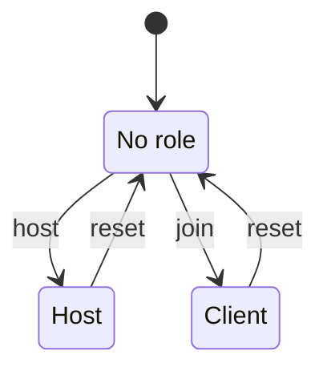

| State | What is true |
|---|---|
| `None` (nil) | No match. |
| `Some(Role::Host)` (`"host"`, `ROLE_HOST`) | Listening and playing slot 0. |
| `Some(Role::Client)` (`"client"`, `ROLE_CLIENT`) | Linked to a host. |

| From | Trigger | To | What it does |
|---|---|---|---|
| `None` | `lobby::host` | `Some(Role::Host)` | See Match phase. |
| `None` | `lobby::join` | `Some(Role::Client)` | See Match phase. |
| any | `MultiplayerState::reset` | `None` | Clears every field but `events`. |

Starts in `None`. Never ends.

### Local slot

`MultiplayerState` holds this machine's own slot. Source: `crates/balaur_multiplayer/src/lib.rs`, `MultiplayerState.local`.

| State | What is true |
|---|---|
| `None` (`local_player()` nil) | No slot yet. |
| `Some(slot)` | This machine plays `slot`. |

| From | Trigger | To | What it does |
|---|---|---|---|
| `None` | `lobby::host` | `Some(0)` | See Match phase. |
| `None` | `heard` reads `Control::Welcome` | `Some(slot)` | Tells `connected`. |
| `Some` | `reset` | `None` | Nothing else. |

Starts in `None`. Never ends.

Refused or ignored: `set_input` does nothing while this is `None` or during a re-simulated tick.

### Session in hand

`MultiplayerState` holds the running `NetSession` between ticks. Source: `crates/balaur_multiplayer/src/lib.rs`, `MultiplayerState.net`.

| State | What is true |
|---|---|
| `None` | Not playing, or the driver holds the session this frame. |
| `Some(NetSession)` | Playing, between frames. `session()` answers it. |

| From | Trigger | To | What it does |
|---|---|---|---|
| `None` | `begin` | `Some` | Nothing else. |
| `Some` | `drive` starts its frame | `None` | Takes the session out. |
| `None` | `drive` ends its frame, match goes on | `Some` | Puts the session back with `owed`. |
| `None` | `drive` ends its frame, match over | `None` | The session is dropped. |
| `Some` | `leave`, or `reset` | `None` | `leave` closes the links first. `reset` drops the session. |

Starts in `None`. Never ends.

Refused or ignored: `drive` answers false for `Playing` with no session, and `App::tick` takes the frame.

### Leave asked

`MultiplayerState` holds a leave a script asked for while the driver held the session. Source: `crates/balaur_multiplayer/src/lib.rs`, `MultiplayerState.leave_asked`.

| State | What is true |
|---|---|
| `false` | No leave is waiting. |
| `true` | The next `settle` leaves the match. |

| From | Trigger | To | What it does |
|---|---|---|---|
| `false` | `leave` while `Playing` with `net` empty | `true` | Nothing else. |
| `true` | `settle` | `false` | Broadcasts `Bye`, `end` with "left". |

Starts in `false`. Never ends.

### Desync told

`MultiplayerState` holds whether scripts have heard of the session's desync. Source: `crates/balaur_multiplayer/src/lib.rs`, `MultiplayerState.desync_told`.

| State | What is true |
|---|---|
| `false` | No `desync` event told in this match. |
| `true` | `desync` is queued or delivered. |

| From | Trigger | To | What it does |
|---|---|---|---|
| `false` | `settle`, `NetSession::desync` is `Some` | `true` | Tells `desync` with the tick. The match goes on. |
| `true` | `begin`, `reset` | `false` | Nothing else. |

Starts in `false`. Never ends.

### Play began

`MultiplayerState` holds when play began, to time a link never heard from. Source: `crates/balaur_multiplayer/src/lib.rs`, `MultiplayerState.began`.

| State | What is true |
|---|---|
| `None` | Not playing. |
| `Some(Instant)` | `settle` times silent links from here. |

| From | Trigger | To | What it does |
|---|---|---|---|
| `None` | `begin` | `Some(now)` | Nothing else. |
| `Some` | `reset` | `None` | Nothing else. |

Starts in `None`. Never ends.

### Match options

`MultiplayerState` holds what `host` or `join` opened with. Source: `crates/balaur_multiplayer/src/lib.rs`, `MultiplayerState.options`.

| State | What is true |
|---|---|
| `None` | No match. |
| `Some(Options)` | Timeout, slots, token and scene are read from here. |

| From | Trigger | To | What it does |
|---|---|---|---|
| `None` | `lobby::host`, `lobby::join` | `Some` | Nothing else. |
| `Some` | `reset` | `None` | Nothing else. |

Starts in `None`. Never ends.

## WebSocket

### Script socket status

`WebsocketState` holds this for each socket a script opened, and `websocket.state(id)` answers it. Source: `crates/balaur_websocket/src/lib.rs`, `WebsocketState.status` and `mod state`.

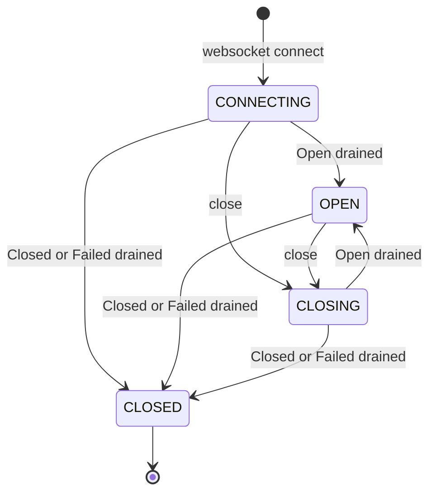

| State | What is true |
|---|---|
| `state::CONNECTING` (`"connecting"`, `STATE_CONNECTING`) | `connect` ran and no `Open` has drained. |
| `state::OPEN` (`"open"`, `STATE_OPEN`) | `Open` drained. |
| `state::CLOSING` (`"closing"`, `STATE_CLOSING`) | `close` ran and no final event has drained. |
| `state::CLOSED` (`"closed"`, `STATE_CLOSED`) | No row: a final event drained, or the id names nothing. |

| From | Trigger | To | What it does |
|---|---|---|---|
| none | `WebsocketState::connect` | `CONNECTING` | Stores the handler, logs `websocket.connect`, spawns the worker through `io.start`. With no queue it reports `Failed`. |
| `CONNECTING`, `CLOSING` | `pump_websocket_system` drains `Open` | `OPEN` | Handler hears `open`. `host.wake(id)`. |
| `CONNECTING`, `OPEN` | `close` | `CLOSING` | Sends `SocketCommand::Close`. Answers whether a worker took it. |
| any | pump drains `Closed` | `CLOSED` | Removes status, sockets and handler. Handler hears `closed` with `code` and `reason`. No wake. |
| any | pump drains `Failed` | `CLOSED` | Same removal. Handler hears `error` with `reason` and `status`. `host.wake(id)`. |
| `OPEN`, `CLOSING` | pump drains `Message`, `Binary` | same | Handler hears `message` or `binary`. |

Starts in `CONNECTING`. Ends in `CLOSED`.

Refused or ignored: `send` and `close` answer false once `sockets` has no row, which is every socket during a replay. `close` still marks that row `CLOSING`. `send` is not refused while connecting. The browser backend calls `ws.send_*` and ignores the result. A payload that is not a string or bytes returns an error. An event for a removed id finds no handler and still enters `WebsocketSnapshot`.

Held by a pause, a `process` mode or a parked scene: `pump_websocket_system` reads none of them. A handler runs through `call_on`, so a paused node hears it and a parked node, having no instance there, misses it. A task awaiting the id stays suspended until its node can tick.

### Native socket worker

The thread behind one websocket holds this. The states are implicit in `spawn_socket` and `run`, apart from the `closing` flag and `closed_at`. Source: `crates/balaur_websocket/src/frames.rs`, `spawn_socket`, `run`, `closing`, `closed_at`.

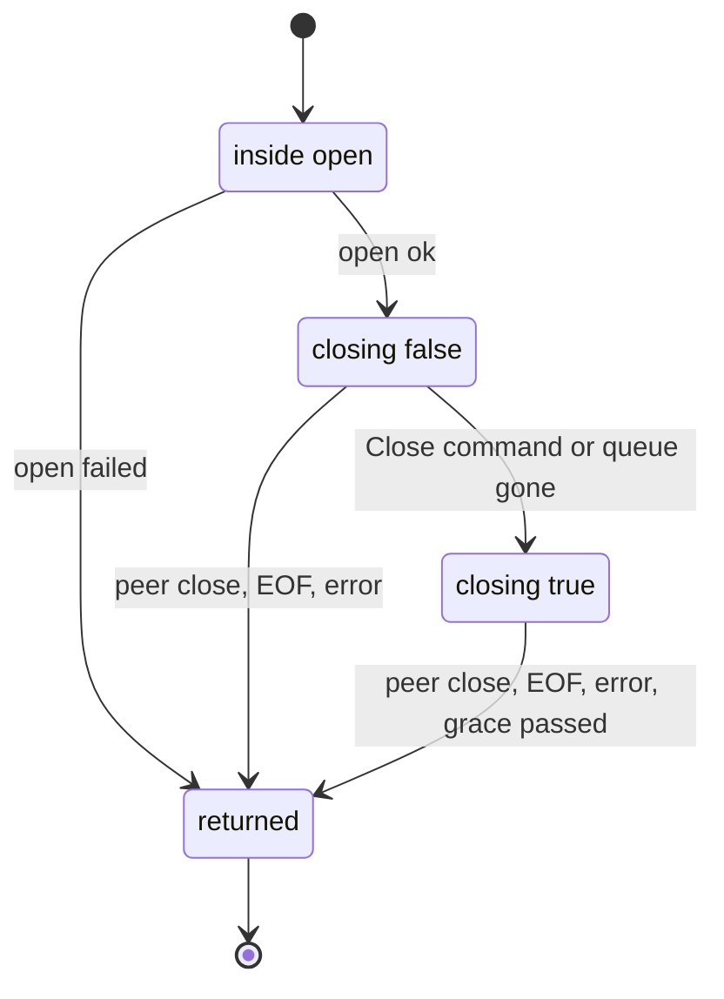

| State | What is true |
|---|---|
| inside `open` | DNS, TCP, TLS and the upgrade block the thread. Commands wait in the queue. |
| `closing == false` | Serving frames. The poll has no timeout. |
| `closing == true`, `closed_at` set | The close frame is sent. The poll waits at most what is left of `CLOSE_GRACE`, 5 seconds. |
| returned | The final event is reported and the thread ended. |

| From | Trigger | To | What it does |
|---|---|---|---|
| inside `open` | `open` succeeds | `closing == false` | Reports `SocketEvent::Open`, then `run`. |
| inside `open` | `open` fails | returned | Reports `Failed`, with `status` when the upgrade was refused. |
| `closing == false` | `drain_commands` reads `Close`, or the queue disconnects | `closing == true` | `request_close` sends a close frame, 1000 "bye". |
| `closing == false` | `handle` reads a peer close frame | returned | Answers it. Reports `Closed` with its code and reason. |
| `closing == true` | `handle` reads a peer close frame | returned | Reports `Closed`. Sends no answer. |
| `closing == true` | `CLOSE_GRACE` passes | returned | Reports `Closed`, 1006, "the peer never answered the close". |
| either | `read_all` reads end of stream | returned | Reports `Closed`, 1006, empty reason. |
| either | `register`, `drain_commands`, `flush`, poll or a read fails | returned | Reports `Failed`. |

Starts inside `open`. An accepted peer starts at `run`. Ends in returned.

Refused or ignored: a second `Close` does nothing. `drain_commands` still sends frames queued after a `Close`.

### Message assembly

A socket worker holds whether a fragmented message is being put together. Source: `crates/balaur_websocket/src/frames.rs`, `Inbox.open`.

| State | What is true |
|---|---|
| `false` | Between messages. |
| `true` | A text or binary frame started and no final frame has come. |

| From | Trigger | To | What it does |
|---|---|---|---|
| `false` | `Inbox::push` reads a text or binary frame | `true` | Clears the buffer. A final frame goes straight back to `false`. |
| `true` | `Inbox::push` reads a final frame | `false` | Returns `Incoming`, which `deliver` reports. |

Starts in `false`. Never ends.

Refused or ignored: a continuation with no message open, a new message inside one, reserved bits or opcodes, and a message past 64 MiB are errors, and the connection reports `Failed`.

### Websocket listener

A `WebsocketListener` holds a bound port. The state is implicit: whether the value exists, and whether its accept thread still runs. Source: `crates/balaur_websocket/src/listener.rs`, `WebsocketListener`, `_stop`, `accept_until_dropped`.

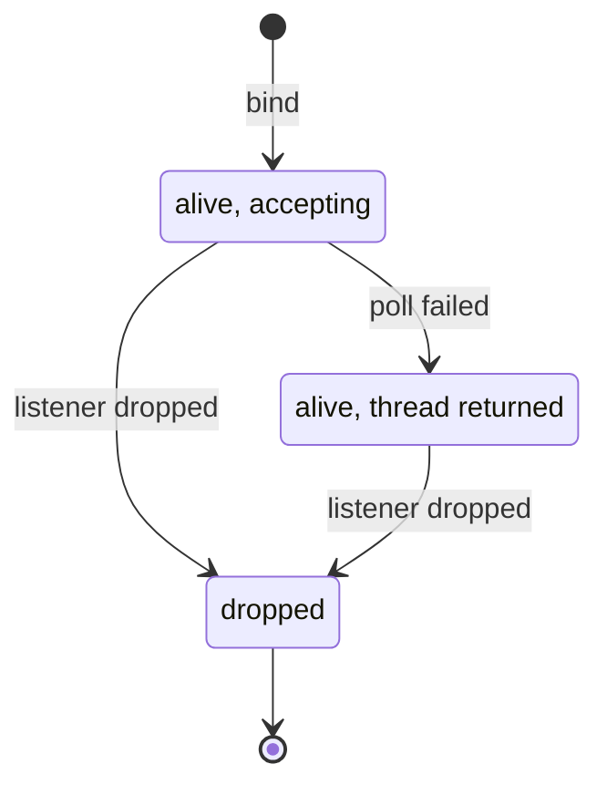

| State | What is true |
|---|---|
| alive, accepting | The accept thread sleeps in its poll and hands each knock a thread. |
| alive, thread returned | The poll failed, so no new knock gets a thread. |
| dropped | `_stop` is gone, so the accept thread returns at its next wake. |

| From | Trigger | To | What it does |
|---|---|---|---|
| none | `WebsocketListener::bind` | alive, accepting | Binds and spawns the accept thread. |
| alive, accepting | The listener is dropped | dropped | The command queue disconnects. |
| alive, accepting | The poll fails with anything but `Interrupted` | alive, thread returned | Logs a warning. |
| alive, thread returned | The listener is dropped | dropped | Nothing else. |

Starts alive, accepting. Ends dropped.

Refused or ignored: `bind` returns an error while a recording plays, a tick re-runs, or the port will not bind.

### Accepted websocket peer

One knock at a listener holds this on its own thread. The states are implicit in `serve`. Source: `crates/balaur_websocket/src/listener.rs`, `serve`, `upgrade`.

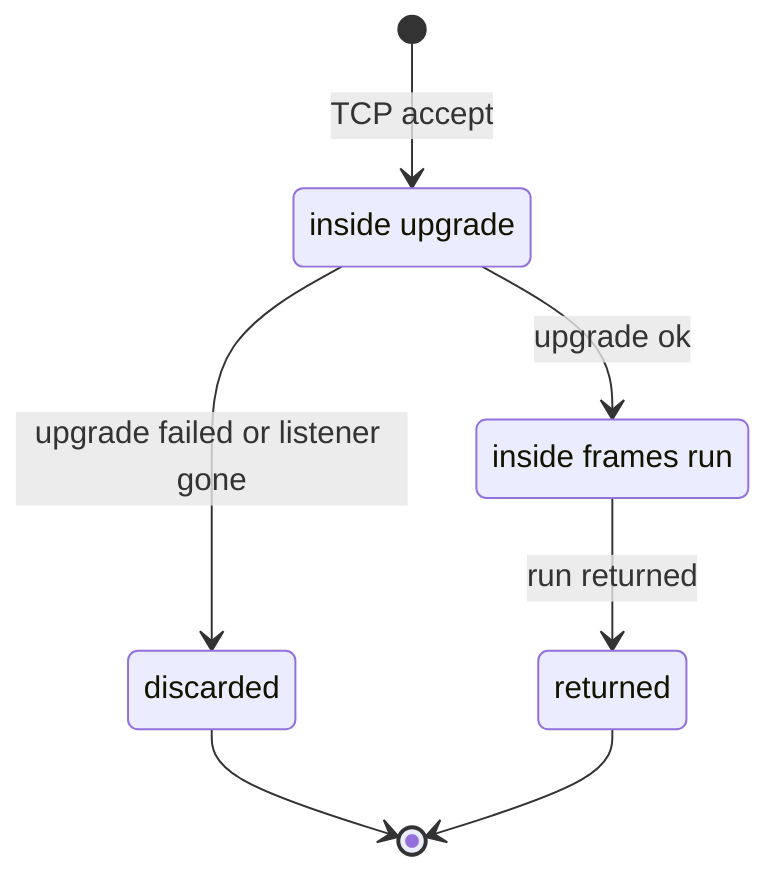

| State | What is true |
|---|---|
| inside `upgrade` | The server half of the handshake blocks this thread. |
| inside `frames::run` | `Accepted` is queued for `accept` and `Open` is reported. The worker runs as above. |
| discarded | No `Connection` exists and no event was reported. |
| returned | The final event is reported. |

| From | Trigger | To | What it does |
|---|---|---|---|
| inside `upgrade` | `upgrade` succeeds | inside `frames::run` | Sends `Accepted`, reports `SocketEvent::Open`. |
| inside `upgrade` | `upgrade` fails | discarded | Logs a warning. |
| inside `upgrade` | `arrivals.send` fails | discarded | Nothing else. |
| inside `frames::run` | `run` returns | returned | Reports the final event. |

Starts inside `upgrade`. Ends in returned or discarded.

### Browser socket entry

The browser backend's `LIVE` list holds this for each `WebSocket`. Source: `crates/balaur_websocket/src/browser.rs`, `LiveSocket.finished`.

| State | What is true |
|---|---|
| `false` | Kept in `LIVE`. `pump` flushes its commands each tick. |
| `true` | The next `pump` drops the entry and its callbacks. |

| From | Trigger | To | What it does |
|---|---|---|---|
| `false` | `onclose` | `true` | Reports `Closed`, code 1006 with no `CloseEvent`. |
| `false` | `onerror` | `true` | Reports `Failed`. |
| `true` | `pump` | entry gone | Nothing else. |

Starts in `false`. Ends with the entry gone.

Refused or ignored: an unreadable frame reports `Failed` and leaves this `false`. A `Close` command or a disconnected queue calls `ws.close` with 1000 "bye" and keeps the entry.

## WebTransport

### Native link worker

The thread behind one `WebTransportLink` holds this. The states are implicit in `dial`, `serve` and `pump`. Source: `crates/balaur_webtransport/src/link.rs`, `dial`, `serve`, `pump`.

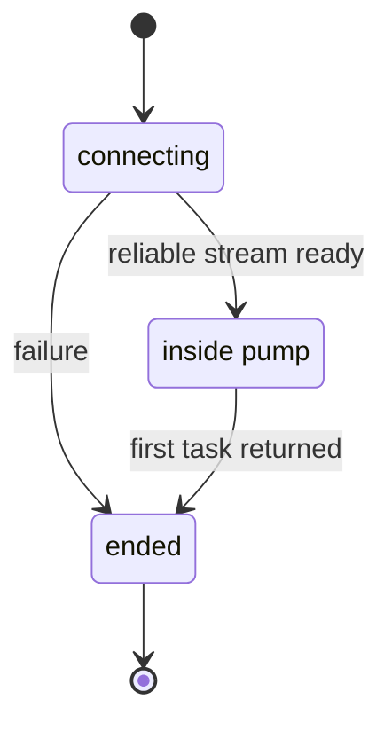

| State | What is true |
|---|---|
| connecting | A dialer awaits `connect` then `open_bi`. An acceptor awaits `accept_bi`. |
| inside `pump` | Three tasks run: `read_datagrams`, `read_reliable`, `write_outbound`. |
| ended | `LinkEvent::Closed` is reported and the thread or task is done. |

| From | Trigger | To | What it does |
|---|---|---|---|
| connecting | `open_bi` or `accept_bi` succeeds | inside `pump` | Reports `LinkEvent::Open`. |
| connecting | No runtime, `connect` fails, or no stream | ended | Reports `Closed` with "no runtime: …", the failure, or "no reliable stream: …". |
| inside `pump` | `read_datagrams` returns | ended | Reason is "the session ended: …" or "the engine dropped the link". |
| inside `pump` | `read_reliable` returns | ended | Reason is "the reliable stream ended: …", "a peer announced a N byte message", "a reliable message was cut short: …" or "the engine dropped the link". |
| inside `pump` | `write_outbound` reads `LinkCommand::Close` | ended | `session.close`. Reason is "closed by the engine". |
| inside `pump` | `write_outbound` returns otherwise | ended | Reason is "the reliable stream closed: …" or "the engine dropped the link". |

Starts in connecting. Ends in ended. The first task to return says why, and `pump` aborts the others.

Refused or ignored: a datagram send that fails only logs a warning, as does a reliable message too long to frame.

### WebTransport server

A `WebTransportServer` holds a bound UDP port, and its worker thread holds the state. The states are implicit in `listen`, with `Serving.live` counting peers. Source: `crates/balaur_webtransport/src/link.rs`, `listen`, `accept_until_dropped`, `refuse_while_serving`, `Serving.live`; `crates/balaur_webtransport/src/lib.rs`, `WebTransportServer._stop`.

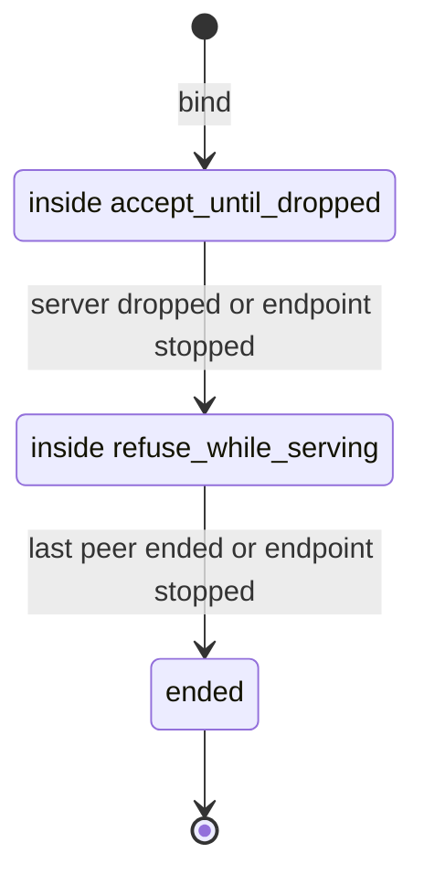

| State | What is true |
|---|---|
| inside `accept_until_dropped` | Each session that opens goes to `arrivals`. |
| inside `refuse_while_serving` | The server is gone and `Serving.live > 0`. A newcomer gets a 503. |
| ended | `Serving.live == 0`, or the endpoint stopped. |

| From | Trigger | To | What it does |
|---|---|---|---|
| none | `WebTransportServer::bind_with` | `accept_until_dropped` | Returns the bound address. |
| `accept_until_dropped` | `request.ok` succeeds | same | Sends the peer to `arrivals`, `Serving.live` plus one, spawns `serve`. |
| `accept_until_dropped` | `request.ok` fails | same | Logs a warning. |
| `accept_until_dropped` | `_stop` dropped, `accept` answers `None`, or `peers.send` fails | `refuse_while_serving` | Nothing else. |
| `refuse_while_serving` | A newcomer arrives | same | `request.reject(503)`. |
| `refuse_while_serving` | `Serving.live` reaches 0, or `accept` answers `None` | ended | Nothing else. |
| any | A peer's `serve` ends | same | `Serving.live` minus one, `ended.notify_one`. |

Starts in `accept_until_dropped`. Ends in ended.

Refused or ignored: `bind_with` returns an error while a recording plays, a tick re-runs, or the address or the bind fails.

### Browser WebTransport session

Each browser `WebTransport` holds this across a JS handle and a `LiveLink`. Source: `crates/balaur_webtransport/src/browser.rs`, `bt_open`, `handle.reliable`, `handle.datagrams`, `handle.closed`, `LiveLink.finished`.

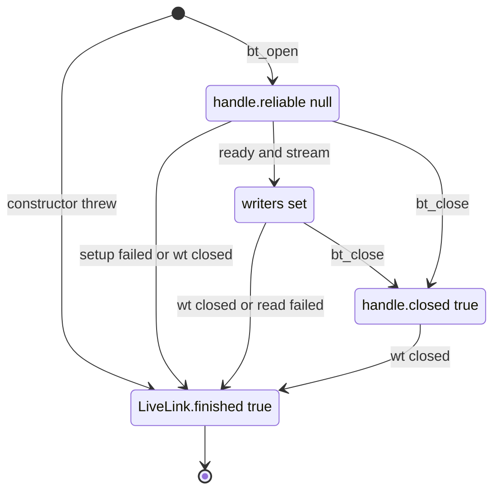

| State | What is true |
|---|---|
| `handle.reliable == null` | `ready` or the stream is pending. `bt_send` drops what it is given. |
| writers set | `on_open` fired. `bt_send` writes. |
| `handle.closed == true`, `finished == false` | `bt_close` ran. `bt_send` and `bt_close` do nothing. |
| `LiveLink.finished == true` | `on_closed` ran. The next `pump` drops the entry. |

| From | Trigger | To | What it does |
|---|---|---|---|
| none | `new WebTransport` throws | `finished == true` | `on_closed(e)`. `bt_open` returns null and `dial` keeps no `LiveLink`. |
| none | `bt_open` | `handle.reliable == null` | Registers the `closed` and `ready` handlers. |
| `handle.reliable == null` | `wt.ready`, then `createBidirectionalStream` | writers set | `on_open` reports `LinkEvent::Open`. Starts two read loops. |
| any | `die`: `wt.closed` settles, or setup or a read fails | `finished == true` | Sets `handle.closed`. `on_closed` reports `LinkEvent::Closed`. |
| any | `pump` reads `LinkCommand::Close`, or its queue disconnected | `handle.closed == true` | `bt_close` calls `wt.close`. The entry stays. |
| `finished == true` | `pump` | entry gone | Nothing else. |

Starts in `handle.reliable == null`. Ends with the entry gone. `pump` runs from `WebTransportLink::receive`.

## HTTP

### One request

`HttpState` holds each `http.request` from its id to its delivered end. This state is derived, from which tables hold the id. Source: `crates/balaur_http/src/lib.rs`, `HttpState.in_flight`, `cancelled`, `cancelled_now`, `handlers`, `progress`.

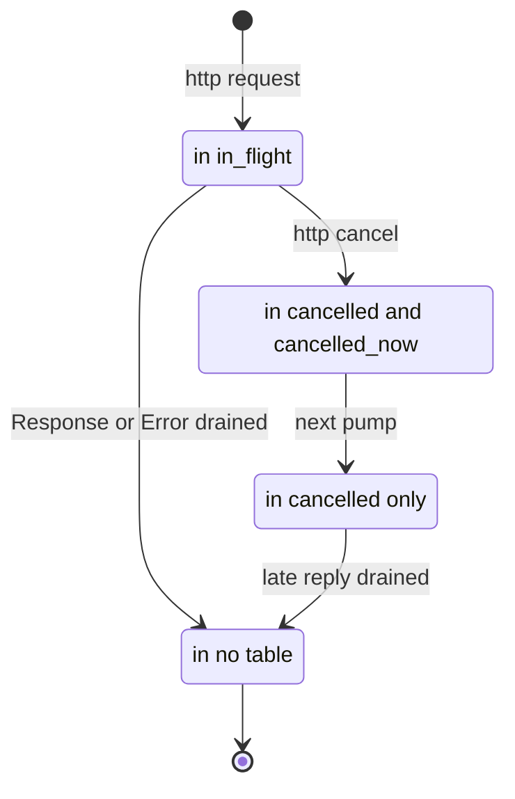

| State | What is true |
|---|---|
| in `in_flight` | The cancel flag is held. The job is queued or running. |
| in `cancelled` and `cancelled_now` | Canceled, with the handler not yet told. Out of `in_flight` and `progress`. |
| in `cancelled` only | The handler was told. A late reply is expected. |
| in no table | Finished. |

| From | Trigger | To | What it does |
|---|---|---|---|
| none | `request_with_progress` | in `in_flight` | Stores handlers, logs `http.request`, submits to the pool through `io.start`. A replay submits nothing. |
| in `in_flight` | `pump_http_system` drains `Progress` or `Sent` | same | The progress handler hears `progress` or `upload`. No wake. |
| in `in_flight` | Pump drains `Response` or `Error` | in no table | Removes the rows. The handler hears `response` or `error`. `host.wake(id)`. |
| in `in_flight` | `HttpState::cancel` | in `cancelled` and `cancelled_now` | Sets the flag, removes the progress handler, answers true. |
| in `cancelled` and `cancelled_now` | Next pump | in `cancelled` only | Removes the handler. Handler and wake hear `cancelled`. |
| in `cancelled` | Pump drains `Progress` or `Sent` | same | Dropped. |
| in `cancelled` | Pump drains `Response` or `Error` | in no table | Dropped, and nobody is told. |

Starts in `in_flight`. Ends in no table.

Refused or ignored: `cancel` answers false once the id left `in_flight`. A timeout out of range or a bad option type returns an error at the call. An HTTP 4xx or 5xx is a `Response`. The browser backend ignores the flag and only drops the reply.

Held by a pause, a `process` mode or a parked scene: `pump_http_system` reads none of them. A handler runs through `call_on`, so a paused node hears it and a parked node, having no instance there, misses it. A task awaiting the id stays suspended until its node can tick.

### Request job on a worker

A worker in the pool holds one request's execution, on native builds. The states are implicit in `run`, `perform` and `stream_to_file`, with `Job.cancel` as the flag and `<path>.part` as the file. Source: `crates/balaur_http/src/request.rs`, `Job`, `run`, `perform`, `stream_to_file`.

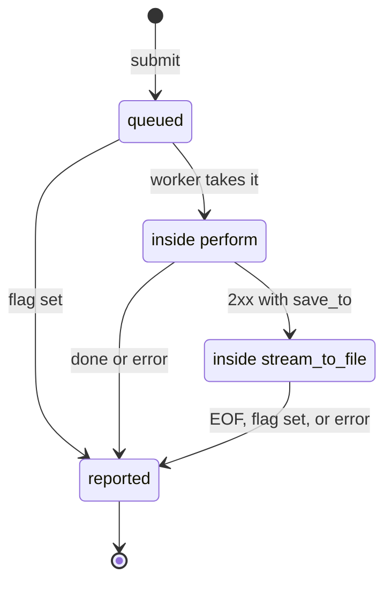

| State | What is true |
|---|---|
| queued | In the `balaur_core::task::Pool` waiting list, first in first out. |
| inside `perform` | The request runs. The flag is not read here. |
| inside `stream_to_file` | The body lands in `<path>.part`. The flag is read before each chunk. |
| reported | The final event is sent. |

| From | Trigger | To | What it does |
|---|---|---|---|
| queued | `run`, flag set | reported | `Error` with the message `"cancelled"`. The request never goes out. |
| queued | `run`, flag clear | inside `perform` | Nothing else. |
| inside `perform` | 2xx and `save_to` | inside `stream_to_file` | Creates `<path>.part`. |
| inside `stream_to_file` | Flag set | reported | Removes `.part`. `Error` with the message `"cancelled"`. |
| inside `stream_to_file` | End of body | reported | Renames over the target, a final `Progress`, `Response` with `saved`. |
| inside `stream_to_file` | A read or write fails | reported | `Error`. `.part` stays on disk. |
| inside `perform` | Done, or failed | reported | `Response` or `Error`. |

Starts queued. Ends reported.

Refused or ignored: dropping the pool clears the queue, and a queued job then reports nothing. An unsupported method is an `Error`.

### HTTP pool

`HttpState` holds the workers, made with the first request. Source: `crates/balaur_http/src/lib.rs`, `HttpState.pool`.

| State | What is true |
|---|---|
| `None` | No request has been submitted. |
| `Some(Pool)` | Workers exist, up to `max_parallel`. |

| From | Trigger | To | What it does |
|---|---|---|---|
| `None` | `request_with_progress`, inside `io.start` | `Some` | `Pool::new`. |

Starts in `None`. Ends in `Some` for the life of the state.

Refused or ignored: a replay never makes it, because `io.start` does not run.

## Gamend

### Realtime socket

A `LiveSocket` holds where it is between one connection and the next, and how far the current connection has gone. Source: `crates/balaur_gamend/src/realtime.rs`, `Phase`, `Link.opened`, `Link.join_ref`, `Link.joined`.

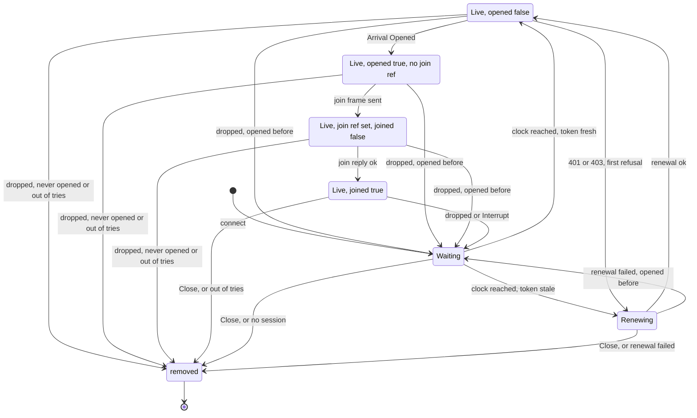

| State | What is true |
|---|---|
| `Waiting(f64)` | Sitting out a back-off until that reading of the socket's clock. The loop is woken for it. |
| `Renewing(Receiver)` | The client's worker is trading the refresh token. |
| `Live(Link)`, `opened == false` | A connection is dialed and not open. |
| `Live(Link)`, `opened == true`, `join_ref == None` | Held only inside one `live` call, before the join frame goes out. |
| `Live(Link)`, `join_ref == Some`, `joined == false` | The own-user join waits for its reply. |
| `Live(Link)`, `joined == true` | Commands, rejoins and heartbeats run. |
| removed | `step` answered false, and the socket left `GamendState.live`. |

No script reads this directly. Scripts hear the events below and read `gamend.connection()`, the activity row further down.

| From | Trigger | To | What it does |
|---|---|---|---|
| none | `GamendState::connect`, `LiveSocket::new` | `Waiting(0.0)` | Pushed to `live`, with a `sockets` row. With no session, it reports `SocketError` instead. |
| `Waiting` | `step`, clock not reached | same | `wake_at`. |
| `Waiting` | `step`, clock reached, `Session::stale` | `Renewing` | `renew` calls `spawn_renew`. |
| `Waiting` | `step`, clock reached, not stale | `Live`, `opened == false` | `dial`: `Connection::connect`, `Protocol::new`. |
| `Waiting` | `dial`, `socket_url` finds no session | via `dropped` | Reason is "connect needs a logged-in session". |
| `Renewing` | `step`, no answer yet | same | Nothing else. |
| `Renewing` | `step`, answer `Ok` | `Live`, `opened == false` | `dial`. |
| `Renewing` | `step`, answer `Err`, or the channel is gone | via `dropped` | Nothing else. |
| `Waiting`, `Renewing` | `wait_commands` reads `Close`, or the channel is gone | removed | `closed_by_game`: `SocketClosed`, "closed by the game". |
| `Live`, `opened == false` | `arrivals` reads `Arrival::Opened` | `opened == true` | Nothing else. |
| `opened == true`, `join_ref == None` | `live` | `join_ref == Some` | Sends the own-user `phx_join`. A send failure goes via `dropped`. |
| `Live`, `opened == false` | `Arrival::Failed` with status 401 or 403, `renewed_after_refusal == false` | `Renewing` | Sets the flag. `renew`. |
| `Live`, `opened == false` | Same, `renewed_after_refusal == true` | via `dropped` | Nothing else. |
| `join_ref == Some` | `deliver`, join reply `ok`, `opened_once == false` | `joined == true` | Sets `opened_once`, clears `renewed_after_refusal`. Reports `SocketOpen`. |
| `join_ref == Some` | `deliver`, join reply `ok`, `opened_once == true` | `joined == true` | Clears `renewed_after_refusal`. `rejoin` joins every topic again. |
| `join_ref == Some` | `deliver`, join reply not `ok` | via `dropped` | Reason is "joining the user channel was refused: …". |
| `Live` | `arrivals` reads `Closed` or `Failed`, or `Protocol::decode` fails | via `dropped` | An empty reason reads "closed". |
| `joined == true` | `run` reads `Interrupt` | via `dropped` | Reason is "interrupted by the game". |
| `joined == true` | `run` fails: `push` or `leave` on a topic with no join ref, or a frame send fails | via `dropped` | The command's request gets no reply. |
| `joined == true` | `Protocol::heartbeat` errors, or a rejoin or heartbeat send fails | via `dropped` | Nothing else. |
| `joined == true` | `run` reads `Close`, or the channel is gone | removed | `closed_by_game`. |
| via `dropped` | `opened_once` and `tries + 1 <= 8` | `Waiting(now + backoff)` | `fail_pending`, clears rejoins, closes. Reports `SocketReconnecting`. |
| via `dropped` | `opened_once` and tries exceeded | removed | `SocketError`, "gave up after 8 tries: …". |
| via `dropped` | `opened_once == false` | removed | `SocketError` with the reason. |

Starts in `Waiting(0.0)`. Ends removed.

Refused or ignored: in `Waiting` and `Renewing`, `Join`, `Push` and `CallHook` get `Failed`, "the socket is reconnecting". `Leave` drops the topic and answers `Replied` with `ok`. `Interrupt` is ignored. A `Live` socket not yet `joined` reads no commands, `Close` included. `pump` steps nothing during a replay or a re-simulated tick.

Held by a pause, a `process` mode or a parked scene: `pump_gamend_system` reads none of them. A handler runs through `call_on`, so a paused node hears it and a parked node, having no instance there, misses it. A task awaiting the id stays suspended until its node can tick.

### First open

A `LiveSocket` holds whether it has ever opened. Source: `crates/balaur_gamend/src/realtime.rs`, `LiveSocket.opened_once`.

| State | What is true |
|---|---|
| `false` | A drop ends the socket with `SocketError`. |
| `true` | A drop backs off and reconnects. Later opens report `SocketReopened`. |

| From | Trigger | To | What it does |
|---|---|---|---|
| `false` | `deliver`, first own-user join reply `ok` | `true` | Reports `SocketOpen`. |

Starts in `false`. Ends in `true`.

### Refusal renewed

A `LiveSocket` holds whether this dial has already renewed a refused token. Source: `crates/balaur_gamend/src/realtime.rs`, `LiveSocket.renewed_after_refusal`.

| State | What is true |
|---|---|
| `false` | The next refusal renews the token. |
| `true` | The next refusal drops the connection. |

| From | Trigger | To | What it does |
|---|---|---|---|
| `false` | `step`, `Next::Refused` | `true` | `renew`. |
| `true` | `deliver`, own-user join reply `ok` | `false` | Nothing else. |

Starts in `false`. Never ends.

### Reconnect tries

A `LiveSocket` counts drops since its last full reopen. Source: `crates/balaur_gamend/src/realtime.rs`, `LiveSocket.tries`.

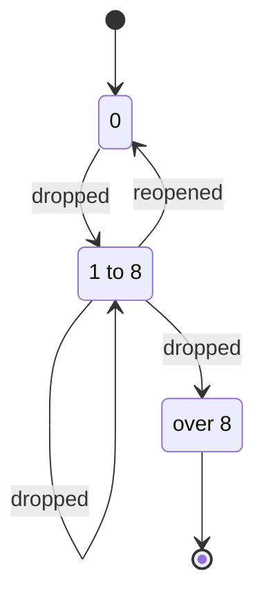

| State | What is true |
|---|---|
| `0` | No drop since the last reopen. |
| `1` to `RECONNECT_TRIES` (8) | The back-off is 1, 2, 4, 8, 16, then 30 seconds. |
| over `RECONNECT_TRIES` | The socket gives up within that `dropped` call. |

| From | Trigger | To | What it does |
|---|---|---|---|
| `n` | `dropped`, `opened_once` | `n + 1` | Waits or gives up. |
| `n` | `reopened` | `0` | Reports `SocketReopened` with `lost`. |

Starts in `0`. Ends over `RECONNECT_TRIES`, when the socket is removed.

### A topic on a socket

A `LiveSocket` holds each channel the game asked for. This state is derived, from which list holds the topic. Source: `crates/balaur_gamend/src/realtime.rs`, `LiveSocket.topics`, `joining`, `rejoining`, `lost`, `Link.rejoining`; `crates/balaur_gamend/src/channels.rs`, `Rejoins`.

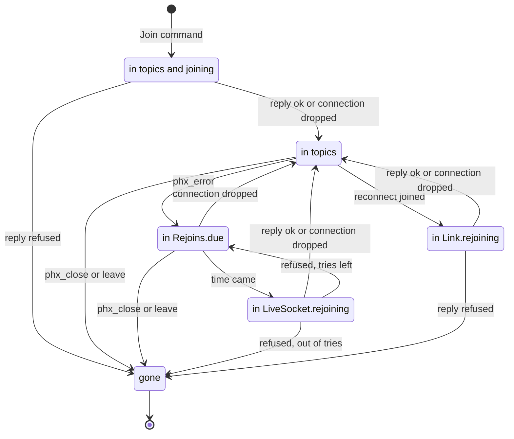

| State | What is true |
|---|---|
| in `topics` and `joining` | The join is sent and its reply awaited. |
| in `topics` | Joined. A reconnect asks for it again. |
| in `Link.rejoining` | A reconnect's join awaits its reply. Still in `topics`. |
| in `Rejoins.due` | The channel crashed. A `Due` holds the time and the attempt. |
| in `LiveSocket.rejoining` | A crashed channel's join awaits its reply. |
| gone | In none of them. `lost` names it if a reconnect refused it, until `reopened` takes the list. |

| From | Trigger | To | What it does |
|---|---|---|---|
| none | `run` reads `SocketCommand::Join` | in `topics` and `joining` | Sends the frame and adds a `pending` row. |
| in `joining` | `deliver`, reply `ok` | in `topics` | `Replied`. |
| in `joining` | `deliver`, reply not `ok` | gone | `Replied`. |
| in `joining` | `fail_pending` on a drop | in `topics` | `joining` is cleared. |
| in `topics` | `Rejoins::heard`, `phx_error` | in `Rejoins.due`, attempt 1 | Due in 1 second. Reports `SocketMessage`. `Protocol.joins` forgets it. |
| in `topics`, `Rejoins.due` | `Rejoins::heard`, `phx_close` | gone | Reports `SocketMessage`. |
| in `topics` | `run` reads `Leave` | gone | Sends `phx_leave`. |
| in `Rejoins.due` | `run` reads `Leave` | gone | `Protocol::leave` errors because the topic has no join ref, so the connection drops. |
| in `topics` | `wait_commands` reads `Leave` | gone | `Replied` with `ok`. |
| in `Rejoins.due` | `live`, `take_due` | in `LiveSocket.rejoining` | Sends the join. No event. |
| in `LiveSocket.rejoining` | `Rejoins::answered`, `ok` | in `topics` | Nothing else. |
| in `LiveSocket.rejoining` | `Rejoins::answered`, refused, attempt below 8 | in `Rejoins.due`, next attempt | Waits `backoff(attempt)`. |
| in `LiveSocket.rejoining` | `Rejoins::answered`, refused, attempt 8 | gone | Nothing else. |
| in `Rejoins.due`, `LiveSocket.rejoining` | `dropped` | in `topics` | Both are cleared, and the reconnect asks again. |
| in `topics` | `rejoin` after a reconnect | in `Link.rejoining` | Sends the join. A send failure leaves it out of the list. |
| in `Link.rejoining` | `deliver`, reply `ok` | in `topics` | `reopened` once none are left. |
| in `Link.rejoining` | `deliver`, reply not `ok` | gone | Pushed to `lost`. `reopened` once none are left. |

Starts in `joining`. Ends in gone.

Refused or ignored: a `phx_error` for a topic the game never joined does nothing. The own-user topic can be due too, with an empty payload, though it is never in `topics`.

### Heartbeat

A `Protocol` holds the heartbeat in flight for one connection. Source: `crates/balaur_gamend/src/client/phoenix.rs`, `Protocol.pending_heartbeat`.

| State | What is true |
|---|---|
| `None` | The next beat may go. |
| `Some(String)` | A beat is unanswered, under this ref. |

| From | Trigger | To | What it does |
|---|---|---|---|
| `None` | `heartbeat`, 30 seconds since the last | `Some(ref)` | Returns the frame. |
| `Some` | `decode`, topic `phoenix` or a matching ref | `None` | Swallows the frame. |
| `Some` | `heartbeat`, 30 seconds since the last | same | Returns an error, and the connection drops. |

Starts in `None`, with each new `Protocol`. Ends with its connection.

### Protocol join ref

A `Protocol` holds each topic's join ref for one connection. Source: `crates/balaur_gamend/src/client/phoenix.rs`, `Protocol.joins`.

| State | What is true |
|---|---|
| no row | `push` and `leave` return an error. |
| row with the ref | Frames on the topic carry that join ref. |

| From | Trigger | To | What it does |
|---|---|---|---|
| any | `join` | row | Replaces any earlier row and returns the frame. |
| row | `leave` | no row | Returns the frame. |
| row | `decode` reads `phx_error` or `phx_close` | no row | Returns `SocketEvent::Message`. |

Starts in no row. Ends with its connection.

### Server pointer

`GamendState` holds the client for the configured server. Source: `crates/balaur_gamend/src/lib.rs`, `GamendState.client`.

| State | What is true |
|---|---|
| `None` | `login`, `rest` and `connect` return "gamend.configure(url) must be called first". |
| `Some(SharedClient)` | Calls go to this server. |

| From | Trigger | To | What it does |
|---|---|---|---|
| any | `GamendState::configure` | `Some(new)` | The new client has no session. Live sockets keep their old clone. |

Starts in `None`. Never ends.

### Signed-in session

A `Client` holds who is signed in, and `gamend.session()` answers it. Staleness is derived from the token's `exp` claim. Source: `crates/balaur_gamend/src/client/rest.rs`, `Client.session`; `crates/balaur_gamend/src/client/auth.rs`, `Session::stale`.

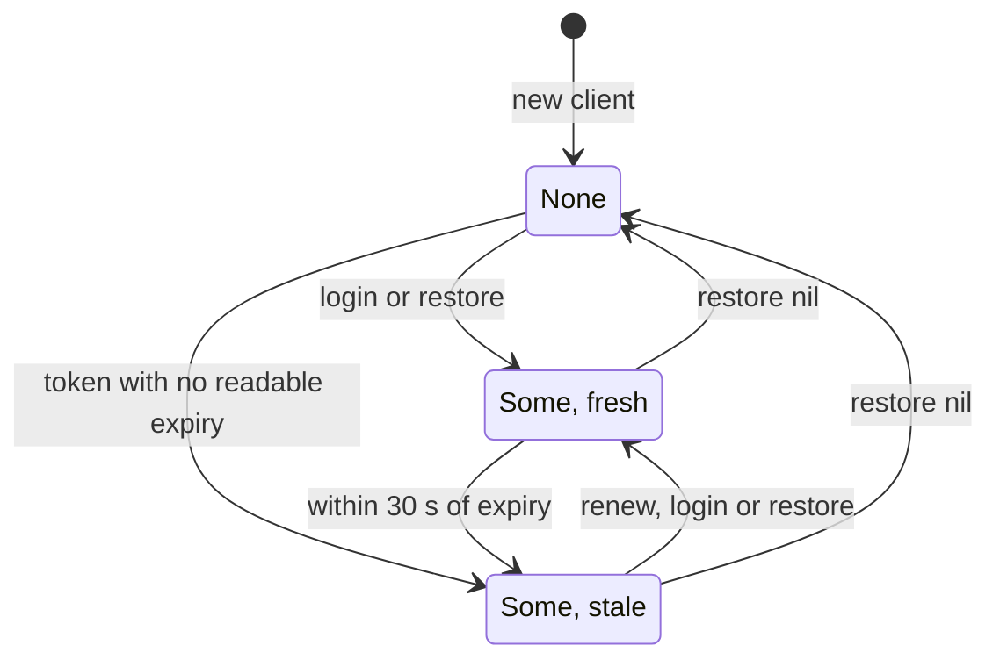

| State | What is true |
|---|---|
| `None` (`gamend.session()` nil) | Calls go without a bearer. `connect` reports `SocketError`, "connect needs a logged-in session". |
| `Some(Session)`, not `stale` | The bearer is sent. A socket dials with no renewal. |
| `Some(Session)`, `stale` | The token is past its expiry, within 30 seconds of it, or has no expiry to read. A socket renews before it dials. |

| From | Trigger | To | What it does |
|---|---|---|---|
| none | `Client::new` | `None` | Nothing else. |
| any | `auth::login`, or the browser's `spawn_login`, succeeds | `Some(new)` | `LoggedIn`. |
| `Some` | `Client::call` gets a 401 with a refresh token, `renew` succeeds | `Some(new)` | The call is retried once. |
| `Some` | `LiveSocket::renew`, `spawn_renew` succeeds | `Some(new)` | Answers on the socket's channel. |
| any | `gamend.restore(map)` with an `access_token` | `Some` | `activity.signed_in`. Answers true. |
| any | `gamend.restore(nil)` | `None` | `activity.signed_in(None)`. Answers true. |

Starts in `None`. Never ends.

Refused or ignored: a failed login or a failed renewal leaves the session as it was. A call whose renewal failed answers its 401. `restore` answers false with no client, or a map with no `access_token`.

### One-shot call

`GamendState` and a `LiveSocket` hold one login, rest, join, push, leave or call_hook from its id to its answer. This state is derived from `request_handlers`, `pending` and the queues. Source: `crates/balaur_gamend/src/lib.rs`, `GamendState.request_handlers`; `crates/balaur_gamend/src/realtime.rs`, `LiveSocket.pending`.

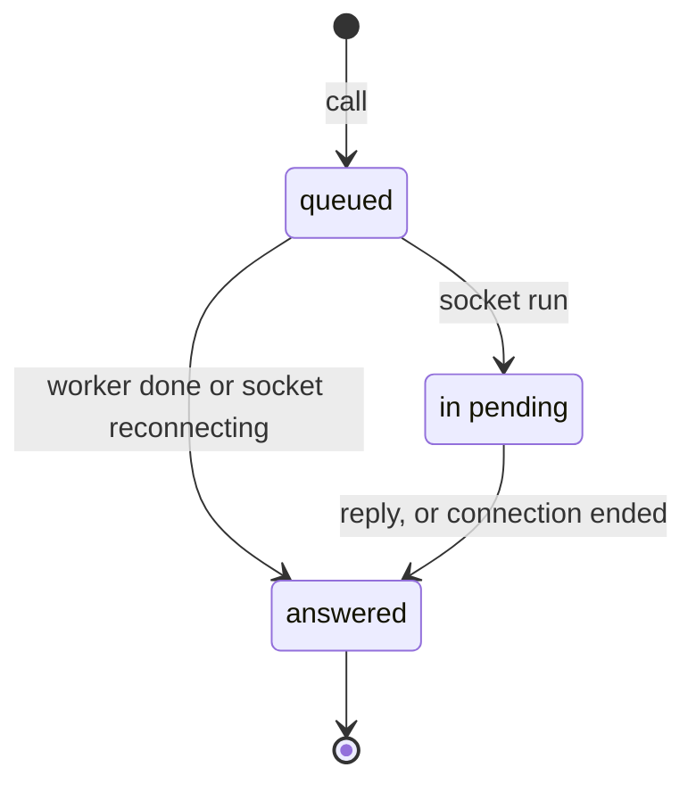

| State | What is true |
|---|---|
| queued | On the client's worker queue, or the socket's command channel. |
| in `pending` | Sent, keyed by ref. |
| answered | The handler is removed. `gamend.reply(id)` answers the event until 64 newer replies push it out. |

| From | Trigger | To | What it does |
|---|---|---|---|
| none | `login`, `rest` | queued | `activity.started`. Queues through `io.start`. |
| none | `join`, `push`, `leave`, `call_hook` | queued | `activity.started`. `command` returns "no such gamend socket" or "the gamend connection is gone", and the handler and the row stay. |
| queued | `run` | in `pending` | Sends the frame. |
| queued | `spawn_login`, `spawn_rest` finish | answered | `LoggedIn`, `RestDone` or `Failed`. |
| queued | `wait_commands` | answered | `Failed`, "the socket is reconnecting", or `Replied` for a `Leave`. |
| in `pending` | `deliver`, reply by ref | answered | `Replied`. |
| in `pending` | `fail_pending` | answered | `Failed`, "the connection ended before the reply". |

Starts queued. Ends answered.

Refused or ignored: a command that makes `run` fail leaves queued and never reaches `pending`, so no event answers it.

### Activity row status

The activity log holds this for each call it shows, and `gamend.activity()` reads it. Source: `crates/balaur_gamend/src/activity.rs`, `Entry.status`.

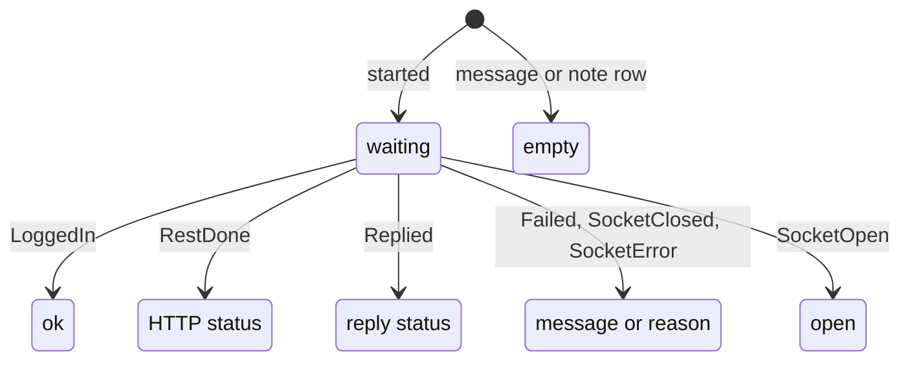

| State | What is true |
|---|---|
| `"waiting"` (`WAITING`) | No answer. `ms` is nil. |
| `"ok"` | A login answered. |
| status digits | A REST call answered with this HTTP status. |
| reply's `status` | A socket reply answered. |
| message or reason text | `Failed`, or a socket closed or failed on its connect row. |
| `"open"` | A connect row opened. |
| `""` | A `message`, `reconnecting` or `reopened` row, fixed when made. |

| From | Trigger | To | What it does |
|---|---|---|---|
| none | `Activity::started` | `"waiting"` | Stamps the start. |
| none | `SocketMessage`, or `note` | `""` | Keeps the payload or the text. |
| `"waiting"` | `heard` calls `finish`, newest row for the request still waiting | the answer | Sets `ms` and `reply`. |

Starts in `"waiting"` or `""`. Ends when `push` evicts the row past 200, or `gamend.clear_activity()` runs.

Refused or ignored: rows past the newest 50 lose `args` and `reply`. A socket's later close does not touch a connect row that already opened.

### Activity socket row

The activity log holds what scripts read about each socket, in `gamend.connection().sockets`. It follows the drained events and is separate from the socket itself. Source: `crates/balaur_gamend/src/activity.rs`, `Socket.open`, `Socket.reason`, `Socket.topics`.

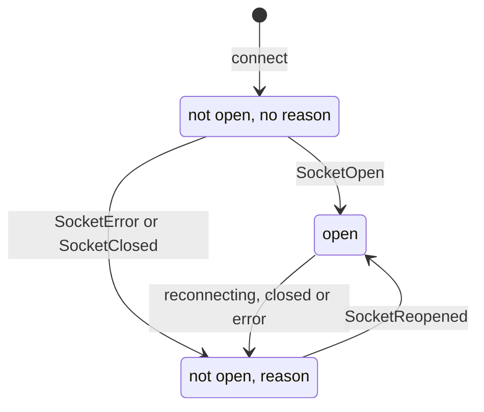

| State | What is true |
|---|---|
| `open == false`, `reason == nil` | `connect` started. |
| `open == true`, `reason == nil` | Open or reopened. |
| `open == false`, `reason` set | Reconnecting, closed or failed. |

| From | Trigger | To | What it does |
|---|---|---|---|
| none | `started` with kind `connect` | `open == false` | Adds the row. |
| any | `heard`, `SocketOpen` | `open == true` | Leaves `reason`. |
| any | `heard`, `SocketReconnecting` | `open == false`, `reason` set | Adds a `reconnecting` row. |
| any | `heard`, `SocketReopened` | `open == true`, `reason == nil` | Removes `lost` from `topics`. Adds a `reopened` row. |
| any | `heard`, `SocketClosed`, `SocketError` | `open == false`, `reason` set | Finishes the connect row. |
| any | `replied`, `ok` to a join or a leave | same | Adds to or removes from `topics`. |
| any | `heard`, `SocketMessage` with `phx_close` | same | Removes the topic. |

Starts with `open == false`. Never ends: `configured` leaves the rows and nothing removes one.

### Activity user

The activity log holds who `gamend.connection()` names. Source: `crates/balaur_gamend/src/activity.rs`, `Activity.user`.

| State | What is true |
|---|---|
| `None` (`user_id` and `username` nil) | Nobody known. |
| `Some((id, name))` | A login or a restore landed. |

| From | Trigger | To | What it does |
|---|---|---|---|
| any | `configured` | `None` | Sets the url. |
| any | `heard`, `LoggedIn` | `Some` | Finishes the login row. |
| any | `signed_in`, from `gamend.restore` | `Some` or `None` | Nothing else. |

Starts in `None`. Never ends.

## Platform

### Signed-in player

`PlatformState` holds who the store says is playing. Scripts read it with `platform.player()` and `platform.signed_in()`. Source: `crates/balaur_platform/src/lib.rs`, `PlatformState.player`.

| State | What is true |
|---|---|
| `None` (nil, `false`) | No sign-in has landed, or the player signed out. |
| `Some(Player)` (`id` and `alias`, `true`) | The latest `SignedIn`. |

| From | Trigger | To | What it does |
|---|---|---|---|
| any | `pump_platform_system` drains `SignedIn` | `Some(player)` | The asker's handler and every watcher hear `signed_in`. Wakes the request. |
| any | `pump_platform_system` drains `SignedOut` | `None` | Every watcher hears `signed_out`. Wakes request 0. |

Starts in `None`. Never ends.

Refused or ignored: `Failed` and `Unsupported` leave it as it was.

### Sign-in watcher

`PlatformState` keeps each handler a sign-in named, to tell it of later changes. Source: `crates/balaur_platform/src/lib.rs`, `PlatformState.watchers`.

| State | What is true |
|---|---|
| not in `watchers` | Hears only answers to its own calls. |
| in `watchers` | Hears every `SignedIn` and `SignedOut`. |

| From | Trigger | To | What it does |
|---|---|---|---|
| not in `watchers` | `PlatformState::start` with `Call::SignIn` and a handler | in `watchers` | A handler with the same node and method is added once. |

Starts not in `watchers`. Ends in `watchers`: this crate removes none.

### One platform call

`PlatformState` holds a `platform.*` call from its id to its answer. This state is derived from `pending` and `handlers`. Source: `crates/balaur_platform/src/lib.rs`, `PlatformState.pending`, `PlatformState.handlers`, `PlatformState::start`, `PlatformState::issue`, `PlatformState::release`.

```mermaid
stateDiagram-v2
    state "in pending" as Held
    state "issued" as Issued
    state "answered" as Answered
    state "discarded" as Discarded
    [*] --> Held: write on a tick that can roll back
    [*] --> Issued: anything else
    Held --> Issued: tick settled
    Held --> Discarded: tick re-run
    Issued --> Answered: event drained
    Discarded --> [*]
    Answered --> [*]
```

| State | What is true |
|---|---|
| in `pending` | A write held as tick, id and call, on a tick a late input can still undo. |
| issued | The backend has it. Only `handlers[id]` remains, if a handler was given. |
| answered | The handler is removed. Handlers and any await have heard. |
| discarded | It left `pending` without being issued. |

| From | Trigger | To | What it does |
|---|---|---|---|
| none | `start`, `Call::writes` and `clock.tick >= clock.settled` | in `pending` | Stores the handler, logs `platform.call`. |
| none | `start`, otherwise | issued | `issue`. With no session `settled` is `u64::MAX`, so a write goes out at once. |
| in `pending` | `release` in the pump, tick before `settled`, not suppressed | issued | `issue`. |
| in `pending` | Pump, tick at or past `clock.tick` | discarded | No event. `handlers[id]` stays. |
| issued | `issue`, no backend | answered at the next pump | `Unsupported`. |
| issued | Pump drains its event | answered | Targets are dispatched. `host.wake(request)`. |

Starts in `pending` or issued. Ends answered or discarded.

Refused or ignored: `issue` starts nothing during a replay or a re-simulated tick, because the recording answers there. The pump calls `PlatformBackend::discard` instead of `pump` on those ticks.

Held by a pause, a `process` mode or a parked scene: `pump_platform_system` reads none of them. A handler runs through `call_on`, so a paused node hears it and a parked node, having no instance there, misses it. A task awaiting the id stays suspended until its node can tick.

### Store backend

`PlatformState` holds which store answers. Source: `crates/balaur_platform/src/lib.rs`, `PlatformState.backend`.

| State | What is true |
|---|---|
| `None` (`platform.backend()` answers `"none"`) | Every call answers `unsupported`. |
| `Some(backend)` (`backend.name()`) | The backend answers. |

| From | Trigger | To | What it does |
|---|---|---|---|
| any | `set_backend` | `Some(backend)` | The last caller wins. |

Starts in `None`. Never ends.

## Not states

| Name | Source | Values | What it is |
|---|---|---|---|
| `Delivery` | `crates/balaur_net/src/transport.rs` | `Reliable`, `Datagram` | The promise one payload was sent under. |
| `Message` | `crates/balaur_net/src/netsession.rs` | `Inputs`, `Digest`, `Ping`, `Pong`, `Control` | One thing a peer says to another. |
| `Control` | `crates/balaur_multiplayer/src/wire.rs` | `Hello`, `Welcome`, `Refuse`, `Roster`, `Start`, `Absent`, `Bye` | The lobby and match messages the host and its players send reliably. |
| `EventKind` | `crates/balaur_multiplayer/src/vocabulary.rs` | `Connected` (`"connected"`), `Failed` (`"error"`), `Joined` (`"joined"`), `Left` (`"left"`), `Started` (`"started"`), `Desync` (`"desync"`), `Closed` (`"closed"`) | The `kind` of one `on_multiplayer_event` map, each an `EVENT_*` constant. |
| `SocketEvent` | `crates/balaur_websocket/src/lib.rs` | `Open`, `Message`, `Binary`, `Closed`, `Failed` | One report from a socket worker, recorded and replayed through `ExternalIo`. |
| `kind` | `crates/balaur_websocket/src/lib.rs` | `"open"`, `"message"`, `"binary"`, `"closed"`, `"error"` | The `kind` of a websocket event map, each an `EVENT_*` constant. |
| `SocketCommand` | `crates/balaur_websocket/src/lib.rs` | `SendText`, `SendBytes`, `Close` | What the engine asks a socket worker to do. |
| `Arrival` | `crates/balaur_websocket/src/connection.rs` | `Opened`, `Text`, `Binary`, `Closed`, `Failed` | What `Connection::receive` returns per `SocketEvent`. |
| `LinkEvent` | `crates/balaur_webtransport/src/lib.rs` | `Open`, `Payload`, `Closed` | One report from a link worker. |
| `LinkCommand` | `crates/balaur_webtransport/src/lib.rs` | `Send`, `Close` | What the engine asks a link worker to do. |
| `HttpEvent` | `crates/balaur_http/src/lib.rs` | `Response`, `Progress`, `Sent`, `Error` | One report from a request worker. |
| `kind` | `crates/balaur_http/src/lib.rs` | `"response"`, `"progress"`, `"upload"`, `"cancelled"`, `"error"` | The `kind` of an HTTP event map. `"cancelled"` comes from the pump and has no `HttpEvent`. |
| `Next` | `crates/balaur_gamend/src/realtime.rs` | `Stay`, `Drop`, `Refused`, `ClosedByGame` | What one `live` call tells `step` to do. |
| `SocketEvent` | `crates/balaur_gamend/src/client/phoenix.rs` | `Reply`, `Message`, `Closed` | One decoded server frame. `Protocol::decode` makes `Reply` and `Message`. |
| `SocketCommand` | `crates/balaur_gamend/src/lib.rs` | `Join`, `Push`, `Leave`, `CallHook`, `Close`, `Interrupt` | What the engine asks a realtime socket to do. |
| `GamendEvent` | `crates/balaur_gamend/src/lib.rs` | `LoggedIn`, `RestDone`, `Failed`, `Replied`, `SocketOpen`, `SocketMessage`, `SocketClosed`, `SocketError`, `SocketReconnecting`, `SocketReopened` | One completion crossing to the frame loop. |
| `kind` | `crates/balaur_gamend/src/lib.rs` | `"login"`, `"rest"`, `"reply"`, `"open"`, `"message"`, `"closed"`, `"reconnecting"`, `"reopened"`, `"error"` | The `kind` of a Gamend event map. `Failed` and `SocketError` both read `"error"`. |
| `PlatformEvent` | `crates/balaur_platform/src/lib.rs` | `SignedIn`, `SignedOut`, `Done`, `Scores`, `Read`, `Failed`, `Unsupported` | One report from a store backend. Unsolicited ones arrive under request 0. |
| `kind` | `crates/balaur_platform/src/lib.rs` | `"signed_in"`, `"signed_out"`, `"done"`, `"scores"`, `"read"`, `"unsupported"`, `"error"` | The `kind` of a platform event map. |
| `Call` | `crates/balaur_platform/src/lib.rs` | `SignIn`, `Unlock`, `Progress`, `SubmitScore`, `Scores`, `CloudRead`, `CloudWrite`, `SetPresence` | One call on its way to a backend. `Call::writes` picks the ones a rollback must wait for. |
