# Lifecycle: runtime subsystems

The animation, audio, physics, input, UI and render crates each keep state that moves at run time, and this file defines it. [LIFECYCLE.md](LIFECYCLE.md) has the app, nodes and scripts.

## Holds and scripts

A game pause is `Engine::set_paused`. `Stage::FixedUpdate` keeps running through it, and each subsystem asks `process::ticks` about its own nodes. A debugger freeze or a held replay stops that stage and no other. `Engine::frozen_root` names what such a hold covers: the `Engine::debug_scope` subtree, or the whole tree with no scope. A pause covers the same subtree.

A parked scene hangs under a hidden holder with `ProcessMode::Disabled`, so `process::ticks` answers false for it. `events::announce` returns at once for a parked node.

The script host obeys the same rule. `BsHost::each` runs `update`, `fixed_update`, `call_all` and `call_all_with` on an instance unless something holds it. Three things do: `process::ticks` answers false, its node sits under `frozen_root`, or its file holds a debugger stop (`stopped_in`).

`BsHost::run_tasks` leaves a task held the same way waiting with its wake kept, and it goes on when the hold ends. So an editor outside the debug scope keeps running its `update` and its tasks through a stop. A stop in the middle of a pass skips only what it holds, in `each_of`.

Two calls still reach a script that a pause or a `process` mode holds: `ScriptHost::announce` and `ScriptHost::call_on`. The pause and device hooks use the first, which skips an instance under `frozen_root` or in the file holding a stop. Every `on_<event>` hook that `events::announce` runs uses the second, which asks nothing. So a held script hears the events below, while a task on it that awaits one waits. `set_parked` sets a parked script's instance aside, and neither call finds it.

## Animation

`advance_system` and `modify_system` run in `Stage::Update`, and `advance_system` spends whole fixed steps from its own accumulator.

### Animation player

One node's `animation` component holds this as a `Playback` in `AnimationState.players`. It is derived from two bools.

Source: `crates/balaur_animation/src/player.rs`, `Playback.playing` and `Playback.paused`.

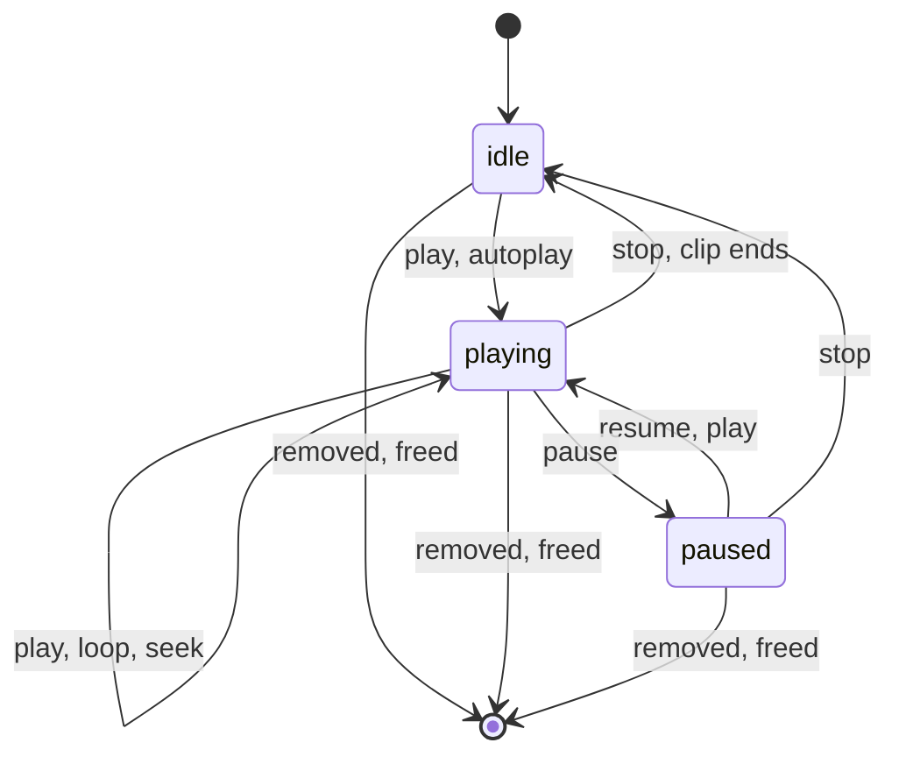

| State | What is true |
|---|---|
| Idle: `playing=false`, `paused=false` (script: `is_playing` false, `current_clip` nil) | No clip is current. The pose, `time` and `clip` stay as they were. |
| Playing: `playing=true` (script: `is_playing` true, `current_clip` names it) | The playhead moves every fixed step and the pose is written. |
| Paused: `paused=true` (script: `is_playing` false, `current_clip` names it) | The clip is current. The playhead and the fades hold. |

| From | Trigger | To | What it does |
|---|---|---|---|
| Idle | `play`, `play_from`, `play_blended` | Playing | Loads the clip, sets `time` to 0 and fills `began`. |
| Idle | `animation_written` with `autoplay` set | Playing | As `play`. A clip that does not load warns and stays Idle. |
| Playing, Paused | `play_blended` of another clip, `blend_time` above 0 | Playing | Pushes the old clip on `fades`, sets `time` to 0 and fills `began`. |
| Playing, Paused | `play_blended`, `blend_time` 0 or less | Playing | Clears `fades`. |
| Playing, Paused | `play_from` of the same clip, `from_start=false` | Playing | Keeps `time` and leaves `began` empty. |
| Playing | `pause` | Paused | Holds the playhead. |
| Paused | `resume` | Playing | Goes on from `time`. |
| Playing, Paused | `stop` | Idle | Clears `queue` and `fades`. No event. |
| Playing | `advance_playback`: `LoopMode::None` at `time >= length`, or a negative speed at `time <= 0` | Idle | Writes the last pose, sets `finished` and clears `fades`. `settle_ended` plays the next queued clip, then announces `animation_finished` with the clip. |
| Playing | `advance_playback` with `clip` empty | Idle | No event. |
| Playing | `advance_playback` crosses a pass of a looping clip | Playing | Announces `animation_looped` with the clip. |
| any | Machine `enter` | Playing | Takes the state's clip, fills `began`, pushes or clears `fades`. |
| any | Machine `finish` | Idle | Clears `fades`. The pose holds. |
| any | `seek` | same | Sets `time` and poses through `pose_now`. No method key fires. |
| Playing, Paused | `refresh_reloaded_clips` after an asset reload | same | Takes the new clip and caps `time` to its length. |
| any | Snapshot `restore` | as captured | Re-resolves the clip from its reference. |
| any | `animation_removed`, or the node freed (`advance_system`) | gone | Drops the `Playback`. No event. |

Starts in Idle. Ends when the `Playback` is dropped.

Refused or ignored: `pause` on a clip not playing and `resume` on one not paused are no-ops. `animation_written` never restarts an active clip. `play` errors with no `animation` component, or with no library and no clip of that name.

Held by a pause, a `process` mode or a parked scene: `advance_system` skips the node for the step through `process::ticks`, and the accumulator is still spent, so held time is not owed. A freeze returns early and empties the accumulator. None of them writes `playing` or `paused`. A method key aimed at a held script still runs, through `call_on`.

### Just-finished clip

One node's `Playback` keeps the clip that ended on the last step, for `animation_finished`.

Source: `crates/balaur_animation/src/player.rs`, `Playback.finished`.

| State | What is true |
|---|---|
| `""` | No clip ended on the last step. |
| the clip's name | That clip ended on the last step. |

| From | Trigger | To | What it does |
|---|---|---|---|
| any | `advance_playback` ends the clip | the clip's name | Read as the payload of `animation_finished`. |
| any | Top of `advance_system` | `""` | Runs after the script tick that could read it. |

Starts in `""`. Never ends.

Held by a pause, a `process` mode or a parked scene: a pause and a mode still clear it. A freeze returns before the clear, so the name stays readable.

### Clip queue

One node's `Playback` keeps the clips to play after the current one.

Source: `crates/balaur_animation/src/player.rs`, `Playback.queue`.

| State | What is true |
|---|---|
| `queue` empty | Nothing follows the current clip. |
| `queue` holds names | The head plays when the current clip ends. A looping clip never ends, so its queue never drains. |

| From | Trigger | To | What it does |
|---|---|---|---|
| any | `queue` | holds names | Pushes the name at the back. |
| holds names | `settle_ended` | shorter | Removes the head and calls `play`. A clip that does not load warns. |
| any | `stop` | empty | Clears it. |

Starts empty. Never ends.

### Clip started notice

One node's `Playback` keeps a clip begun since the system last announced one.

Source: `crates/balaur_animation/src/player.rs`, `Playback.began`.

| State | What is true |
|---|---|
| `began=None` | Nothing to announce. |
| `began=Some((from, to))` | A clip began. `from` is empty when nothing was active. |

| From | Trigger | To | What it does |
|---|---|---|---|
| `None` | `play_blended` from the start or on another clip, or machine `enter` | `Some` | Records the pair. |
| `Some` | `announce_began`, at the end of `advance_system` | `None` | Announces `animation_changed` `#{ from, to }` when `from` is set and differs, then `animation_started` with `to`. |

Starts in `None`. Never ends.

Held by a pause, a `process` mode or a parked scene: `announce_began` asks none of them, and `events::announce` drops the event for a parked node. A freeze returns before it.

### Crossfade

One entry of `Playback.fades` is the outgoing clip of a crossfade, sampled and blended out.

Source: `crates/balaur_animation/src/player.rs`, `Fade` and `Playback.fades`.

| State | What is true |
|---|---|
| In `fades`, `elapsed < duration` | Sampled and blended. `elapsed` and `time` move only while the player is Playing. |
| Dropped | Not sampled. |

| From | Trigger | To | What it does |
|---|---|---|---|
| none | `play_blended` with `blend_time` above 0 on another active clip | In `fades` | Built by `leaving`. A fade begun during a fade stacks. |
| none | Machine `enter` with a fade above 0 on an active clip | In `fades` | Built by `leaving`, with the transition's curve and `break_loop_at_end`. |
| In `fades` | `advance_playback`, this or a newer fade reaches `duration` | Dropped | Drains it and every older one. |
| In `fades` | The clip finishes, `stop`, or a cut | Dropped | Clears the list. |

Starts in `fades`. Ends when dropped.

### Tween

`AnimationState.tweens` holds one running tween per handle, on the node it was made on.

Source: `crates/balaur_animation/src/tween.rs`, `Tween`.

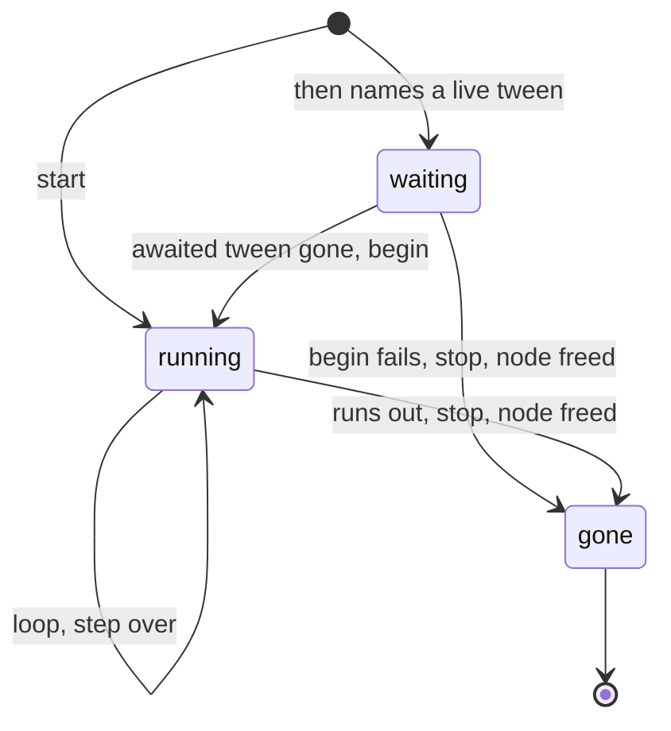

| State | What is true |
|---|---|
| Waiting: `after=Some(id)` with `id` in `tweens`, `pending=Some(spec)`, `running=true` | Sits out every step. `is_tween_running` answers true. |
| Running: `running=true`, `after` empty or naming nothing | `time` moves by `fixed_dt * speed`. A node tween writes its pose and fires its calls. |
| Gone: no entry in `tweens` | `is_tween_running` false, `stop_tween` a no-op. |

| From | Trigger | To | What it does |
|---|---|---|---|
| none | `start`, spec `then` names a live tween | Waiting | Keeps the spec in `pending`. |
| none | `start`, `start_to`, `start_script` | Running | Builds the clip and reads the start values. The handle counts up and is never reused. |
| Waiting | `advance_system` finds `after` names nothing, then `begin` | Running | Rebuilds the clip, so `by` and a captured `from` read the node now. |
| Waiting | `begin` fails | Gone | Warns. No event. |
| Running | `advance` passes a step's end | Running | Announces `tween_step` `#{ tween, step }`. |
| Running | `advance`, clip over, `loops` is 0 or `played < loops` | Running | Sets `time` to 0 and announces `tween_looped` `#{ tween, played }`. |
| Running | `advance`, clip over, loops done | Gone | Announces `tween_finished` with the handle. |
| any | `tween::stop`, script `animation.stop_tween(handle)` | Gone | No event. |
| any | The node freed (`advance_system`) | Gone | No event. |

Starts in Running or Waiting. Ends in Gone. `release_unheld` then lets go of script functions no live tween names.

Refused or ignored: `start` errors on no steps, an unknown property, a target that names no node, or a `speed` not above 0. `stop_tween` on an unknown handle is a no-op.

Held by a pause, a `process` mode or a parked scene: `advance_system` skips the tween through `process::ticks` on `tween.node`. A freeze returns early. A `call` step aimed at a held script still runs.

### State machine run

One node's `state_machine` component holds this as a `MachineRun` in `AnimationState.machines`. The run drives the `animation` player its `player` property names.

Source: `crates/balaur_animation/src/machine.rs`, `MachineRun.current`, `MachineRun.ended` and `MachineRun.machine`.

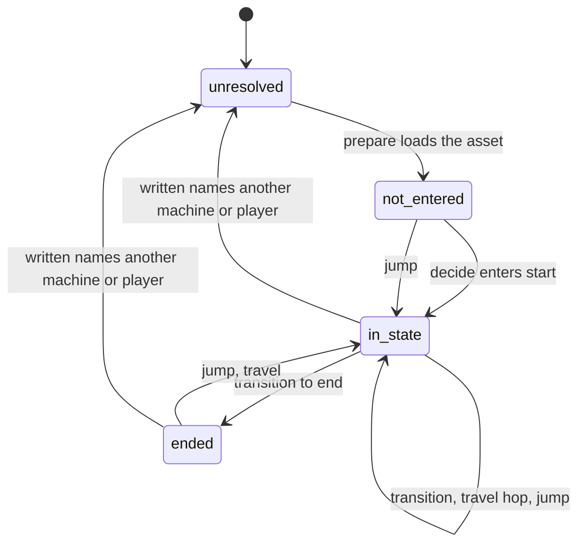

| State | What is true |
|---|---|
| Unresolved: `machine=None` | `step` skips the run. `travel` waits in `pending`. |
| Not entered: `current=""`, `ended=false` (script: `current_state` nil) | The next step enters `start`. |
| In state: `current` is `name` or `group/state` (script: `current_state` names it) | Its clip plays and its `auto` transitions are asked. |
| Ended: `current=""`, `ended=true` (script: `current_state` nil, target word `animation.STATE_END`, `end`) | The pose holds. Nothing is entered until a jump or a travel. |

| From | Trigger | To | What it does |
|---|---|---|---|
| none | `written` on a new component | Unresolved | Makes the run from `machine`, `player`, `enabled` and `check_node`. |
| any | `written` with another `machine` or `player` | Unresolved | Resets the whole run, `conditions` and `times` included. |
| any | `written`, other properties | same | `enabled` and `check_node` land on the run. |
| any | `prepare`, before the fixed steps, when the asset generation moved | Not entered or as it was, Unresolved on a failure | Loads the asset and each state's clip. A load failure warns and leaves `machine` empty. `current` stays. |
| Not entered | `decide` with `start` set | In state | Cuts to `start`. Announces `state_started`. |
| In state | `decide`: lowest-priority `auto` transition with its condition and check true, and `ready` | In state | `enter` runs the fade the transition names. Announces `state_finished` with the old state, then `state_started` with the new one. |
| In state | `decide`: next hop of `travel`, its transition `ready` | In state | As above. |
| any | `decide` takes `jump` | In state | Cuts with no fade, `reset` true. Announces as above; from Ended, `state_started` only. |
| In state | A transition's `to` is `end`, through `finish` | Ended | Stores the clip's `time`, clears `travel`, stops the player and clears its fades. Announces `state_finished` only. |
| Ended | `decide` | Ended | Stays until a jump, or a travel that `route` turns into a jump. |
| any | Component removed, or the node freed (`advance_system`) | gone | Drops the run. |

Starts in Unresolved. Ends when the run is dropped.

Refused or ignored: `travel` errors once loaded when the state is unknown. An unknown `jump` or `pending` warns at the next `decide`. A `from = end` or a nested `to = end` is a parse error. A transition whose clip did not load moves `current` and leaves the player alone.

Held by a pause, a `process` mode or a parked scene: `step` skips the run through `process::ticks` on the machine's own node, as it does while `enabled` is false. `evaluate_checks` still calls the `check` methods each frame under a pause, and a held script answers them. A freeze returns before it.

### Machine route

One `MachineRun` keeps how it was asked to reach another state.

Source: `crates/balaur_animation/src/machine.rs`, `MachineRun.pending`, `MachineRun.jump` and `MachineRun.travel`.

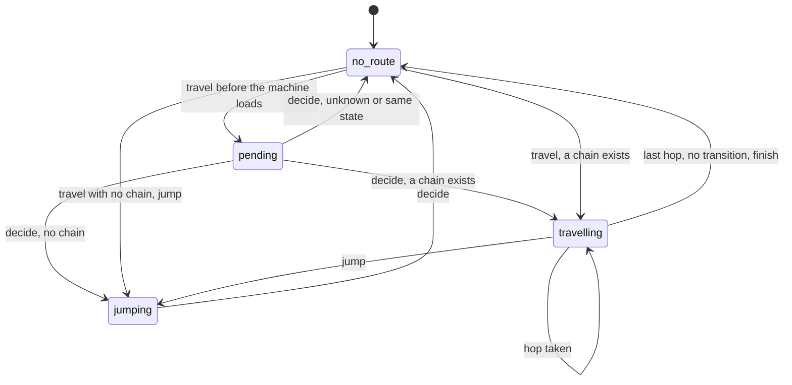

| State | What is true |
|---|---|
| No route: `pending=None`, `jump=None`, `travel` empty | `auto` transitions decide. |
| `pending=Some(state)` | A travel asked before the machine loaded. |
| `travel` holds states | The states to pass through, the target last. `auto` transitions do not run. |
| `jump=Some(state)` | Cut on the next step. |

| From | Trigger | To | What it does |
|---|---|---|---|
| any | `travel`, machine not loaded | `pending` | Clears `travel`. |
| any | `travel`, `route` finds a chain and `current` is set | `travel` holds states | The cheapest chain by `priority`, avoiding `disabled` transitions. |
| any | `travel`, `route` finds no chain | `jump` | Clears `travel`. |
| any | `travel` to the current state with no chain | No route | Clears `travel`. |
| any | `jump` | `jump` | Clears `travel`. |
| `pending` | `decide` | as `route` answers | An unknown state warns and leaves No route. |
| `jump` | `decide` | No route | Enters the state, or warns when it is unknown. |
| `travel` | `decide`, hop `ready` | shorter | Removes the head and enters it. |
| `travel` | `decide`, hop not `ready` | same | Waits. |
| `travel` | `decide`, no transition for the hop | No route | Clears it. |
| `travel` | `finish` | No route | Clears it. |

Starts in No route. Never ends.

### Machine conditions and checks

One `MachineRun` keeps what its `auto` transitions wait on.

Source: `crates/balaur_animation/src/machine.rs`, `MachineRun.conditions` and `MachineRun.checks`.

| State | What is true |
|---|---|
| Off: no entry, or `false` | A transition naming it does not fire on its own. |
| On: `true` | A transition naming it may fire. |

| From | Trigger | To | What it does |
|---|---|---|---|
| any | `set_condition`, script `animation.set_condition` | as asked | Writes `conditions`. It stays until written again or the run resets. |
| any | `evaluate_checks`, each frame | as the method answers | Clears `checks` and asks the script methods of the current state's transitions. Only a `true` answer is on. |

Starts off. Never ends.

### Modifier enabled

A `modifier2d` or `modifier3d` component says whether it poses its bones after the clip.

Source: `crates/balaur_animation/src/modifier.rs`, `Modifier2d.enabled`, `Modifier3d.enabled` and `Params.enabled`.

| State | What is true |
|---|---|
| Running: `enabled=true`, with a `target` where its `kind` wants one | Solved each frame after the clip. |
| Off: `enabled=false`, or no `target` where its `kind` wants one | The clip's pose stands. A jiggle chain's memory stays in `AnimationState.jiggle`. |

| From | Trigger | To | What it does |
|---|---|---|---|
| any | Component write, `written_2d` or its 3D twin | per `enabled` | Builds a new `Params`. |
| any | `modifier2d_removed`, `modifier3d_removed` | gone | Drops `Params` and the jiggle memory. |

Starts as authored, on by default. Ends when the component is removed.

Held by a pause, a `process` mode or a parked scene: `modify_system` skips the node through `process::ticks`, so it writes nothing, a jiggle chain's memory stays, and held time is not owed. A freeze returns early.

## Audio

`hold_sounds` runs first in `sweep_sounds_system`, every frame in `Stage::PostUpdate`. It holds a node's sound with its node, and a cue has no node to hold it. `count_down_system` runs in `Stage::FixedUpdate`, so a freeze stops every clock. A cue, or a node outside the frozen subtree, keeps its sink playing while its clock stands.

### Sound node voice

A `sound` node holds this as a `Voice` in `AudioState.nodes`: its hold on the playback it started.

Source: `crates/balaur_audio/src/lib.rs`, `Voice.handle`.

| State | What is true |
|---|---|
| `handle=None` | Nothing started, it was stopped, or it played out. `Sound.playback_time` reads 0. |
| `handle=Some(h)` | This node started playback `h`. A known length ends on the clock, so a sink that empties first leaves it set. |

| From | Trigger | To | What it does |
|---|---|---|---|
| any | `play_node`, script `node.sound.play()` | `Some(new)` | Stops the old handle at once and starts a new one from the top. |
| `None` | Component `written` with `autoplay` and a `file` | `Some(new)` | Starts it, fading over `crossfade_time` when a file change released another. |
| `Some` | Component `written`, `file` changed | `None`, then maybe `Some(new)` | `release_over` with `crossfade_time`, then autoplay. |
| `Some` | Component `written`, same file | same | `retune` lands volume, pitch, pause, pan, `fade_out_time` and distances. `hold_sounds` puts any hold back over the pause. |
| `Some` | `stop_on`, script `node.sound.stop()` | `None` | `release` over the sound's `fade_out_time`. No event. |
| `Some` | `announce_finished` after the clock ran out or a sink of unknown length ended | `None` | Announces `finished` with the handle. |
| `Some` | `skip_on` past the last file | `None` | Announces `finished` with the handle. |
| any | `stop_all` | `None` | Stops everything. No event. |
| any | `sound_removed`, or the node freed (`sweep_sounds_system`) | gone | Stops the handle at once. |

Starts in `None`. Ends when the voice is dropped.

Refused or ignored: `play_on` errors with no `sound` component, no `file`, or a file that does not exist. Autoplay warns instead.

Held by a pause, a `process` mode or a parked scene: the voice does not change. Its playback holds, as the next block says.

### Sound playback

One `play` is a handle, and which tables of `AudioState` hold it says where it is. A cue's play is the same with no voice owning it.

Source: `crates/balaur_audio/src/lib.rs`, `AudioState.routing` (`Routed`), `AudioState.playing` and `AudioState.releasing` (`Release`).

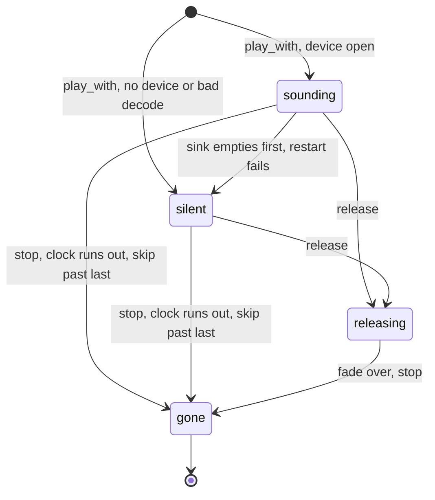

| State | What is true |
|---|---|
| Sounding: in `routing` and `playing` (script: `is_playing` true) | The sink is live. |
| Silent: in `routing` only (script: `is_playing` true) | No device, it did not decode, or the sink emptied ahead of the clock. The clock still counts. |
| flag `Routed.paused=true` on either | The clock and the sink hold. The node asked through `Sound.paused`, or `hold_sounds` found the node held. |
| flag `Routed.fade` below 1 on either | `Timeline::left` is under `fade_out_time`, so the gain falls as it ends. |
| Releasing: in `releasing` only (script: `is_playing` false, `releasing_volume` a number) | Falling to silence after a stop. It no longer counts as the game's sound. |
| Gone: in none (script: `is_playing` false) | Setters no-op. |

| From | Trigger | To | What it does |
|---|---|---|---|
| none | `play_with`, device open, decodes | Sounding | Places an emitter first when it has one. The handle counts up and is never reused. |
| none | `play_with`, no device or a bad decode | Silent | A bad decode warns. |
| Sounding, Silent | `set_paused`, `retune` | same | Sets `Routed.paused` and pauses the sink. |
| Sounding, Silent | `hold_sounds`, a voice's handle, each frame | same | Sets `Routed.paused` to `Sound.paused`, or to true when `process::ticks` is false or the node sits under `frozen_root`. |
| Sounding, Silent | `count_down_system`, not paused | same | Advances the clock by `dt * pitch` and updates the end fade. |
| Sounding, Silent | `count_down_system`, clock over | Gone | `stop`, then `announce_finished`. A voice owner hears `finished`. |
| Sounding | `sweep_sounds_system`, sink empty, clock not `counted` | Gone | `announce_finished`. |
| Sounding | `sweep_sounds_system`, sink empty, clock `counted` | Silent | The clock decides the end. |
| Sounding, Silent | `release`, `release_over` above 0 seconds, script `stop_playback` | Releasing | Keeps the sink, falling from the applied gain. |
| Sounding, Silent | `release_over` at 0 seconds | Gone | Stops the sink. |
| Releasing | `count_down_system`, `left` reaches 0 | Gone | Stops the sink. No event. |
| Releasing | `sweep_sounds_system`, sink empty | Gone | No event. |
| any | `stop`, `stop_all` | Gone | Stops the sink. No event. |
| Sounding, Silent | `seek` | same | Moves the clock and rebuilds a live sink through `restart`. |
| Sounding, Silent | `skip`, a next file | same | As `seek`. |
| Sounding, Silent | `skip`, no next file | Gone | `skip_on` announces `finished`. |
| Sounding | `restart` does not decode | Silent | Warns. |

Starts in Sounding or Silent. Ends in Gone.

Refused or ignored: setters on a Silent handle reach the bookkeeping only. A handle played before the device opened stays Silent, since only `play_with` starts a sink and `restart` needs one.

Held by a pause, a `process` mode or a parked scene: `hold_sounds` holds a node's sound when `process::ticks` is false. So a pause holds a `pausable` node's sound and an `always` node's plays on. A debugger stop or a paused replay holds the sounds under `frozen_root`. When a hold ends, the sound goes back to what `Sound.paused` asks. A cue's handle has no voice and plays on.

### Playback clock

Each `Routed` holds a `Timeline`, counted on the fixed step: where the play has got to, with or without a sink. `Segment` is one file's fixed `start`, `end`, `looped` and `loop_from`.

Source: `crates/balaur_audio/src/playback.rs`, `Timeline` and `Segment`.

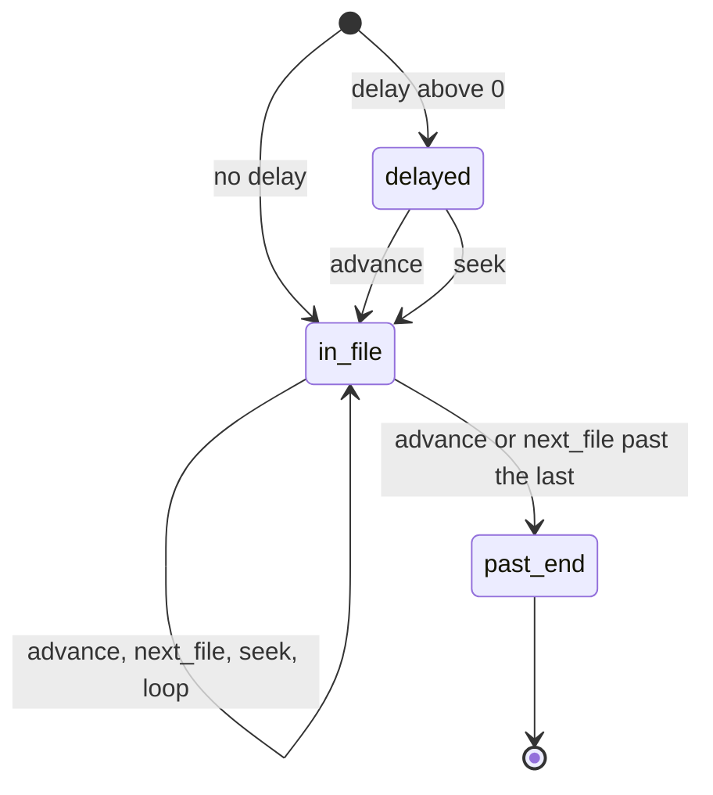

| State | What is true |
|---|---|
| Delayed: `delay` above 0 | Silence before the first file. `playback_time` reads the start. |
| In file: `index` within `segments`, `at` seconds into it | Counting. A `looped` segment wraps at `end` to `loop_from`. An `end` of `None` leaves the sink to decide. |
| Past end: `index` past the last segment | `advance` answered true. |

| From | Trigger | To | What it does |
|---|---|---|---|
| none | `Timeline::new` | Delayed or In file | `at` is `start_time` for `main`, the top for the rest. |
| Delayed | `advance` | Delayed or In file | Spends the delay first. |
| In file | `advance` to `end`, looped | In file | Wraps to `loop_from`, or holds at `end` with no span to wrap in. |
| In file | `advance` to `end`, a next file | In file | `next_file` moves `index` and sets `delay` to 0. |
| In file | `advance` to `end`, no next file | Past end | Answers true. |
| In file | `next_file` from `skip` | In file or Past end | As above. |
| Delayed, In file | `seek` | In file | Sets `delay` to 0 and `at` to the time, capped to a known `end`. |

Starts in Delayed or In file. Ends in Past end.

Held by a pause, a `process` mode or a parked scene: `count_down_system` skips a clock while `Routed.paused` is set, so a clock holds with its sound. A freeze stops the stage, so every clock stands.

### A played file

`audio.play_file` starts an ordinary handle with no node and no voice behind it.

Source: `crates/balaur_audio/src/play_file.rs`, `play_file`.

Refused or ignored: an option the `sound` component does not spell ends the call. No voice owns its handle, so `finished` is never announced for it. `Playback::default` gives it a `fade_out_time` of 0, so `stop_playback` stops it at once.

Held by a pause, a `process` mode or a parked scene: no voice owns the handle, so `hold_sounds` never reaches it. A played file sounds through all three, so a pause menu's click still sounds. A freeze stops its clock and leaves its sink playing.

### Output device

`AudioState` holds how far the output device has opened.

Source: `crates/balaur_audio/src/lib.rs`, `AudioState.configured`, `AudioState.access`, `AudioState.opening`, `AudioState.device` and `AudioState.was_focused`.

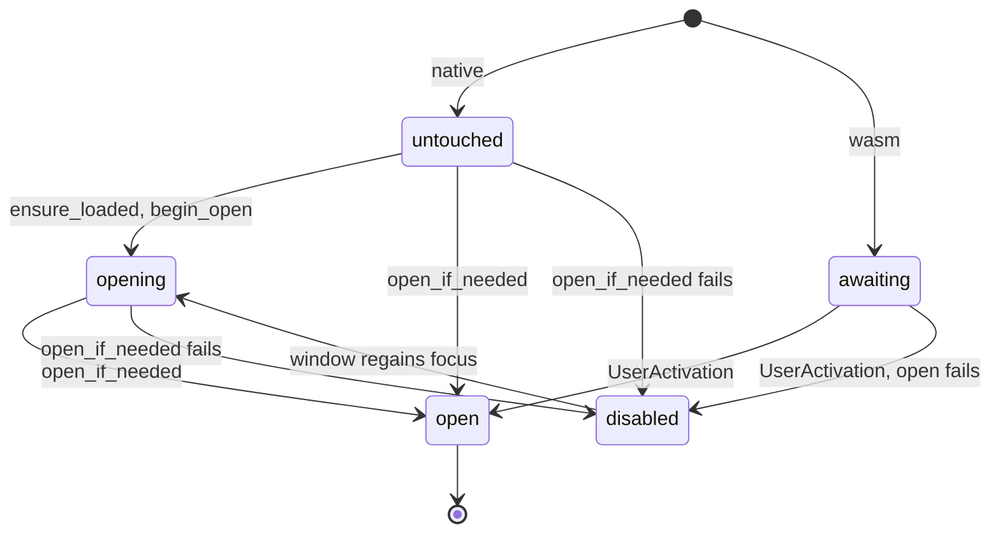

| State | What is true |
|---|---|
| Untouched: `access=Untried`, `opening=None` | Nothing asked for audio yet. |
| Awaiting: `access=AwaitingActivation` | The browser refuses audio before a gesture. Sounds get handles and no sink. Script `device_ready` false. |
| Opening: `access=Untried`, `opening=Some(receiver)` | A worker is opening the device. |
| Open: `access=Tried`, `device=Some` | Sounds get sinks. Script `device_ready` true. |
| Disabled: `access=Tried`, `device=None` | Every handle stays silent. Script `device_ready` false. `was_focused` follows the window. |

| From | Trigger | To | What it does |
|---|---|---|---|
| Untouched | `ensure_loaded`, then `begin_open` | Opening | Reads `[audio]` and the buses once (`configured`), and starts the open on a worker. |
| Untouched, Opening | `open_if_needed`, from `play_with` or script `device_ready` | Open | Waits for the worker, or opens in place when none started. |
| Untouched, Opening | The same open fails | Disabled | Warns `audio disabled`. |
| Awaiting | `open_on_activation_system`, `UserActivation` present | Open or Disabled | Runs in `Stage::First`. |
| Disabled | `sweep_sounds_system`, `focused` true and `was_focused` false | Opening | Sets `access` back to `Untried` and calls `begin_open`. A failed retry waits for the window to come back again. |

Starts in Untouched, or Awaiting on wasm. Ends in Open. Disabled lasts until a retry opens the device.

Refused or ignored: `open_if_needed` and `begin_open` do nothing while Awaiting.

### Listener

A `listener` component says whether the mix may be heard from its node.

Source: `crates/balaur_audio/src/spatial.rs`, `Listener.current` and `AudioState.listeners`.

| State | What is true |
|---|---|
| `current=true` | The last such node in `listeners` that is not parked gives the ears their place. |
| `current=false` | Ignored. |
| no such node | The ears follow the view: the current camera's pose. |

| From | Trigger | To | What it does |
|---|---|---|---|
| any | `listener_written` | as written | Copies it to `listeners`. A current one moves the ears at once. |
| any | `listener_removed`, or `sweep_listeners` for a freed node | gone | Drops the copy. |

Starts as authored, true by default. Ends when the component is removed.

Held by a pause, a `process` mode or a parked scene: `follow_nodes` skips a parked listener. A pause and a mode are not asked.

## Physics

`step_system` runs once per fixed tick in the 3D world and in the 2D one. A world cannot be held per node, so a pause holds every body and a `process` mode reaches nothing here.

### World stepping

Each physics world holds whether it steps. It is derived from its own flag and the engine's pause.

Source: `crates/balaur_physics/src/lib.rs` and `crates/balaur_physics/src/dim2/mod.rs`, `PhysicsState3d.paused`, `PhysicsState2d.paused` and `step_system`.

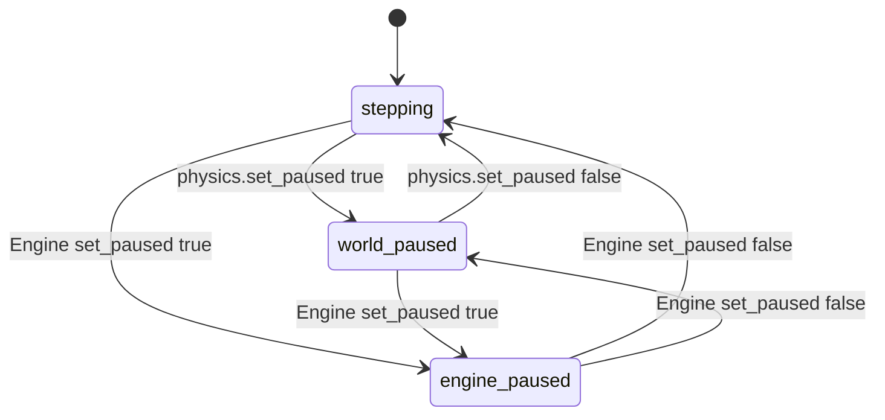

| State | What is true |
|---|---|
| Stepping: `paused=false`, engine not paused (script: `physics.is_paused` false) | One rapier step per fixed tick. Events follow it. |
| World paused: `paused=true` (script: `physics.is_paused` true) | Freed nodes are pruned and pending joints retried. No step and no events. |
| Engine paused | `step_system` returns first and does nothing. `physics.is_paused` reads the world's own flag only. |

| From | Trigger | To | What it does |
|---|---|---|---|
| any | `physics.set_paused` | as asked | Writes both worlds' flags. |
| any | `Engine::set_paused` | as asked | `step_system` reads it each tick. |
| any | Snapshot restore | as captured | Restores the world's flag. |

Starts in Stepping. Never ends.

Held by a pause, a `process` mode or a parked scene: this block is the pause. A freeze stops `Stage::FixedUpdate`, so no step runs either.

### Body and soft body enabled

A `body3d`, `body2d`, `softbody3d` or `softbody2d` component says whether the body takes part in the step.

Source: `crates/balaur_physics/src/body.rs`, `crates/balaur_physics/src/dim2/body.rs`, `crates/balaur_physics/src/softbody.rs` and `crates/balaur_physics/src/dim2/softbody.rs`, the `enabled` property.

| State | What is true |
|---|---|
| Enabled | Simulated. |
| Disabled | Keeps its state and costs nothing. |

| From | Trigger | To | What it does |
|---|---|---|---|
| any | Component write, `write_body` or the soft body patch | as asked | Calls `set_enabled`. It also re-enables a quarantined body. |
| any | `parked_changed`, scene parked | Disabled | A soft body's whole family goes with it. |
| Disabled | `parked_changed`, scene back | as asked | Reads `enabled` off the component. |
| Enabled | Rapier finds a non-finite position or velocity | Disabled | Rolls a body back to its last valid pose when known, zeroes it and lists it in `physics.quarantined` for that step. `warn_about_quarantine` logs it. |

Starts as authored, enabled by default. Ends when the component is removed.

Held by a pause, a `process` mode or a parked scene: a parked scene disables it, as above. A pause does not change the flag.

### Collider enabled

A `collider3d` or `collider2d` component, or a tile map's collider, says whether the shape collides.

Source: `crates/balaur_physics/src/collider.rs`, `crates/balaur_physics/src/dim2/collider.rs` and `crates/balaur_physics/src/shared/collider.rs`, `enabled`.

| State | What is true |
|---|---|
| On | Collides and answers queries. |
| Off | Keeps its shape. Rapier treats it as removed, which ends its contacts. |

| From | Trigger | To | What it does |
|---|---|---|---|
| any | Component write, `apply_collider` | as asked | Builds it with `enabled`. |
| any | `parked_changed`, scene parked | Off | Also in `dim2::tiles::parked_changed`. `queries_ready` goes false. |
| Off | `parked_changed`, scene back | On | Writes `set_enabled(true)` without reading the component. |
| On | Rapier finds its own geometry non-finite | Off | Lists it in `physics.quarantined` for that step. |

Starts as authored, on by default. Ends when the component is removed.

### Sleeping allowed

Each world holds whether its bodies may fall asleep.

Source: `crates/balaur_physics/src/lib.rs` and `crates/balaur_physics/src/dim2/mod.rs`, `sleeping_allowed`, with `Authored.can_sleep` per body.

| State | What is true |
|---|---|
| `sleeping_allowed=true` (script: `physics.sleeping_allowed` true) | A body sleeps by its own thresholds unless it says `can_sleep=false`. |
| `sleeping_allowed=false` | Every body's thresholds are -1, so none sleeps. Bodies added later too. |

| From | Trigger | To | What it does |
|---|---|---|---|
| any | `set_sleeping_allowed`, script `physics.set_sleeping_allowed` | as asked | `allow_sleep` on every body, both worlds. Forbidding wakes each one. |
| any | Snapshot restore | as captured | Writes the flag. |

Starts true. Never ends.

### Asleep

Rapier keeps whether a body or a soft body is at rest, and the world remembers last step's set to say what changed.

Source: `crates/balaur_physics/src/shared/world.rs`, `sleep_changes` and `PhysicsState3d.asleep`; rapier's `RigidBody::is_sleeping` and `SoftBody::is_sleeping`.

| State | What is true |
|---|---|
| Awake (script: `is_sleeping` false) | Simulated. Listed by `active_bodies`. |
| Asleep (script: `is_sleeping` true; `softbody_sleeping` true when every piece is) | Skipped until something wakes it. |

| From | Trigger | To | What it does |
|---|---|---|---|
| Awake | Rapier: under `sleep_threshold` and `sleep_angular_threshold` for `time_to_sleep` | Asleep | After the step, `sleep_changes` finds it and `announce_sleep` announces `sleeping_changed` true. |
| Awake | `sleep` | Asleep | The next step's diff announces it. |
| none | `start_body`, `start_asleep` set and sleeping allowed | Asleep | Read once, when the body is made. |
| Asleep | `wake_up`, `wake_all`, `wake_softbody` | Awake | The next step's diff announces `sleeping_changed` false. |
| Asleep | Any component write, `write_body` | Awake | Calls `wake_up`. |
| Asleep | `allow_sleep` with sleep forbidden | Awake | Sets the thresholds to -1 and wakes it. |
| Asleep | A vehicle's drive input on a resting chassis | Awake | Engine force, brake or steering, in the vehicle update. |
| Asleep | Rapier: a new contact with an awake body, or a collider touching it changes, is removed or is disabled | Awake | As above. |

Starts Awake, or Asleep with `start_asleep`. Ends when the body goes. `asleep` empties with the world.

Held by a pause, a `process` mode or a parked scene: no step means no change and no announcement. A body disabled by parking is left out of the step.

### Joint

A `joint3d` or `joint2d` component holds one joint, and `joint_state` reports its status.

Source: `crates/balaur_physics/src/joint.rs`, `crates/balaur_physics/src/dim2/joint.rs` and `crates/balaur_physics/src/shared/joint.rs`, `joint_state`, `PhysicsState3d.joints` and `PhysicsState3d.joint_params`.

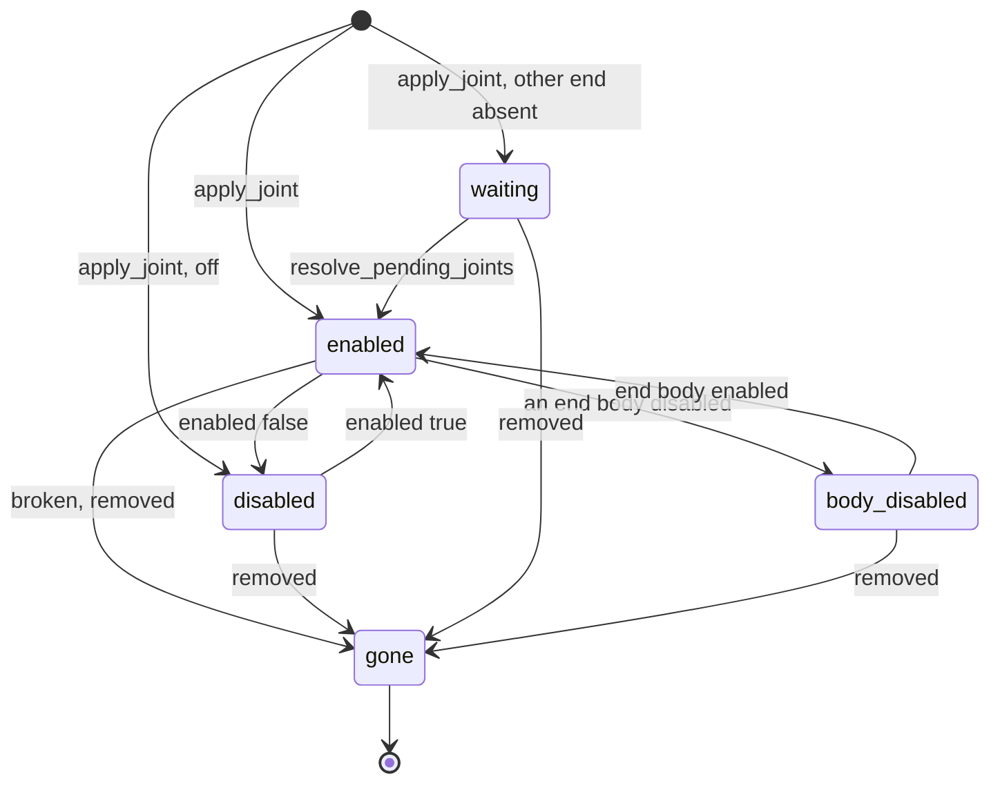

| State | What is true |
|---|---|
| `waiting` | Params held, no rapier joint, `enabled` true: its other end is not in the scene yet. |
| `disabled` | Made and switched off, or no rapier joint at all for an articulation that is off. |
| `enabled` | Solved. |
| `body_disabled` | Made, and a body at either end is disabled. |
| Gone: no row in `joint_params` | `joint_state` errors. |

| From | Trigger | To | What it does |
|---|---|---|---|
| none | `apply_joint`, ends resolve | `enabled` or `disabled` | Makes the joint. `thresholds` refuses break values on an articulation. |
| none | `apply_joint`, ends do not resolve | `waiting` | Keeps the params, with no error. |
| none | `apply_joint`, articulated and off | `disabled` | Keeps the params and makes nothing. |
| `waiting` | `resolve_pending_joints`, each step | `enabled` | `pending` lists it. A failed retry logs at debug. |
| `enabled`, `disabled` | Component write changing only `enabled`, `toggled_in_place` | as asked | Switches it where it stands. |
| any | Component write changing more | as the new params say | `apply_joint` removes the joint first and makes it again. |
| `enabled` | A body at an end disabled, rapier | `body_disabled` | Rapier's `JointEnabled::DisabledByAttachedBody`. |
| `body_disabled` | An end body enabled again, rapier | `enabled` | Rapier's `JointEnabled::Enabled`. |
| `enabled` | After a step, reaction over `break_force` or `break_torque`, `broken` | Gone | `break_joints` removes it and announces `joint_break` `#{ a, b, force, torque }`. |
| any | Script `remove_joint`, `joint3d_removed` | Gone | `remove_joint`. No event. |

Starts in `waiting`, `enabled` or `disabled`. Ends in Gone.

Refused or ignored: an articulation never breaks, since `broken` only reads impulse joints. A broken joint has no params, so `pending` does not make it again.

Held by a pause, a `process` mode or a parked scene: no step means no break. `parked_changed` does not touch joints, and the disabled bodies at their ends do the rest.

### Soft body tearing

An edge or a cell of a soft body is whole or torn, and a tear can split the body into pieces that every call then walks together.

Source: `crates/balaur_physics/src/softbody/runtime.rs`, `crates/balaur_physics/src/shared/events.rs` and `crates/balaur_physics/src/shared/softbody.rs`, `tear_edge`, `tear_cell`, `Event::Tear`; rapier's `SoftBody`.

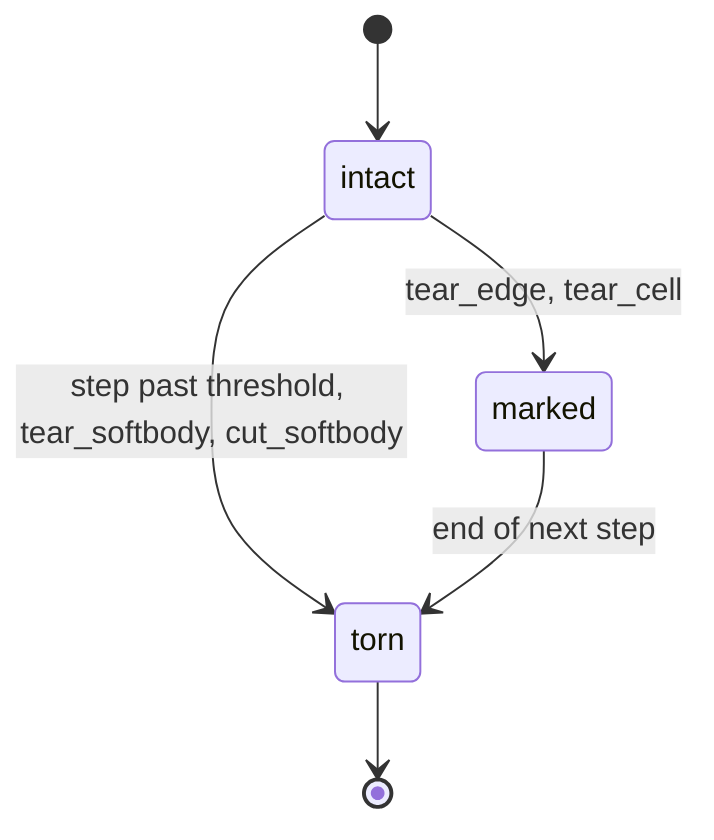

| State | What is true |
|---|---|
| Intact | Carries load. `softbody_stress` reads it from 0 slack to 1 tearing. |
| Marked (script: `has_pending_tears` true) | Tears at the end of the next step. |
| Torn | Gone from the body. A piece it split off counts as the same node, through `stamp_colliders` and `pieces`. |

| From | Trigger | To | What it does |
|---|---|---|---|
| Intact | Rapier's step: load past `tear_force` or `tear_strain`, within `max_tears_per_step` | Torn | `handle_soft_body_tear_event` files `Event::Tear`. After the meshes are written, `dispatch` announces `tear` with the record. |
| Intact | `tear_edge`, `tear_cell` | Marked | No event. |
| Marked | Rapier's step | Torn | Announces `tear` as above. |
| Intact | `tear_softbody`, `cut_softbody` | Torn | Done at once. The records are the call's answer, and no `tear` is announced. |

Starts in Intact. Ends in Torn.

Refused or ignored: who hears does not gate `tear`, because rapier calls the handler on every tear in a step. `set_edge_tear_resistance` and `set_cell_tear_resistance` move the threshold. A `tear_force` and a `tear_strain` of 0 never tear.

Held by a pause, a `process` mode or a parked scene: step tears wait. `tear_softbody` and `cut_softbody` ask nothing and run through a pause.

### Damaged particle

One particle of a soft body can be marked to tear as an outside one does.

Source: `crates/balaur_physics/src/softbody/runtime.rs`, `set_particle_damaged`.

| State | What is true |
|---|---|
| Whole | Tears as its place in the body says. |
| Damaged | Tears as an outside particle does, which seeds a crack. |

| From | Trigger | To | What it does |
|---|---|---|---|
| any | `set_particle_damaged` | as asked | Writes rapier's flag. |

Starts Whole. Ends with the body.

### Character on floor

The world keeps what the last `move_character` said about the ground, so `is_on_floor` need not sweep again.

Source: `crates/balaur_physics/src/lib.rs`, `crates/balaur_physics/src/character.rs` and `crates/balaur_physics/src/dim2/character.rs`, `PhysicsState3d.grounded` and `PhysicsState2d.grounded`.

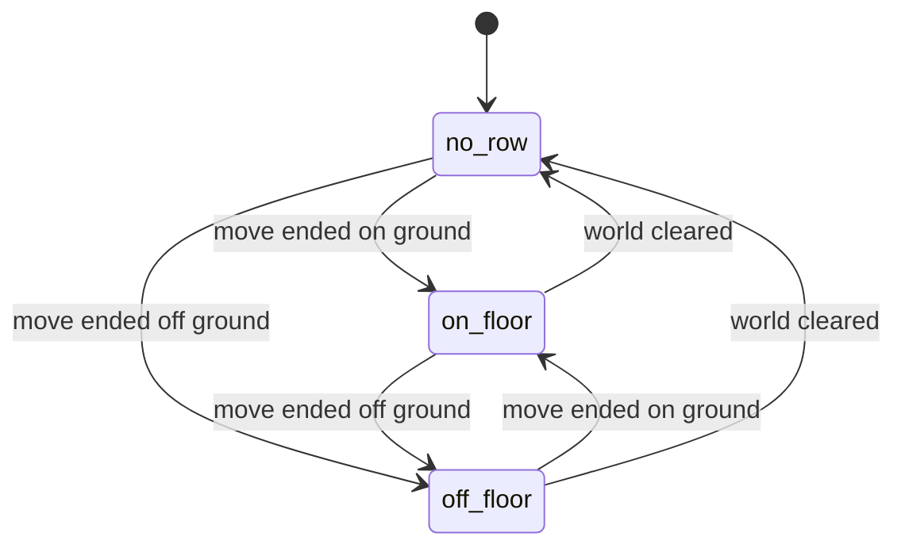

| State | What is true |
|---|---|
| No row (script: `is_on_floor` false) | It has not moved. |
| `grounded=true` (script: `is_on_floor` true, `on_floor` in the move's answer) | The last move ended on ground. |
| `grounded=false` (script: `is_on_floor` false) | The last move did not. |

| From | Trigger | To | What it does |
|---|---|---|---|
| any | `move_character` | as `movement.grounded` says | Writes the row. Between moves the value stays as it was. |
| any | World `clear` | No row | Empties the map. |
| any | Snapshot restore | as captured | Replaces the map. |
| any | The node freed, prune in `step_system` | gone | Drops the row. |

Starts in No row. Ends when the row is dropped.

Held by a pause, a `process` mode or a parked scene: `move_character` asks nothing, so a call through a pause still sweeps and writes. A held script makes no call from `fixed_update`.

### Wheel in contact

A `wheel3d` node's input row keeps whether its ray touched the ground on the last vehicle update.

Source: `crates/balaur_physics/src/vehicle.rs`, `grounded` in the wheel's input, read as `in_contact`.

| State | What is true |
|---|---|
| `grounded=false` (script: `in_contact` false) | The ray hit nothing, or no update ran yet. |
| `grounded=true` (script: `in_contact` true) | The ray hit ground. |

| From | Trigger | To | What it does |
|---|---|---|---|
| any | The vehicle update | as `raycast_info().is_in_contact` says | Writes it with the wheel's `rotation` and `suspension_force`. |

Starts false. Ends with the wheel's row.

### Collision touch

Rapier keeps whether two colliders that asked for events touch. The engine only hears the changes.

Source: `crates/balaur_physics/src/shared/events.rs`, `Event::Started` and `Event::Stopped`; `PhysicsState3d.gone` for colliders removed.

| State | What is true |
|---|---|
| Apart | No contact has been reported, or the last report was a stop. |
| Touching | The last report was a start. Both sides have heard it. |

| From | Trigger | To | What it does |
|---|---|---|---|
| Apart | `handle_collision_event`, started | Touching | Announces `collision_enter` `#{ other, sensor, removed, points, normals }` to each side's collider node, then its body. |
| Touching | `handle_collision_event`, stopped | Apart | Announces `collision_exit` `#{ other, sensor, removed }` the same way. |
| Touching | The collider removed, `remove_colliders` | Apart, on the next step | `gone` names its owner so the stop can still be told, with `removed` true. |
| Touching | The collider disabled, or its body, rapier | Apart, on the next step | Rapier treats it as removed, so the stop carries `removed` true. A parked side hears nothing. |
| Touching | `handle_contact_force_event`, force over `contact_force_threshold` | Touching | Announces `contact_force` `#{ other, force, direction, total_force, max_force, started }`. `started` says the force just rose past the threshold. |

Starts in Apart. Ends when either collider is gone.

Refused or ignored: a collider reports only what its node or its body's node hears (`follow_hearers`). Events are sorted by `Event::key`, then delivered after the step.

Held by a pause, a `process` mode or a parked scene: no step means no events.

### Query freshness

Each world holds whether its broad phase already describes the colliders, so a query need not rebuild it.

Source: `crates/balaur_physics/src/shared/query.rs`, `PhysicsState3d.queries_ready` and `PhysicsState2d.queries_ready`.

| State | What is true |
|---|---|
| `queries_ready=true` | A query reads the tree as it is. |
| `queries_ready=false` | The next query rebuilds it first, through `ensure_queries`. |

| From | Trigger | To | What it does |
|---|---|---|---|
| any | `step_system`, `ensure_queries` | `true` | The step rebuilds the broad phase itself. |
| `true` | A collider made or removed, `parked_changed`, a teleport, a move with no body, a voxel cell set | `false` | Written where each change lands. |

Starts false. Never ends.

## Input

Everything here runs in `Stage::First`, which a pause and a freeze do not stop. Nothing in this crate asks about a pause or a `process` mode, except that touch controls skip a parked node.

### Input frame begun

`InputSnapshot` holds whether a windowed backend already began this frame.

Source: `crates/balaur_input/src/lib.rs`, `InputSnapshot.begun`.

| State | What is true |
|---|---|
| `begun=false` | The tick begins the frame itself. |
| `begun=true` | A backend pumped this frame's events, and the tick must not clear them. |

| From | Trigger | To | What it does |
|---|---|---|---|
| any | `begin_frame` | `true` | Clears the edges and delivers what `input.feed_*` held. |
| `true` | `begin_frame_unless_begun` | `false` | Leaves the backend's frame alone. |
| `false` | `begin_frame_unless_begun` | `false` | Begins a frame for a headless run. |

Starts false. Never ends.

### Key or mouse button

`InputSnapshot` holds each key and each of eight mouse buttons. The state is derived from which sets name it.

Source: `crates/balaur_input/src/lib.rs`, `InputSnapshot.down`, `just_pressed` and `just_released`, and the `mouse_*` arrays.

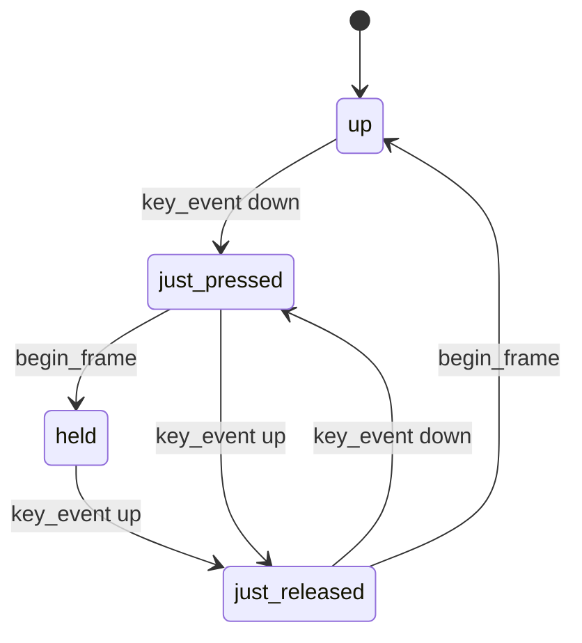

| State | What is true |
|---|---|
| Up | In no set. |
| Just pressed: in `down` and `just_pressed` (script: `key_just_pressed`, `mouse_just_pressed`, and `key_down`) | Went down this frame. |
| Held: in `down` only (script: `key_down`, `mouse_down`) | Down since an earlier frame. |
| Just released: in `just_released` (script: `key_just_released`, `mouse_just_released`) | Came up this frame. A tap within one frame is in `just_pressed` too. |

| From | Trigger | To | What it does |
|---|---|---|---|
| Up, Just released | `key_event` or `mouse_button_event`, pressed | Just pressed | Adds to `down` and `just_pressed`. |
| Just pressed, Held | `key_event` or `mouse_button_event`, released | Just released | Removes from `down` and adds to `just_released`. |
| Just pressed, Held | the window loses focus | Just released | kiss3d sends a release for each key and button it holds, since no platform but Windows and X11 sends one after the release happens elsewhere. |
| Just pressed | `begin_frame` | Held | Clears the edge. |
| Just released | `begin_frame` | Up | Clears the edge. |

Starts in Up. Never ends.

Refused or ignored: a press on a key already down and a release on one already up do nothing. A button past the eighth is ignored.

### Pointer placed

`InputSnapshot` holds where the mouse is as far as the window knows, so a position that arrives from outside moves nothing and nothing is under a mouse that left.

Source: `crates/balaur_input/src/lib.rs`, `InputSnapshot.mouse_place`.

| State | What is true |
|---|---|
| `Unplaced` | No position yet. The next one places the mouse and leaves `mouse_delta` alone. |
| `Placed` | A position adds its move from the last one to `mouse_delta`. |
| `Outside` (script: no node is under it) | Left the window. `interact` treats it as over nothing, so the node it was over hears `pointer_exit`. |
| `Held` | A grab holds the cursor. A position moves nothing; the delta is the raw motion. |

| From | Trigger | To | What it does |
|---|---|---|---|
| any | `set_mouse_pos` | `Placed` | Sets `mouse_pos`, and adds to `mouse_delta` only from `Placed`. |
| any | `mouse_exited`, from kiss3d's `CursorEnter(false)` | `Outside` | Keeps `mouse_pos`. |
| any | `hold_mouse(true)`, each frame kiss3d says a grab holds the cursor | `Held` | Positions stop counting toward `mouse_delta`. |
| `Held` | `hold_mouse(false)` | `Unplaced` | The jump to wherever the cursor is released is not a move. |
| `Held` | `add_mouse_motion`, from kiss3d's `MouseMotion` | `Held` | Adds to `mouse_delta` and leaves `mouse_pos`. |

Starts `Unplaced`. Recorded, and `Unplaced` in a session recorded before it existed.

### Finger

`InputSnapshot` holds each finger on the screen. The state is derived from three lists. `TouchPhase` is what a report says happened.

Source: `crates/balaur_input/src/lib.rs`, `InputSnapshot.touches`, `touches_started` and `touches_ended`.

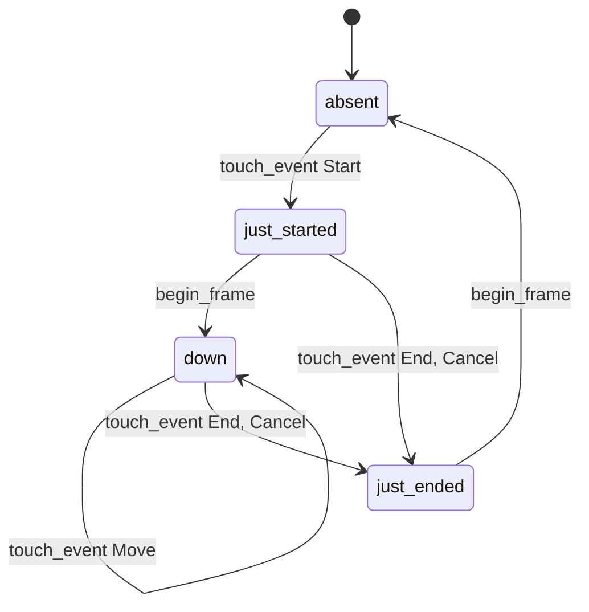

| State | What is true |
|---|---|
| Absent | In no list. |
| Just started: in `touches` and `touches_started` (script: `touches`, `touches_just_started`) | Landed this frame. |
| Down: in `touches` only (script: `touches`) | Active. Its place follows Move reports. |
| Just ended: in `touches_ended` (script: `touches_just_ended`) | Lifted or canceled this frame. |

| From | Trigger | To | What it does |
|---|---|---|---|
| Absent | `touch_event`, `Start` | Just started | Appends it, so `touches` runs oldest first. |
| Just started, Down | `touch_event`, `Move` | same | Updates its place. |
| Just started, Down | `touch_event`, `End` or `Cancel` | Just ended | Removes it from `touches`. |
| Just started | `begin_frame` | Down | Clears the list. |
| Just ended | `begin_frame` | Absent | Clears the list. |

Starts in Absent. Never ends.

Refused or ignored: `Start` on a finger already down and `Move` on an unknown one do nothing. `End` on an unknown one still lands in `touches_ended`. `input.feed_touch` lands on the next frame.

### Emulated pointer

`InputSnapshot` holds which finger the mouse is following.

Source: `crates/balaur_input/src/lib.rs`, `Emulation.primary`.

| State | What is true |
|---|---|
| `primary=None` | No finger drives the cursor. |
| `primary=Some(id)` | This finger is mouse button 0. A second finger is a touch and nothing else. |

| From | Trigger | To | What it does |
|---|---|---|---|
| `None` | `mouse_from_touch`, a finger started | `Some` | Places the cursor, then presses button 0. |
| `Some` | `mouse_from_touch`, that finger ended | `None` | Releases button 0. |

Starts in `None`. Never ends.

Refused or ignored: `touch_from_mouse` reports nothing while `primary` is set. `convert_pointer_and_touch` does not run on a replay. `mouse_from_touch` runs only with `emulate_mouse_from_touch` on.

### Action

`InputActions` holds each named action's value this frame and last. The state is derived from the size of those two against a threshold of 0.5.

Source: `crates/balaur_input/src/actions.rs`, `ActionState.value` and `ActionState.previous`.

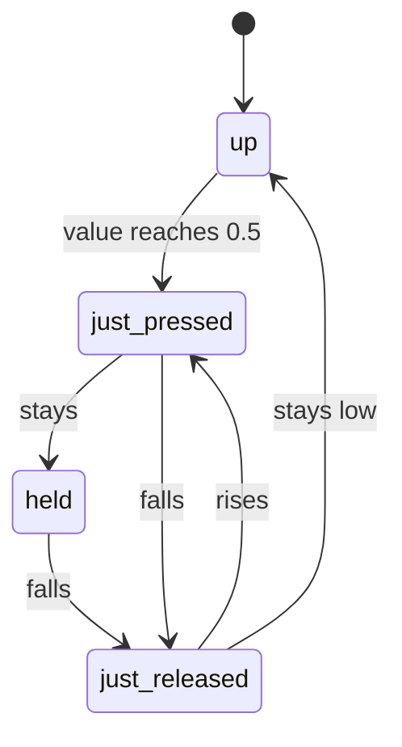

| State | What is true |
|---|---|
| Up: both below 0.5 | `action_down` false. |
| Just pressed: `value` at 0.5 or more, `previous` below (script: `action_just_pressed`, `action_down`) | Went down this frame. |
| Held: both at 0.5 or more (script: `action_down`) | Down since an earlier frame. |
| Just released: `value` below, `previous` at 0.5 or more (script: `action_just_released`) | Came up this frame. |

| From | Trigger | To | What it does |
|---|---|---|---|
| any | `tick`, each frame | per the table | `previous` takes `value`. `value` takes the binding or fed source furthest from rest, then `fed` empties. |
| any | `feed`, script `feed_action`, a touch control | next `tick` | A source for one frame. The furthest from rest wins. |
| any | `restore_bindings` for a replay | Up | Clears `state`. |

Starts in Up. Never ends.

Refused or ignored: a key or chord binding reads 0 while `keyboard_taken` is set. A press and release in one frame reads as pressed. An action nothing declared reads 0 and warns once.

### Gamepad connection

`GamepadState` holds one `Live` per connected pad and rebuilds a `Pad` snapshot from it each frame.

Source: `crates/balaur_input/src/gamepad.rs`, `GamepadState.live` and `GamepadState.pads`.

| State | What is true |
|---|---|
| Absent | Not in `live`. Queries answer neutrally. |
| Connected (script: in `gamepads`) | In `live`, ordered by id, with its identity, pressures, sticks and power. |

| From | Trigger | To | What it does |
|---|---|---|---|
| any | `apply_one`, `PadEvent::Connected` | Connected | Starts a fresh `Live`, all zero. Next frame `announce_pads_system` tells every script `on_gamepad_connected`, a held one too. |
| Connected | `apply_one`, `PadEvent::Disconnected` | Absent | Drops the `Live`. `announce_pads_system` tells every script `on_gamepad_disconnected`. |
| any | Script `feed_gamepad` | next `poll` | Feeds events. Anything fed connects a pad, and `connected: false` unplugs it. |
| any | Replay `restore` | as recorded | Replaces `pads`. |

Starts Absent. Ends when the pad goes.

Refused or ignored: an event for an unknown id is dropped. `poll` does not run on a replay or a re-simulated tick.

### Gamepad button

One `Live` holds each button's pressure, whether it is down, and how long it has been held.

Source: `crates/balaur_input/src/gamepad.rs`, `Live.down`, `Live.held`, and `Pad.just_pressed`, `just_released` and `repeated`.

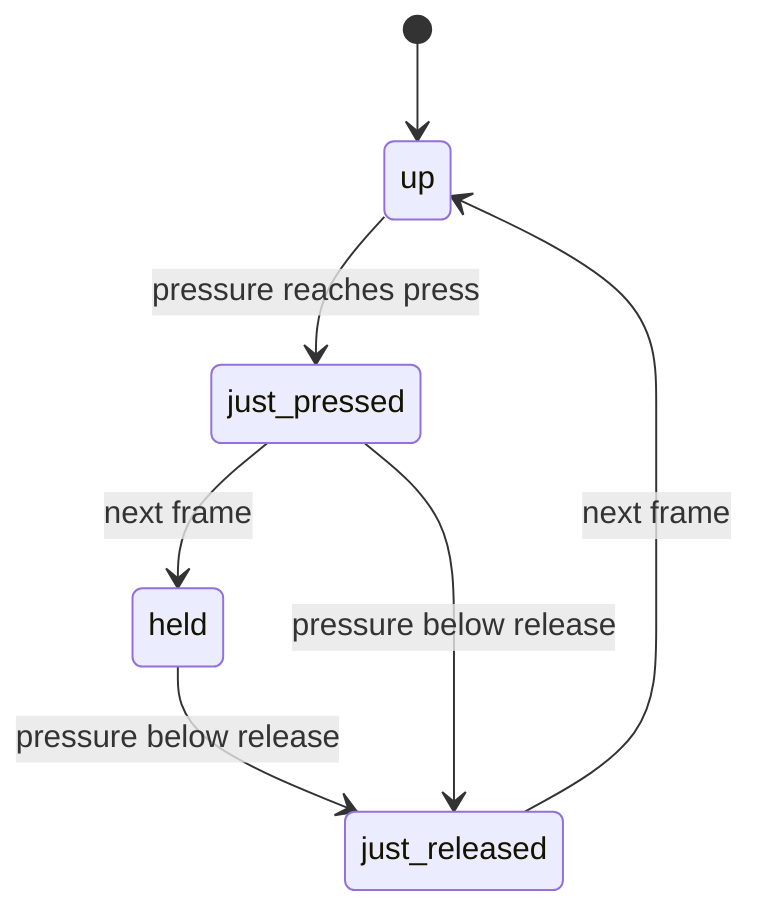

| State | What is true |
|---|---|
| Up | Below `settings.press` since the last release. |
| Just pressed (script: `gamepad_just_pressed`, `gamepad_repeated`, `gamepad_down`) | Rose past `settings.press` in this frame's events. |
| Held (script: `gamepad_down`) | Down. `gamepad_repeated` is true at `repeat_delay`, then each `repeat_interval`. |
| Just released (script: `gamepad_just_released`) | Fell below `settings.release` in this frame's events. |

| From | Trigger | To | What it does |
|---|---|---|---|
| Up, Just released | `apply_one`, `PadEvent::Button` at `settings.press` or more | Just pressed | Sets `down`, zeroes `held`, pushes an edge. |
| Just pressed, Held | `apply_one`, `PadEvent::Button` below `settings.release` | Just released | Clears `down`, pushes an edge. |
| Just pressed | `shape`, next frame's snapshot | Held | Edges come from the events alone. |
| Just released | `shape`, next frame's snapshot | Up | Same. |

Starts in Up. Ends when the pad goes.

Refused or ignored: a pressure between `release` and `press` changes nothing but `pressure`.

### Gamepad power

One `Live` holds what powers the pad.

Source: `crates/balaur_input/src/gamepad.rs`, `PowerState` and `Power`.

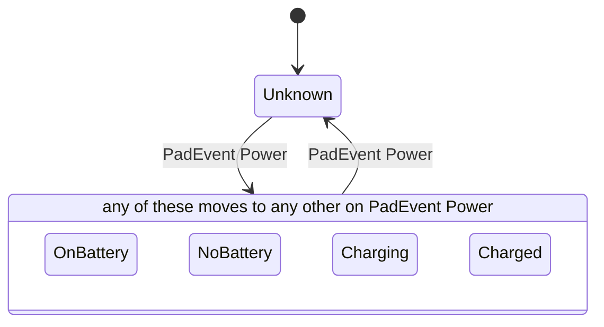

| State | What is true |
|---|---|
| `Unknown` (script: `unknown`) | `level` is -1. gilrs reports `Unknown`. |
| `OnBattery` (script: `on_battery`) | `level` is 0 to 1. gilrs reports `Discharging`. |
| `NoBattery` (script: `no_battery`) | `level` is -1. gilrs reports `Wired`. |
| `Charging` (script: `charging`) | `level` is 0 to 1. gilrs reports `Charging`. |
| `Charged` (script: `charged`) | `level` is 1. gilrs reports `Charged`. |

| From | Trigger | To | What it does |
|---|---|---|---|
| any | `apply_one`, `PadEvent::Power` | as reported | Writes `Live.power`. No event; script `gamepad_power` reads it. |
| any | `read_power`, whenever a pad sends anything | as `power_of` maps it | The gamepad thread forwards a change only. |
| any | Script `feed_gamepad` with `power` | as fed | From the next frame. |
| any | Replay `restore` | as recorded | From `PadFrame.power`. |

Starts in `Unknown`. Ends when the pad goes.

### Gamepad slot

The process's gamepad hub holds player slots, so a pad pulled out and put back is the same player.

Source: `crates/balaur_input/src/pad_thread.rs`, `Inner.slots` and `Slot.key`.

| State | What is true |
|---|---|
| `key=None` | Free. `guid` remembers the model that last held it. |
| `key=Some(k)` | Backend key `k` holds it. Events reach engines under the slot's index. |

| From | Trigger | To | What it does |
|---|---|---|---|
| free | `assign`, `PadEvent::Connected` | held | The lowest free slot of the same model, else the lowest free, else a new one. |
| held | `file`, `PadEvent::Disconnected` | free | Drops the pad's `Current` and its motors. |

Starts with no slots. Never ends.

### Gamepad thread

One thread per process reads pads and files batches in the hub.

Source: `crates/balaur_input/src/pad_thread.rs`, `run` and `GilrsBackend.opened`.

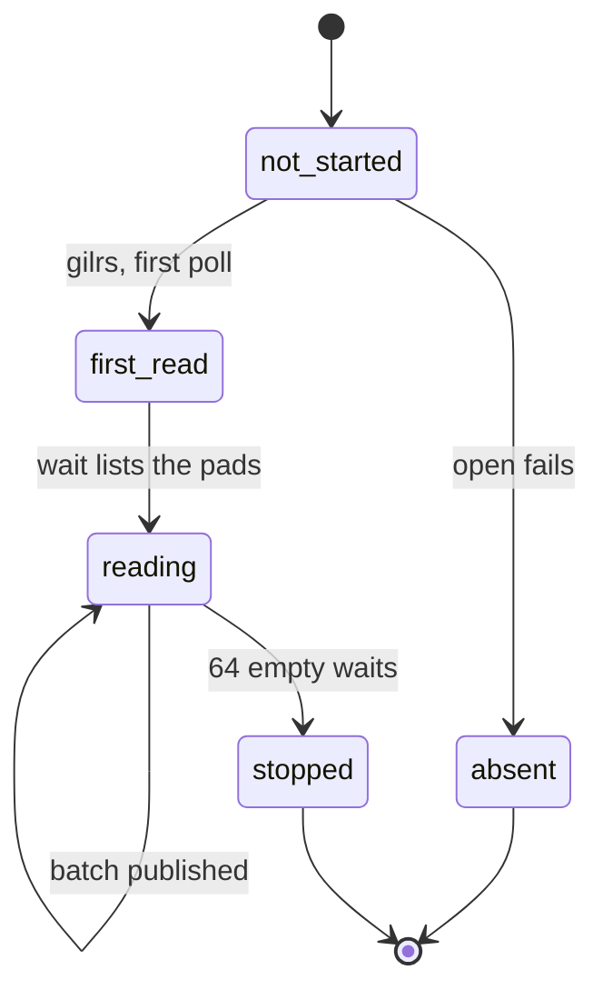

| State | What is true |
|---|---|
| Not started: `OPENED` empty | No poll has asked for pads. |
| Absent: `open` answered `None` | No platform backend, as on mobile. The hub stays empty. |
| First read: `opened=false` | The next `wait` connects every pad already there. |
| Reading: `opened=true` | `wait` blocks until a pad changes. |
| Stopped: `STOPPED_AFTER` empty waits in a row | `release_all` disconnects every pad. The loop has ended. |

| From | Trigger | To | What it does |
|---|---|---|---|
| Not started | `gilrs`, from the first `poll` | First read | Spawns `balaur-gamepads`, with the first engine's mappings. |
| Not started | `GilrsBackend::open` fails | Absent | Warns, except where the platform has no backend. |
| First read | `wait` | Reading | Connects each pad and reads power. |
| Reading | `wait` with changes | Reading | `publish` files them and wakes the loop. |
| Reading | `run`, too many empty waits | Stopped | Warns `gamepads stopped`. |

Starts in Not started. Ends in Absent or Stopped.

Refused or ignored: a browser build has no such thread and reads no pads.

### Touch button

A `touch_button` component's `TouchButton` holds which finger presses it.

Source: `crates/balaur_input/src/touch_controls.rs`, `TouchButton.finger` and `TouchButton.pressed`.

| State | What is true |
|---|---|
| `finger=None`, `pressed=false` | Feeds nothing. This is also what a control with no area or not live on this platform is forced to. |
| `finger=Some(id)`, `pressed=true` | Feeds `action` 1.0 every frame. |

| From | Trigger | To | What it does |
|---|---|---|---|
| `None` | `press`, a finger inside the hit box | `Some` | The first finger found takes it. |
| `Some` | `press`, that finger ended or left `touches` | `None` | Sliding off the box keeps it. |
| any | `press`, no area or `visibility` not live | `None` | Takes no fingers. |
| any | `button_written` | `None` | Builds it anew. |

Starts in `None`. Ends when the component is removed.

Held by a pause, a `process` mode or a parked scene: `tick` skips a parked button, so it keeps its state and feeds nothing. A pause and a mode are not asked.

### Touch stick

A `touch_stick` component's `TouchStick` holds which thumb pushes it.

Source: `crates/balaur_input/src/touch_controls.rs`, `TouchStick.finger`, `center`, `knob` and `value`.

| State | What is true |
|---|---|
| `finger=None` | `value` is zero and nothing is fed. `center` is its anchored home. |
| `finger=Some(id)` | Feeds `action_x` and `action_y` from the knob's place, past `deadzone`. |

| From | Trigger | To | What it does |
|---|---|---|---|
| `None` | `push`, a finger within the throw of home | `Some` | With `recenter`, `center` moves under the thumb. |
| `Some` | `push`, that finger ended or left `touches` | `None` | The knob returns to `center` and `value` zeroes. |
| any | `push`, no area or `visibility` not live | `None` | Zeroes `value`. `center` and `knob` stay. |
| any | `stick_written` | `None` | Builds it anew at rest. |

Starts in `None`. Ends when the component is removed.

Held by a pause, a `process` mode or a parked scene: `tick` skips a parked stick. A pause and a mode are not asked.

### Finger gesture

`Gestures` keeps one `Span` per finger on the screen. It is rebuilt from the recorded touches, and is never recorded itself.

Source: `crates/balaur_input/src/gestures.rs`, `Span.announced`.

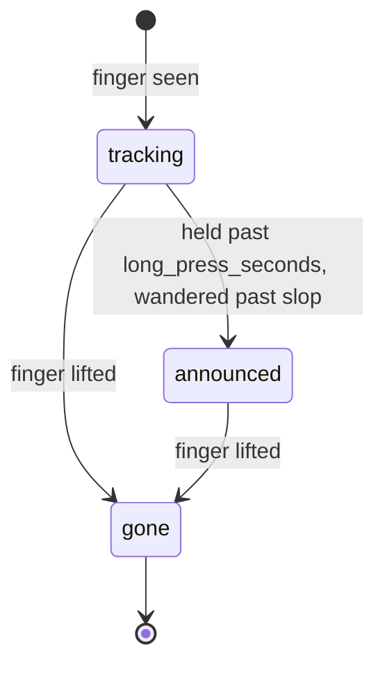

| State | What is true |
|---|---|
| Tracking: `announced=false` | It can still become a long press. |
| Announced: `announced=true` | It reported its long press, or it wandered too far to make one. |
| Gone: no `Span` | The finger lifted. |

| From | Trigger | To | What it does |
|---|---|---|---|
| none | `tick`, a finger with no span | Tracking | Records where it landed. |
| Tracking | `tick`, `held` reaches `long_press_seconds` within slop | Announced | Sets `long_press` for this frame. |
| Tracking | `tick`, moved past `long_press_slop_pixels` | Announced | Reports nothing. |
| any | `tick`, the finger in `touches_just_ended` | Gone | Sets `swipe` when it travelled `swipe_pixels` and no swipe was set this frame. |

Starts in Tracking. Ends in Gone.

Refused or ignored: `tick` does not run on a re-simulated tick.

### Rumble

`GamepadState.rumble` holds one playing rumble per pad. The phase is derived from `elapsed` and its `Spec`.

Source: `crates/balaur_input/src/rumble.rs`, `Playing` and `Spec`.

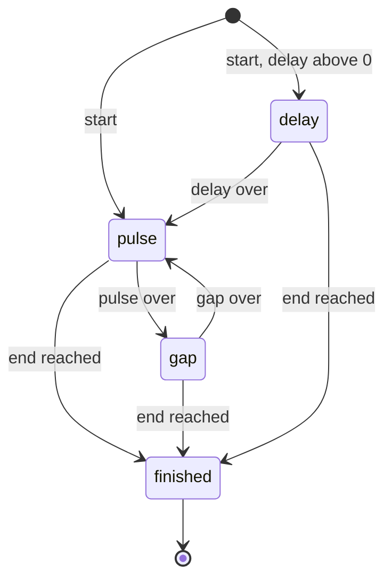

| State | What is true |
|---|---|
| Delay: `t < delay` | Motors at zero. |
| Pulse: inside a window | Levels follow the envelope and, when placed, the distance to the listener. |
| Gap: `pulse` set, between windows | Motors at zero. |
| Finished: `t >= delay + duration` | Removed. |

| From | Trigger | To | What it does |
|---|---|---|---|
| none | `start`, script `gamepad_rumble` | Delay or Pulse | Replaces the pad's rumble. |
| any | `step` in `rumble_system` | per `elapsed` | Sends levels only when they moved, and owes a wake at the next change. |
| any | `step`, past the end | Finished | Holds motors at 0 and tells every script `on_gamepad_rumble_finished`. |
| any | `stop`, script `gamepad_stop_rumble` | gone | No finish. |
| any | `forget_all_but`, the pad gone | gone | Quiet. |

Starts in Delay or Pulse. Ends in Finished or gone.

Refused or ignored: lengths are capped at 60 seconds. `rumble_system` does not run on a re-simulated tick.

### Input method text

`InputSnapshot` holds the text an input method is still composing, for a script to read.

Source: `crates/balaur_input/src/lib.rs`, `InputSnapshot.composing`.

| State | What is true |
|---|---|
| `composing=""` | Nothing in progress. |
| `composing` holds text | It outlives the frame until the editor commits or lets go. |

| From | Trigger | To | What it does |
|---|---|---|---|
| any | `pump_input`, `ImeEvent::Preedit` | holds text | `set_composing`. |
| any | `pump_input`, `ImeEvent::Commit` | `""` | Feeds the committed text through `char_event`, into one frame's `typed`. |
| any | `pump_input`, `ImeEvent::Enabled` or `Disabled` | `""` | `set_composing`. |

Starts in `""`. Never ends.

### Keyboard taken

`InputSnapshot` holds whether a text field held the keyboard when the last UI pass ended.

Source: `crates/balaur_input/src/lib.rs`, `InputSnapshot.keyboard_taken`.

| State | What is true |
|---|---|
| `keyboard_taken=false` | Key and chord bindings read as usual. |
| `keyboard_taken=true` | Key and chord bindings read 0. It is recorded, so a replay derives the same actions. |

| From | Trigger | To | What it does |
|---|---|---|---|
| any | `pump_input`, each frame | as `is_egui_capturing_keyboard` says | `set_keyboard_taken`. |

Starts false. Never ends.

## UI

The draw only reports what it saw, and `apply_system` writes it in the next tick, in `Stage::First`. No system here asks about a pause or a `process` mode, so a held script's `on_click` and `on_change` still run through `call_on`. A parked node reads hidden and is not drawn.

### Widget input buffer

The `WidgetInputBuffer` resource holds what the draw reported and no tick has taken.

Source: `crates/balaur_ui/src/widget/input.rs`, `WidgetInputBuffer`.

| State | What is true |
|---|---|
| `None` | Nothing waits. |
| `Some(WidgetInputSnapshot)` | Clicks, edits and a focus arrival wait for the next tick. |

| From | Trigger | To | What it does |
|---|---|---|---|
| any | `record`, from a draw, `click`, `submit` or `edit` | `Some` | Adds to what waits, so two passes between ticks both count. |
| `Some` | `apply_system` | `None` | Moves it into `WidgetInputSnapshot`, then settles edits, clicks and focus. |

Starts in `None`. Never ends.

Refused or ignored: on a replay or a re-simulated tick `apply_system` keeps the restored snapshot and leaves the buffer.

### UI pass context

A thread-local holds the egui context while a pass runs.

Source: `crates/balaur_ui/src/bridge.rs`, `PASS`.

| State | What is true |
|---|---|
| `None` | A `ui.*` call that needs the frame's input errors with `this ui.* call only answers during a UI pass`. |
| `Some(context)` | That call runs on it. |

| From | Trigger | To | What it does |
|---|---|---|---|
| `None` | `enter_pass` | `Some` | Set by `pass`. |
| `Some` | `leave_pass` | `None` | Set by `pass`. |

Starts in `None`. Never ends.

### Font binding

`UiState` holds whether egui has its fonts.

Source: `crates/balaur_ui/src/lib.rs`, `UiState.fonts_installed`.

| State | What is true |
|---|---|
| `fonts_installed=false` | The next `pass` binds fonts, asks for a rerun and draws the splash alone. |
| `fonts_installed=true` | Widgets draw. A shaper generation that moved loads the faces again. |

| From | Trigger | To | What it does |
|---|---|---|---|
| false | `pass` | true | `load_fonts`, `max_passes` 3 and `request_discard`. |

Starts false. Ends in true.

### Freed node sweep

`UiState` holds the tree's shape when the widget layer last let go of what freed nodes left. Owed or swept is derived from `scene::shape_revision`.

Source: `crates/balaur_ui/src/lib.rs`, `UiState.swept_at` and `sweep_freed`.

| State | What is true |
|---|---|
| Swept: `swept_at` equals `shape_revision` | No node was added, freed, moved or renamed since the last sweep. |
| Owed: `swept_at` differs | The next `pass` sweeps. |

| From | Trigger | To | What it does |
|---|---|---|---|
| Swept | A node added, freed, moved or renamed | Owed | `shape_changed` adds to the revision. |
| Owed | `sweep_freed`, at the start of `pass` | Swept | Drops each `fields` entry whose `Field.owner` is freed. `window::forget_freed` and `code::forget_freed` do the same for `FOLDED` and `CARETS`. |

Starts with `swept_at` at 0. Never ends.

Refused or ignored: a `Field` with `owner=None`, as a `DragNumber` keeps, is never swept. `edit` and `code_editor` set `owner` on each pass.

Held by a pause, a `process` mode or a parked scene: a parked node is alive, so its field, its caret and its fold stay and a return finds them.

### Worn theme

`UiConfig` holds the theme egui's own controls were last dressed in. The theme in force is the one `ui.set_theme` named, else `[ui] theme`, or `theme_dark` on a dark system.

Source: `crates/balaur_ui/src/lib.rs` and `crates/balaur_ui/src/theme.rs`, `UiConfig.worn_theme` and `out_of_date`.

| State | What is true |
|---|---|
| Worn | egui has the theme in force. |
| Out of date | Another is in force. The next `pass` dresses egui in it. Pacing owes a frame for it. |

| From | Trigger | To | What it does |
|---|---|---|---|
| Worn | Script `ui.set_theme`, the project changing, the system going dark | Out of date | Read on the next frame. |
| Out of date | `pass` | Worn | `theme::wear`. |

Starts Worn, in the built-in look. Never ends.

### Pointer on a widget

The draw works out where the pointer is for each widget, and `WidgetState` carries the answer to the theme.

Source: `crates/balaur_ui/src/widget/theme.rs` and `crates/balaur_ui/src/widget/layer.rs`, `Pointer`, `Pointer::of` and `pointer_state`.

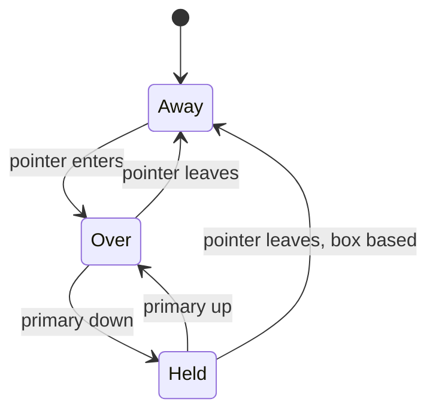

| State | What is true |
|---|---|
| `Away` | The pointer is not on it. A disabled widget is always here on the box path. |
| `Over` (theme table `hover`) | The pointer is on it with no primary button held. |
| `Held` (theme table `active`, else `hover`) | The primary button is down on it. |

| From | Trigger | To | What it does |
|---|---|---|---|
| any | `draw_themed`, each pass: `pointer_state` reads the widget's box | per the box | Every kind gets this. `Held` is any primary button down while over the box. |
| any | `Pointer::of` on the kind's own response | per the response | A `button` and a `fold` header use it. `Held` lasts until the button comes up, wherever the pointer is. |
| Away | `pointer_edits`, widget newly in `under` | Over | Next tick announces `pointer_enter`. |
| Over, Held | `pointer_edits`, widget gone from `under` | Away | Next tick announces `pointer_exit`. |
| any | `pointer_edits`, a button pressed, released or double-clicked over the innermost widget | same | Next tick announces `pointer_down` or `pointer_up` with `left`, `right` or `middle`, or emits `double_click`. |

Starts in `Away`. Never ends.

### Widget look state

Each draw picks the theme tables a widget wears. There is no variable: it is derived from `WidgetState` and read by `Style::in_states`.

Source: `crates/balaur_ui/src/widget/theme.rs`, `WidgetState`, `Style.hover`, `Style.active`, `Style.disabled`, `Style.focus` and `Style.checked`.

```mermaid
stateDiagram-v2
    [*] --> base
    base --> hover: pointer over
    hover --> active: primary down
    active --> hover: primary up
    hover --> base: pointer away
    base --> focus: focus arrives
    focus --> base: focus leaves
    focus --> hover: pointer over
    hover --> focus: pointer away while focused
    base --> disabled: enabled false
    disabled --> base: enabled true
```

| State | What is true |
|---|---|
| Base | No table applies. |
| `hover` | Pointer `Over`, and not disabled. |
| `active` | Pointer `Held`, and not disabled. With no such table, `hover` applies. |
| `focus` | Focus is on it and the pointer is `Away`. |
| `disabled` | The property `enabled` is false. It beats every other table. |
| `checked` | Layered under the rest while `checked` is set, or a fold is `open`. With no such table a checked widget wears the held look. Its own `hover` and `active` win over the entry's. |

| From | Trigger | To | What it does |
|---|---|---|---|
| any | `draw_themed`, each pass | per `in_states` | Sets `at.state`, then `Painting::look` and `style_of` read it. |

Starts in Base. Never ends.

Refused or ignored: a state table changes paint only. Layout is solved before anything knows where the pointer is, so a size in a `checked` table is dropped by `paint_only`.

### Widget disabled

A widget's `Widget.disabled` follows the property `enabled`.

Source: `crates/balaur_ui/src/widget/schema.rs` and `crates/balaur_ui/src/widget/node.rs`, `Widget.disabled`.

| State | What is true |
|---|---|
| `disabled=false` (`enabled=true`) | Answers input. |
| `disabled=true` (`enabled=false`) | `ui.disable()` runs, the pointer reads `Away` and the click sensor is off. It is no focus stop. Its tooltip still shows. |

| From | Trigger | To | What it does |
|---|---|---|---|
| any | A write of `enabled` | as asked | Written through `follow`. |

Starts as authored, enabled by default. Ends when the component is removed.

Refused or ignored: `click`, `submit`, `edit`, a `shortcut` and `takes_focus` refuse a disabled widget.

### Widget checked

A check, a switch or a `toggle` button holds whether it is on.

Source: `crates/balaur_ui/src/widget/input.rs` and `crates/balaur_ui/src/widget/properties.rs`, `WidgetProperties.checked`, `settle_clicks` and `flips`.

| State | What is true |
|---|---|
| `checked=false` | Clear. |
| `checked=true` | Ticked, or a button held down. |

| From | Trigger | To | What it does |
|---|---|---|---|
| any | A scene or script write | as written | No event. |
| any | `settle_clicks`, a click or an accept, no `radio_group` | flipped | Emits `change` with the new value and calls `on_change`. |
| any | `settle_clicks`, a click or an accept, in a `radio_group` | `true` | Unticks the rest of its group, each emitting `change` false. A second click changes nothing. |

Starts as authored. Ends when the component is removed.

### Widget clicked and submitted

`WidgetProperties` holds two flags that are true for one tick.

Source: `crates/balaur_ui/src/widget/input.rs`, `WidgetProperties.clicked`, `WidgetProperties.submitted` and `settle_clicks`.

| State | What is true |
|---|---|
| `false` | Not hit this tick. |
| `clicked=true` | A pointer, an accept, a shortcut or `ui.click` hit it this tick. |
| `submitted=true` | A field was submitted this tick. |

| From | Trigger | To | What it does |
|---|---|---|---|
| any | `settle_clicks`, every widget every tick | per this tick's hits | A click runs the node's `pointer_click` rows, emits `click` and calls `on_click`. A submit emits `submit` and calls `on_submit`. |

Starts false. Never ends.

### Widget visible

The pass works out whether a widget draws, from what it was authored with, its size lines and its node's inherited appearance.

Source: `crates/balaur_ui/src/widget/arena.rs`, `shown_by_tree` and `Placed.authored_visible`.

| State | What is true |
|---|---|
| Shown: `Widget.visible=true` | Drawn. It can take focus and clicks. |
| Hidden: `Widget.visible=false` | Draws nothing and takes no clicks. Its state stays. |

| From | Trigger | To | What it does |
|---|---|---|---|
| any | `shown_by_tree`, when appearance moved, the surface resized or the slot was written | authored, in its `hide_*` lines, and node shown | Folds them into `visible`. |

Starts as authored. Ends when the component is removed.

Held by a pause, a `process` mode or a parked scene: a parked node's global appearance reads hidden, so it hides. A pause and a mode are not asked.

### Focus

The `UiFocus` resource holds the one widget the keyboard and the pad point at.

Source: `crates/balaur_ui/src/widget/node.rs` and `crates/balaur_ui/src/widget/focus.rs`, `UiFocus.focused`.

| State | What is true |
|---|---|
| `focused=None` (script: `focused_widget` nil) | Nothing has focus. |
| `focused=Some(entity)` (script: `focused_widget` names it) | Accept activates it. A ring or the `focus` table shows it. |

| From | Trigger | To | What it does |
|---|---|---|---|
| any | Script `set_focus` | `Some` | Sets `taking`. A field takes the caret next pass and selects what it holds. A node that cannot take focus falls out at the next draw. |
| any | Tab, Shift+Tab, `Move::Next`, `Move::Previous` | next or previous stop | `advance` walks the stops in scene order and wraps. |
| any | An arrow, `Move::Up`, `Down`, `Left`, `Right` | a stop on that side | The named neighbor, else `toward`, else `around`. From nothing: last for up and left, first for down and right. |
| `Some` | Enter, Space, `Move::Accept` | same | `advance` hands it to `clicked`, and a fold flips through `turned_fold`. |
| `Some` | The widget stops being a stop: hidden, disabled, freed or unfocusable | `None` | Next tick it emits `blur`. |
| any | `Move::Leave`, script `clear_focus` | `None` | Next tick it emits `blur`. |
| any | A click into a field, `gained_focus` | `Some` | `edit` writes it. |
| `Some` | A field left by Escape or a click away, `left` | `None` | A click away emits `submit`, then `blur`. Escape emits `blur` only. |
| `Some` | A field's submit chord, `left` | same | Emits `submit`. |
| any | `focus_moved` sees an arrival | same | `announce_focus` emits `focus` and calls `on_focus` in the next tick. |

Starts in `None`. Never ends.

Refused or ignored: the keys move focus only while `WidgetLayerConfig.keyboard` is on and egui does not want the keyboard. A click on a button does not move focus.

### Focus request flags

`UiFocus` holds three one-shot flags beside the focused widget.

Source: `crates/balaur_ui/src/widget/node.rs`, `UiFocus.pending`, `UiFocus.taking` and `UiFocus.arrived`.

| State | What is true |
|---|---|
| All clear | Focus rests where it is. |
| `pending=Some(move)` | A script asked for a `Move`, taken by the next `advance` ahead of the keys. |
| `taking=true` | Focus was put here by `set_focus`. |
| `arrived=true` | A key, a pad or a script moved focus this pass, so the scroll holding it brings it into view. |

| From | Trigger | To | What it does |
|---|---|---|---|
| clear | Script `focus_next`, `focus_previous`, `activate_focused`, `focus_up`, `focus_down`, `focus_left`, `focus_right`, `clear_focus` | `pending` set | Taken by `advance`. |
| clear | Script `set_focus` | `taking` set | Taken by `focus_before`. |
| clear | `advance` moves focus | `arrived` set | Taken by `focus_before`. |

Starts all clear. Never ends.

### Text field composition

A text field's `Editing` holds what an input method is composing.

Source: `crates/balaur_text/src/edit.rs`, `Editing.composing`, kept in `UiState.fields` through `crates/balaur_ui/src/widget/typing.rs` (`Field`).

| State | What is true |
|---|---|
| `composing=None` | The caret blinks. Motions follow the drawing. |
| `composing=Some(text)` | The text shows in place, underlined. The caret does not blink. Motions move by what is stored. |

| From | Trigger | To | What it does |
|---|---|---|---|
| any | `compose`, `ImeEvent::Preedit` | `Some`, or `None` for empty text | `Editing::compose`. No edit is reported. |
| `Some` | `compose`, `ImeEvent::Commit` | `None` | `Editing::commit` inserts what `admit` lets through, so the field reports `Edit::Text`, which emits `change`. |
| `Some` | `compose`, a commit `admit` empties | `None` | Reports nothing. |
| any | `set_text`, a script's write of other text | `None` | `Field::refill` calls it. Undo clears too. |

Starts in `None`. Ends with the field, which `sweep_freed` drops once its `Field.owner` is freed.

### Undo step join

`Editing` holds whether the next typed character joins the last undo step.

Source: `crates/balaur_text/src/edit.rs`, `Editing.typing`.

| State | What is true |
|---|---|
| `typing=false` | The next change pushes an undo step. |
| `typing=true` | A single typed character joins the last step. |

| From | Trigger | To | What it does |
|---|---|---|---|
| any | `change`, one non-space character | `true` | `remember` pushes a step only when it was false. |
| any | `change`, anything else | `false` | `remember` pushes a step. |
| any | `place`, `select_word`, `select_all`, `set_text` | `false` | A caret move ends the run. |

Starts false. Ends with the field.

### Caret blink

The lazy UI's pacing decides whether a focused field's caret blinks, from how long ago input came.

Source: `crates/balaur_ui/src/pacing.rs`, `Pacing.input_at` and `hold_caret`.

```mermaid
stateDiagram-v2
    [*] --> answering
    answering --> blinking: a pass runs
    blinking --> answering: input
    blinking --> steady: 10 seconds pass
    steady --> answering: input
```

| State | What is true |
|---|---|
| Answering: `input_at=None` | Input came and its pass has yet to run. Blink on. |
| Blinking: `input_at=Some(time)`, under 10 seconds ago | Blink on, each change owed a pass. |
| Steady: `input_at=Some(time)`, 10 seconds ago or more | The caret holds on and owes no passes. |

| From | Trigger | To | What it does |
|---|---|---|---|
| any | `hold_caret`, `input_seen` | Answering | Clears `input_at`. |
| Answering | `hold_caret`, no input | Blinking | Stamps egui's clock. |
| Blinking | `hold_caret`, `BLINK_FOR` passed | Steady | Writes `text_cursor.blink` false, on the change only. |

Starts in Answering. Never ends.

Refused or ignored: `wants_pass` reaches `hold_caret` only while the UI is lazy and the loop honors it.

### Number field

A `number_field` draws one box that rests, drags or takes typing, and a slider's shown number is the same box. The state is derived from egui's focus and drag.

Source: `crates/balaur_ui/src/widget/drag.rs` and `crates/balaur_ui/src/widget/numbers.rs`, `DragNumber` and `Moment.typing`.

```mermaid
stateDiagram-v2
    [*] --> resting
    resting --> dragging: drag
    dragging --> resting: drag stops
    resting --> typing: click, focus
    typing --> resting: Enter, click away, Escape
```

| State | What is true |
|---|---|
| Resting | Shows the number in its face. |
| Dragging | The value moves with the pointer, a tenth as fast with shift. |
| Typing: `Moment.typing` | A `Field` holds the text, selected whole on arrival. Up and down step the value. |

| From | Trigger | To | What it does |
|---|---|---|---|
| Resting | `dragged`, `response.dragged` | Dragging | Reports `Edit::Value`, which emits `change`. |
| Dragging | `drag_stopped` | Resting | Reports `Edit::Committed`, which emits `commit`. |
| Resting | `dragged`, `response.clicked` | Typing | Requests focus. |
| Typing | `keep_typed`, Enter or a click away | Resting | Parses, clamps and writes it unless the value moved under it. Emits `change` and `commit`. |
| Typing | Escape | Resting | Drops the text. `lost_focus` still reports `commit`. |
| any | `drag_value`, an arrow beside it | same | Steps the value. Emits `change` and `commit`. |

Starts in Resting. Ends with the widget.

### Color picker drag

A `color_picker` keeps, in egui's temp data, whether a drag in its popup is changing it.

Source: `crates/balaur_ui/src/widget/kinds.rs`, `color` and the `balaur-color-drag` id.

| State | What is true |
|---|---|
| `false` | No drag is changing it. |
| `true` | The button that changes it is still down. |

| From | Trigger | To | What it does |
|---|---|---|---|
| any | A change with a button down | `true` | Reports `Edit::Color`, which emits `change`. |
| `true` | A button released | `false` | Reports `Edit::ColorCommitted`, which emits `commit`. |
| any | A change with no button down | `false` | Reports `Edit::Color` and `Edit::ColorCommitted`. |

Starts false. Ends with the widget.

### Row or card in hand

A `list` or `tree` keeps, in egui's temp data, the row a drag picked up. A `list` with cards keeps the card a drag carries out the same way.

Source: `crates/balaur_ui/src/widget/rows.rs`, `Dragging.row`, `settle_drag` and `carry`.

| State | What is true |
|---|---|
| `row=""` | Nothing in hand. |
| `row` names one | A drag holds it. A row draws where it would land. A card's label follows the pointer. |

| From | Trigger | To | What it does |
|---|---|---|---|
| empty | `drag_started` on a row or card | names one | Stored under the widget's id. |
| names one | `settle_drag`, buttons up over a row | empty | Reports `Edit::Dropped`, which emits `move` `[moved, target, side]` and calls `on_move`. The rows are the script's to reorder. |
| names one | `settle_drag`, buttons up elsewhere | empty | The row stays. No event. |
| names one | `carry`, buttons up outside the list | empty | Reports `Edit::Carried`, which emits `drop` with the card and calls `on_drop`. |
| names one | `carry`, buttons up inside the list | empty | No event. |

Starts empty. Ends with the widget.

### Tree branch

A `tree` keeps, in egui's temp data, the set of rows shut by their carets.

Source: `crates/balaur_ui/src/widget/rows.rs`, `settle_folds` and `open_walk`.

| State | What is true |
|---|---|
| Open: not in the set | Its children show. |
| Shut: in the set | Everything under it is skipped until the walk comes back up to its level. |

| From | Trigger | To | What it does |
|---|---|---|---|
| any | A caret clicked, `settle_folds` | flipped | Reports `Edit::Folded`, which emits `fold` `#{ row, open }`. |

Starts Open. Never ends. The set stays in egui's temp data after its widget.

### Scroll drag

`UiState` holds a finger on a `scroll` that has a deadzone, and what it left coasting. The state is derived from two maps.

Source: `crates/balaur_ui/src/lib.rs` and `crates/balaur_ui/src/widget/scroll.rs`, `UiState.scroll_drags`, `UiState.scroll_flings` and `deadzone_drag`.

```mermaid
stateDiagram-v2
    [*] --> rest
    rest --> pressed: press inside
    pressed --> scrolling: travels past the deadzone
    pressed --> rest: lift, slow
    pressed --> flinging: lift, fast
    scrolling --> rest: lift, slow
    scrolling --> flinging: lift, fast
    flinging --> pressed: press inside
    flinging --> rest: speed falls
```

| State | What is true |
|---|---|
| Rest | In neither map. |
| Pressed: in `scroll_drags`, travelled under the deadzone | The offset does not follow yet. |
| Scrolling: in `scroll_drags`, travelled past the deadzone | The offset follows the finger. |
| Flinging: in `scroll_flings` | The offset coasts and the speed decays with time. |

| From | Trigger | To | What it does |
|---|---|---|---|
| Rest | `deadzone_drag`, a press that began inside the box | Pressed | Records the offset then. |
| Pressed | `deadzone_drag`, past `dead` | Scrolling | Answers the offset each pass. |
| Pressed, Scrolling | `deadzone_drag`, lift at `FLING_MIN` or faster | Flinging | Keeps the smoothed speed. |
| Pressed, Scrolling | `deadzone_drag`, lift slower | Rest | Stops where it is. |
| Flinging | `deadzone_drag`, a press | Pressed | Removes the fling, then records a new press if it began inside. |
| Flinging | `fling`, speed under a quarter of `FLING_MIN` | Rest | Removes it. |
| Scrolling, Flinging | The offset moved | same | The kind reports `Edit::Scrolled`, which emits `scrolled` with the offset and writes `scroll_offset`. |

Starts in Rest. Never ends.

### Fold, dialog and window open

A `fold`, `dialog` or `window` holds whether it shows in the property `open`.

Source: `crates/balaur_ui/src/widget/properties.rs`, `crates/balaur_ui/src/widget/kinds.rs`, `crates/balaur_ui/src/widget/layer.rs` and `crates/balaur_ui/src/widget/window.rs`, `WidgetProperties.open`.

| State | What is true |
|---|---|
| `open=true` | A fold shows its children. A dialog dims the screen and takes the pointer. A window draws. |
| `open=false` | A fold shows its header alone. A dialog or a window is not drawn. |

| From | Trigger | To | What it does |
|---|---|---|---|
| any | A `fold`'s header clicked, `fold_header` | flipped | Reports `Edit::Open`, which emits `change` with the bool and calls `on_change`. |
| any | Accept on a `fold`, `turned_fold` | flipped | Same. |
| `true` | Escape or a click on a `dialog`'s dim, with `dismissable`, `draw_root` | `false` | Reports `Edit::Open(false)`, which emits `change`. |
| `true` | A `window`'s cross, with `hide_on_close`, `title_bar` | `false` | Reports `Edit::CloseRequested` then `Edit::Open(false)`. Emits `close_request`, then `change`. |
| `true` | A `window`'s cross, with `hide_on_close` off | same | Emits `close_request` alone. |
| any | A scene or script write, or `ui.edit` with a bool | as asked | A write emits nothing. `edit` emits `change`. |
| any | A `dialog` or `window` comes up or goes away | same | `pass_edits` compares `Painting.shown` with last pass's `Shown`, and the next tick emits `opened` or `closed`. |

Starts as authored, true by default. Ends when the component is removed.

### Window folded

A `collapsible` window keeps whether it shows only its bar. No property holds it.

Source: `crates/balaur_ui/src/widget/window.rs`, `FOLDED`, `folded`, `set_folded` and `forget_freed`.

| State | What is true |
|---|---|
| `false` | Its body draws. |
| `true` | Only the title bar draws, and the layout drops its children. |

| From | Trigger | To | What it does |
|---|---|---|---|
| none | `folded`, first asked | `!default_open` | Stored by entity bits. |
| any | The arrow clicked, `set_folded` | flipped | Marks the widget for the layout. No event. |
| any | `sweep_freed`, the window's node freed | gone | `forget_freed` drops the entry. |

Starts as `default_open` says. Ends when its node is freed.

Refused or ignored: a window that is not `collapsible`, or has no `header`, always answers false.

### Popup

A `dropdown`, a `menu` and a `context` menu each hold their list in egui's popup memory.

Source: `crates/balaur_ui/src/widget/kinds.rs`, `dropdown`, `menu`, `dropped`, `popup_rows` and `context_menu`; `egui::Popup`.

| State | What is true |
|---|---|
| Shut | Not drawn. A row's `shortcut` still fires. |
| Up | The rows draw over everything, and the widget is in `Painting.shown`. |

| From | Trigger | To | What it does |
|---|---|---|---|
| Shut | A click on the button, `Popup::menu` toggles | Up | Next tick emits `opened`. |
| Up | A click on the button | Shut | Next tick emits `closed`. |
| any | `showing=true` on a `menu` | Up | `dropped` holds it open from the scene. |
| any | `placement` `pointer`, a click | toggled | Opens at the pointer. |
| Shut | A secondary click or a long touch, `context_menu` | Up | The innermost widget naming a menu takes it. Next tick the menu node emits `opened`. |
| Shut | Hover on a menu inside an open menu, `SubMenu` | Up | One submenu at a time. |
| Up | A row clicked, `popup_rows` | Shut | Unless the row says `keep_open` or is a submenu. A pick reports `Edit::Choice`, which emits `change`. |
| Up | A click, as `close_on` says: `click_outside`, `click`, `never` | Shut, or Up for `never` | egui's `PopupCloseBehavior`. A `dropdown` uses `keep_open` to choose between the first two. |
| Up | Escape | Shut | egui closes every kind. |

Starts Shut. Never ends.

### Tabs page

A `tabs` widget holds which child shows, by name.

Source: `crates/balaur_ui/src/widget/arrange.rs` and `crates/balaur_ui/src/widget/node.rs`, `Widget.active`, from the property `current_page`.

| State | What is true |
|---|---|
| `current_page` names a page | That page shows. A page's `text` also matches when no node name does. |
| `current_page` empty or matching nothing | The first page shows. |

| From | Trigger | To | What it does |
|---|---|---|---|
| any | A click on the strip, `tabs` | that page | Reports `Edit::Active`, which emits `change` with the name and calls `on_change`. |
| any | A scene or script write, or `ui.edit` with text | as asked | A write emits nothing. |

Starts as authored. Ends when the component is removed.

### Splash

The `[application] splash` picture draws over everything while its seconds last or a load holds it. It has no variable and is derived on each pass.

Source: `crates/balaur_ui/src/splash.rs` and `crates/balaur_ui/src/loading.rs`, `draw` and `Loading`.

```mermaid
stateDiagram-v2
    [*] --> off: no splash path
    [*] --> timed: splash path
    timed --> held: set_load_progress
    timed --> over: seconds up
    held --> over: finish_loading, seconds up
    over --> [*]
    off --> [*]
```

| State | What is true |
|---|---|
| Off: `splash` empty | Nothing draws. |
| Timed: `eng.time() < splash_seconds`, no unfinished `Loading` | The picture draws over everything. |
| Held: `Loading.done=false` | It draws past its seconds, with a bar for `progress` and `label` under it. |
| Over: time up and not held | Not drawn. |

| From | Trigger | To | What it does |
|---|---|---|---|
| Timed | Script `set_load_progress`, first report | Held | Inserts `Loading`. Later reports move the bar. |
| Held | Script `finish_loading`, with the seconds passed | Over | Sets `done`, `progress` 1 and an empty `label`. |
| Timed | `eng.time()` reaches `splash_seconds` | Over | A repaint is owed for that moment. |

Starts in Off or Timed. Ends in Off or Over.

Held by a pause, a `process` mode or a parked scene: engine time runs on through a pause, so the seconds do too.

### UI pass pacing

The `Pacing` resource holds whether a frame runs the UI pass. `NextFrame` is what it answers a sleeping loop.

Source: `crates/balaur_ui/src/pacing.rs`, `Pacing.lazy`, `honoured`, `requested`, `owed` and `due`.

| State | What is true |
|---|---|
| Per frame: `lazy` or `honoured` false | Every frame runs a pass. |
| Lazy: `lazy` and `honoured` true | A pass runs only on input, a widget written, a request, a log line, an asset reload, settling or a repaint due. The last pass's shapes are drawn again in between. |

| From | Trigger | To | What it does |
|---|---|---|---|
| none | `honour_lazy`, by the windowed loop, reading `[window] low_processor` | `lazy` and `honoured` true | An offscreen run stays per frame. |
| any | Script `request_repaint` with no delay, `ask` | same | Sets `requested` and `owed` for one frame. |
| any | Script `request_repaint` with `after`, or an egui request | same | Adds a time to `due`. |
| any | `wants_pass`, each frame | same | Spends `requested` and drops `due` times passed. |
| any | `next_frame`, under `low_processor` | same | Spends `owed` and answers `NextFrame`. |

Starts Per frame. Never ends.

### Pointer route

`PointerRoute` holds whose a held press is, so a drag begun in the world stays the world's.

Source: `crates/balaur_ui/src/routing.rs`, `PointerRoute.held`.

```mermaid
stateDiagram-v2
    [*] --> unheld
    unheld --> ui: press where the UI takes the point
    unheld --> world: press elsewhere
    ui --> unheld: all buttons up, a frame after
    world --> unheld: all buttons up, a frame after
```

| State | What is true |
|---|---|
| `held=None` | `pointer_is_ui` answers by what is under the pointer. |
| `held=Some(true)` | The press is the UI's until every button is up. |
| `held=Some(false)` | The press is the world's until every button is up. |

| From | Trigger | To | What it does |
|---|---|---|---|
| any | `pointer_is_ui`, a press, or a button down with `held` empty | `Some` | Asks `takes_point`: a dialog, an egui drag, or a drawn rect at that point. |
| `Some` | `pointer_is_ui`, no button down and none released this frame | `None` | The release itself still goes where the press did. |

Starts in `None`. Never ends.

### Widget surface

`WidgetLayerConfig` holds whether roots draw, on the default surface and each named one.

Source: `crates/balaur_ui/src/widget/node.rs`, `WidgetLayerConfig.enabled` and `Surface.enabled`.

| State | What is true |
|---|---|
| `enabled=true` | Its roots draw. |
| `enabled=false` | Its roots draw nothing, and their widgets are no focus stops. |

| From | Trigger | To | What it does |
|---|---|---|---|
| any | Script `set_widget_layer` | as asked | The default surface, with its rect. |

Starts true. Never ends.

### Keyboard navigation

`WidgetLayerConfig` holds whether keys move focus.

Source: `crates/balaur_ui/src/widget/node.rs`, `WidgetLayerConfig.keyboard`.

| State | What is true |
|---|---|
| `keyboard=false` | The arrows, Tab, Enter and Space do nothing to focus: the game took them. |
| `keyboard=true` | They move and activate it, while egui does not want the keyboard. |

| From | Trigger | To | What it does |
|---|---|---|---|
| any | `drive_ui_focus`, each frame | as read | True where the project declares the `ui_*` actions, or where no action binds those keys and no script has read one. |

Starts true. Never ends.

## Render

### Frame loop

The windowed backend's loop owns the frame. It has no variable, and the state is where `run_windowed_async` is. `run_offscreen` runs the same step with neither wait, at `fixed_dt`, and `run_ios` polls the same future and never returns.

Source: `crates/balaur_render/src/kiss3d_backend.rs`, `run_windowed_async`, `run_offscreen` and `Frontend::step`.

```mermaid
stateDiagram-v2
    [*] --> opening
    opening --> top: window made
    top --> sleeping: low_processor, nothing owed
    sleeping --> top: owed, input, wake
    top --> waiting_visible: tab hidden
    waiting_visible --> top: tab shown
    top --> stepping: go on
    stepping --> rendering: step answers true
    stepping --> over: quit requested
    rendering --> over: window closed, quit requested
    rendering --> top: frame done
    over --> [*]
```

| State | What is true |
|---|---|
| Opening | `Window::new_with_setup` is making the window. |
| Top | A new frame begins. |
| Sleeping | `sleep_until_owed` under `[window] low_processor`, on desktop and browser. |
| Waiting visible | `hidden_tab::until_visible`, in a browser only. |
| Stepping | `Frontend::step`: apply config, `pump_input`, `App::advance`, mirror the scene, run the UI pass. |
| Rendering | `render_chains`, then `shoot`, then `cap_frame_rate` on native. |
| Over | The loop has exited. |

| From | Trigger | To | What it does |
|---|---|---|---|
| Opening | Window ready | Top | Sets `set_ui_retained`, seeds `WindowConfig` from `[window] mode`, hooks `wake` under `low_processor`. |
| Top | `low_processor` | Sleeping | Returns on a wake, unread UI input or `NextFrame::Now`. |
| Top | `hidden_tab::is_hidden` | Waiting visible | No frame runs. |
| Waiting visible | `visibilitychange` | Top | `last` restarts, so `dt` starts fresh. |
| Top | Otherwise | Stepping | `dt` is the measured time, capped at 0.1 seconds. |
| Stepping | `quit_requested` after the step | Over | `Engine::request_quit` was called, by a script or by `pump_input` on `WindowEvent::Close`, which first announces `on_quit_requested`. |
| Rendering | `render_chains` answers false | Over | The window closed. |
| Rendering | `quit_requested` after the shot | Over | A quit asked during the draw. |
| Rendering | First frame drawn, wasm | Top | `announce_ready` dispatches `balaur-ready` on the page's window. |
| Rendering | Otherwise | Top | Serves a due screenshot, then sleeps out `max_fps`. |

Starts in Opening. Ends in Over.

Held by a pause, a `process` mode or a parked scene: the loop keeps drawing through a pause and a freeze.

### Hidden tab

A browser tab is visible or hidden. The loop asks the document each frame.

Source: `crates/balaur_render/src/hidden_tab.rs`, `is_hidden`.

| State | What is true |
|---|---|
| Visible | Animation frames arrive. A tab with nothing owed waits in `next_frame_or_hidden`. |
| Hidden: `document.hidden()` | No animation frame comes. The loop waits in `until_visible`. |

| From | Trigger | To | What it does |
|---|---|---|---|
| Visible | `visibilitychange`, tab hidden | Hidden | `next_frame_or_hidden` returns, and the loop turns to `until_visible`. |
| Hidden | `visibilitychange`, tab shown | Visible | `until_visible` looks again after each change. |

Starts as the document says. Never ends.

### First frame announced

The browser loop holds whether the page was told the first frame is on the canvas.

Source: `crates/balaur_render/src/kiss3d_backend.rs`, `announced`.

| State | What is true |
|---|---|
| `announced=false` | The page's loading screen is waiting. |
| `announced=true` | `balaur-ready` went out. |

| From | Trigger | To | What it does |
|---|---|---|---|
| false | The first `render_chains` that answers true | true | `announce_ready`. |

Starts false. Ends in true.

### Suspended

The device facts hold whether the game is in the background.

Source: `crates/balaur_core/src/facts.rs` and `crates/balaur_render/src/device.rs`, `DeviceFacts.suspended`.

| State | What is true |
|---|---|
| `suspended=false` | In the foreground. |
| `suspended=true` | A window minimized, covered or on another space, an app sent back, or a hidden tab. |

| From | Trigger | To | What it does |
|---|---|---|---|
| any | `pump_input`, `WindowEvent::Iconify`, `set_suspended` | as it says | kiss3d raises it for an occluded window and for an app's lifecycle. |
| any | `WebEvent::Visibility` in `balaur_browser` | not visible | The page's visibility. |
| any | `announce_device_system` sees a change | same | Tells every script, a held one too, `on_suspended_changed(suspended)`. |

Starts false. Never ends.

Refused or ignored: nothing in the render backend stops on it. Only the hook and the fact change.

### Window focused

The device facts hold whether the window is in front.

Source: `crates/balaur_core/src/facts.rs` and `crates/balaur_render/src/device.rs`, `DeviceFacts.focused`.

| State | What is true |
|---|---|
| `focused=true` | The window is in front. |
| `focused=false` | It is behind. |

| From | Trigger | To | What it does |
|---|---|---|---|
| any | `pump_input`, `WindowEvent::Focus`, `set_focused` | as it says | `announce_device_system` tells every script `on_focused_changed`. |

Starts true. Never ends.

### Screenshot

A `ScreenshotRequest` resource is present while a shot is owed.

Source: `crates/balaur_render/src/lib.rs` and `crates/balaur_render/src/kiss3d_backend/screenshot.rs`, `ScreenshotRequest` and `take_if_due`.

| State | What is true |
|---|---|
| No request | Nothing is owed. |
| Requested: `after_frame`, optional `aov` | The first frame at `after_frame` or later is written after it renders. |

| From | Trigger | To | What it does |
|---|---|---|---|
| none | Script `render.screenshot`, `snap_aov`, or `request_screenshot` | Requested | A second request replaces the first. |
| Requested | `take_if_due`, the file written | none | Emits `screenshot_written` with the path. |
| Requested | `take_if_due`, the encode or the write fails | none | Emits `screenshot_failed` `#{ path, error }`. |
| Requested | `unserved_screenshot_system`, no backend, `Stage::Last` | none | Logs an error and emits `screenshot_failed`. |

Starts with no request. Never ends.

### On screen

A `screen_notifier2d` component's `OnScreen` holds whether any of its box was in view when last looked.

Source: `crates/balaur_render/src/notifier.rs`, `OnScreen.on_screen`.

| State | What is true |
|---|---|
| `on_screen=false` (script: `is_on_screen` false) | The box is out of view, or the node is hidden. |
| `on_screen=true` (script: `is_on_screen` true) | Some of the box overlaps the view. |

| From | Trigger | To | What it does |
|---|---|---|---|
| false | `notify_screen_system`, in `Stage::SceneSync`, overlap and shown | true | Announces `screen_enter`. |
| true | `notify_screen_system`, no overlap or hidden | false | Announces `screen_exit`. |
| none | `added` | false | A written notifier keeps what it saw. |
| any | `removed` | gone | Drops it. |

Starts false. Ends when the component is removed.

Held by a pause, a `process` mode or a parked scene: a pause and a mode are not asked. A parked node reads hidden, so it goes false, and `events::announce` drops the event.

### One-shot burst

The `Bursts` resource holds how long each one-shot emitter's burst has been going, on the fixed step and with no live particles. Both dimensions share it.

Source: `crates/balaur_render/src/particles.rs`, `Bursts` and `burst_system`.

```mermaid
stateDiagram-v2
    [*] --> no_key
    no_key --> running: one_shot and emitting
    running --> running: fixed step
    running --> announced: lifetime times two less explosiveness
    announced --> no_key: emitting falls
    running --> no_key: emitting falls
```

| State | What is true |
|---|---|
| No key | The emitter is not one-shot, or not emitting. |
| Running: `Some(elapsed)` | The burst is timing out. |
| Announced: `None` | `finished` went out. It waits for `emitting` to fall. |

| From | Trigger | To | What it does |
|---|---|---|---|
| No key | `burst_system`, `one_shot` and `emitting` | Running | Starts at 0. |
| Running | `burst_system`, `process::ticks` true | Running | Adds `fixed_dt`. |
| Running | `burst_system`, `elapsed` reaches `lifetime * (2 - explosiveness)` | Announced | Announces `finished`, in entity order. |
| Running, Announced | `burst_system`, `emitting` false or not one-shot | No key | The next rise fires again. |

Starts in No key. Never ends.

Held by a pause, a `process` mode or a parked scene: `burst_system` keeps `elapsed` while `process::ticks` is false. A freeze stops the stage.

### Emitter births

A particle emitter's backend slot holds what it owes. This runs only in a windowed backend, and is never seen by the simulation.

Source: `crates/balaur_render/src/particles.rs`, `Births.fired`, `Births.remaining` and `Births.debt`; `Particles.emitting` and `Particles.one_shot`; `crates/balaur_render/src/particles_3d.rs` for `Live3d`.

```mermaid
stateDiagram-v2
    [*] --> off: emitting false
    [*] --> rate: emitting, not one shot
    [*] --> armed: emitting, one shot
    off --> rate: emitting true
    off --> armed: emitting true, one shot
    rate --> off: emitting false
    armed --> firing: due
    firing --> spent: remaining zero
    firing --> off: emitting false
    spent --> off: emitting false
    armed --> off: emitting false
```

| State | What is true |
|---|---|
| Off: `emitting=false` | None born. `debt` is 0 and `fired` false. Live particles finish. |
| Rate: `emitting=true`, `one_shot=false` | `debt` grows by `rate * dt`, capped at 4096. |
| Armed: `one_shot=true`, `fired=false` | The next `due` fires the burst. |
| Firing: `fired=true`, `remaining` above 0 | The rest is spread over what is left of a lifetime. |
| Spent: `fired=true`, `remaining` 0 | Nothing more until `emitting` falls. |

| From | Trigger | To | What it does |
|---|---|---|---|
| any | `due`, `emitting` false | Off | Zeroes `debt` and re-arms. |
| Off, Rate | `due`, `emitting` true, not one-shot | Rate | Whole births come off `debt`. |
| Armed | `due`, with time to step | Firing or Spent | `total` is `rate * lifetime`, capped to 1 through 4096. `explosiveness` of it is born at once. |
| Firing | `due` | Firing or Spent | Moves `remaining` to `debt`. |
| any | `after_write` | same | New settings, same slot. |
| any | The node stops being an emitter | gone | `sync_particles` detaches the group. |

Starts as `emitting` and `one_shot` say. Ends when the slot goes.

Held by a pause, a `process` mode or a parked scene: `step_of` answers 0 for a 2D or 3D emitter when `process::ticks` is false or its node sits under `frozen_root`. With no time `due` bears nothing, so `debt` and the spread stand and an Armed burst stays armed. It still answers `emitting` false. `quad.set_visible` follows the node's appearance.

### Live particle

Each emitter slot holds its particles.

Source: `crates/balaur_render/src/particles.rs`, `Particle.age` and `Particle.lifetime`.

| State | What is true |
|---|---|
| Alive: `age < lifetime` | Moved and drawn as one instance. |
| Dead | Removed. |

| From | Trigger | To | What it does |
|---|---|---|---|
| none | `step_emitter`, a birth due | Alive | `lifetime` is taken at birth, so a change never kills one mid-air. |
| Alive | `step_emitter`, `age` reaches `lifetime` | Dead | `retain` drops it. |

Starts Alive. Ends Dead.

Held by a pause, a `process` mode or a parked scene: a held emitter's particles stand with their `age`, and it draws what it has.

### Window mode

`WindowConfig` holds what a script asked of the window.

Source: `crates/balaur_render/src/config.rs` and `crates/balaur_core/src/project.rs`, `WindowConfig.mode` and `WindowMode`.

```mermaid
stateDiagram-v2
    [*] --> Windowed
    Windowed --> Maximized: set_window_mode
    Windowed --> Fullscreen: set_window_mode
    Windowed --> Exclusive: set_window_mode
    Maximized --> Windowed: set_window_mode
    Maximized --> Fullscreen: set_window_mode
    Maximized --> Exclusive: set_window_mode
    Fullscreen --> Windowed: set_window_mode
    Fullscreen --> Maximized: set_window_mode
    Fullscreen --> Exclusive: set_window_mode
    Exclusive --> Windowed: set_window_mode
    Exclusive --> Maximized: set_window_mode
    Exclusive --> Fullscreen: set_window_mode
```

| State | What is true |
|---|---|
| `Windowed` (script: `windowed`) | An ordinary window. |
| `Maximized` (script: `maximized`) | Maximized. |
| `Fullscreen` (script: `fullscreen`) | Borderless over the whole screen. |
| `Exclusive` (script: `exclusive`) | The monitor's largest video mode. |

| From | Trigger | To | What it does |
|---|---|---|---|
| any | Script `set_window_mode` | as named | Sets `changed`. |
| any | `run_windowed_async`, `[window] mode` not windowed | as set | Seeds `WindowConfig` with `changed` before the first frame. |
| any | `apply_window_config`, next frame | same | Leaves fullscreen first when in it, then asks the window for the mode. |

Starts as `[window] mode` says, `Windowed` by default. Never ends.

Refused or ignored: an unknown word errors. A phone build applies no mode.

### Window cursor and wake flags

`WindowConfig` holds three script switches and one dirty flag.

Source: `crates/balaur_render/src/config.rs`, `WindowConfig.cursor_grabbed`, `cursor_hidden`, `keep_awake` and `changed`.

| State | What is true |
|---|---|
| `cursor_grabbed` true or false | Confines the cursor to the window, or not. |
| `cursor_hidden` true or false | Hides the cursor over the window, or not. |
| `keep_awake` true or false | Keeps the screen on: a page takes a wake lock, and a desktop does nothing. |
| `changed=true` | Something waits for the next frame. |

| From | Trigger | To | What it does |
|---|---|---|---|
| any | Script `set_cursor_grab`, `set_cursor_hidden`, `set_keep_awake` | as asked | Sets `changed`. |
| `changed=true` | `apply_window_config`, next frame | `changed=false` | Hands all three to the window. |

Starts false, all four. Never ends.

### On-screen keyboard

The backend's `Frontend` holds whether it summoned the on-screen keyboard last frame.

Source: `crates/balaur_render/src/kiss3d_backend.rs`, `Frontend.keyboard_shown`.

| State | What is true |
|---|---|
| `keyboard_shown=false` | Not summoned. |
| `keyboard_shown=true` | Summoned. |

| From | Trigger | To | What it does |
|---|---|---|---|
| any | `Frontend::step`, `is_egui_capturing_keyboard` differs | as it says | `set_keyboard_visible`, on the edge only. A no-op on desktop. |

Starts false. Never ends.

### User activation

A `UserActivation` resource says the page has seen a gesture.

Source: `crates/balaur_core/src/lib.rs` and `crates/balaur_render/src/kiss3d_input.rs`, `UserActivation`.

| State | What is true |
|---|---|
| Absent | No key press, button press or touch start yet. |
| Present | One came. The audio device may open on a page. |

| From | Trigger | To | What it does |
|---|---|---|---|
| Absent | `pump_input`, the first press or touch start | Present | `insert_resource`. |

Starts Absent. Ends in Present.

### Retained capture

`RetainedDraws` holds whether a script is capturing draws under a key.

Source: `crates/balaur_render/src/retained.rs`, `RetainedDraws.open`.

| State | What is true |
|---|---|
| `open=None` | Draws are this frame's. |
| `open=Some(Marks)` | Draws from the marks on belong to `key`. |

| From | Trigger | To | What it does |
|---|---|---|---|
| any | `begin`, script `begin_retained` | `Some` | A capture still open is let go, and what it drew stays this frame's. |
| `Some` | `end`, script `end_retained` | `None` | Takes the draws out of the buffers and keeps them under the key. |

Starts in `None`. Never ends.

Refused or ignored: `end` with no capture open does nothing.

### Retained group

`RetainedDraws` keeps each key's draws until they are replaced or cleared.

Source: `crates/balaur_render/src/retained.rs`, `RetainedDraws.groups`.

| State | What is true |
|---|---|
| No key | Nothing kept. |
| Kept | `replay_system` puts the group back in the buffers each frame. |

| From | Trigger | To | What it does |
|---|---|---|---|
| any | `end` | Kept | Replaces what the key held. |
| Kept | `clear`, script `clear_retained` | No key | Stops drawing it. |

Starts with no key. Never ends.

### Frame in flight

An offscreen run keeps at most one frame on the GPU.

Source: `crates/balaur_render/src/pacing.rs`, `InFlight`.

```mermaid
stateDiagram-v2
    [*] --> none
    none --> submitted: submitted
    submitted --> done: GPU finishes
    submitted --> none: wait polls
    done --> none: wait
```

| State | What is true |
|---|---|
| None: `InFlight(None)` | No frame is out, as before the first. |
| Submitted: `Some(flag)`, flag false | The GPU still has the last frame. |
| Done: `Some(flag)`, flag true | The GPU finished it. |

| From | Trigger | To | What it does |
|---|---|---|---|
| None | `submitted`, after the render | Submitted | Hangs a flag on `on_submitted_work_done`. |
| Submitted | The GPU finishes | Done | Sets the flag. |
| Submitted | `wait`, before the next draw | None | Polls the device until it is done. |
| Done | `wait` | None | Returns at once. |

Starts in None. Ends with the run.

## Not states

| Name | Source | Values | What it is |
|---|---|---|---|
| `LoopMode` | `crates/balaur_animation/src/clip.rs` | `None` (`none`), `Linear` (`linear`), `PingPong` (`pingpong`) | Asset data: what time past a clip's end does. `None` clamps and finishes, `Linear` folds, `PingPong` folds over twice the length. Script constants `animation.LOOP_*`. |
| `AdvanceMode` | `crates/balaur_animation/src/machine.rs` | `Disabled` (`disabled`), `Enabled` (`enabled`, default), `Auto` (`auto`) | Asset data on a transition. `Disabled` is never taken, `Enabled` only by travel, `Auto` also by itself. |
| `SwitchMode` | `crates/balaur_animation/src/machine.rs` | `Immediate` (`immediate`, default), `Sync` (`sync`), `AtEnd` (`at_end`) | Asset data on a transition, read by `ready` and `enter`. `Immediate` and `Sync` wait for `fades` to empty, and `Sync` keeps the playhead. `AtEnd` waits for the clip's end, or starts its fade so it ends with the clip. |
| `Effect` | `crates/balaur_animation/src/system.rs` | `Patch`, `Call`, `Invoke`, `TweenFinished`, `TweenLooped`, `TweenStep`, `Looped`, `Deform`, `Shown` | What a fixed step wants done once the borrows are gone. |
| `Moved` | `crates/balaur_animation/src/machine.rs` | `entity`, `left`, `entered` | One machine's change on a step, for `announce`. |
| `Event` | `crates/balaur_physics/src/shared/events.rs` | `Started`, `Stopped`, `Force`, `Tear` | One thing a step reported, before delivery. |
| Sweep status | `crates/balaur_physics/src/shared/character.rs` | `converged`, `out_of_iterations`, `failed`, `penetrating` | How one collision's sweep ended, in `move_character`'s answer. |
| `TouchPhase` | `crates/balaur_input/src/lib.rs` | `Start` (`start`), `Move` (`move`), `End` (`end`), `Cancel` (`cancel`) | What one report says a finger did. |
| `PadEvent` | `crates/balaur_input/src/gamepad.rs` | `Connected`, `Disconnected`, `Info`, `Button`, `Axis`, `Power` | One change a backend or a script reports for a pad. |
| `Fed` | `crates/balaur_input/src/lib.rs` | `Key`, `Mouse`, `Scroll`, `Button`, `Touch` | One `input.feed_*` event, held for the next frame. |
| `Batch` | `crates/balaur_input/src/pad_thread.rs` | `events`, `motors` | What one wait on the gamepad backend brought. |
| `Step` | `crates/balaur_input/src/rumble.rs` | `holds`, `finished`, `next` | What one rumble step asks of the motors and tells the scripts. |
| Gesture reads | `crates/balaur_input/src/gestures.rs` | `Pinch`, `pan`, `Swipe`, `long_press` | This frame's answers, each neutral with no gesture. |
| `Pressed` | `crates/balaur_ui/src/widget/typing.rs` | `Nothing`, `Moved`, `Changed`, `Left` | What one key did in a field. `Left` means it ended the line and gave up focus. |
| `Typed` | `crates/balaur_ui/src/widget/typing.rs` | `response`, `changed`, `caret` | What one pass of a field did. |
| `Moment` | `crates/balaur_ui/src/widget/drag.rs` | `id`, `slow`, `aim`, `auto`, `most`, `typing`, `gained`, `lost` | What one pass of a number knows before it draws. |
| `CARETS` | `crates/balaur_ui/src/widget/code.rs` | One byte offset per `code` node | Where `caret` was last said to be, so it is emitted only when it moves. `forget_freed` drops a freed node's. |
| `Move` | `crates/balaur_ui/src/widget/node.rs` | `Next`, `Previous`, `Accept`, `Up`, `Down`, `Left`, `Right`, `Leave` | One request to focus, from a key, a pad or a script. |
| `Side` (focus) | `crates/balaur_ui/src/widget/focus.rs` | `Up`, `Down`, `Left`, `Right` | An arrow's way across the screen. |
| `Side` (rows) | `crates/balaur_ui/src/widget/rows.rs` | `Before` (`before`), `Into` (`into`), `After` (`after`) | Where a dragged row would land. |
| `Seen` | `crates/balaur_ui/src/widget/rows.rs` | `picked`, `aimed`, `toggled`, `activated`, `marked`, `took`, `landing` | What one pass over the rows found. |
| `Edit` | `crates/balaur_ui/src/widget/layer.rs` | `Width`, `Height`, `Active`, `Text`, `Submit`, `Value`, `Open`, `Choice`, `Picked`, `Widths`, `Sorted`, `Dropped`, `Marked`, `Carried`, `Color`, `Moved`, `Link`, `Gutter`, `Caret`, `Entered`, `Left`, `Pressed`, `Released`, `DoubleClicked`, `Blurred`, `Committed`, `ColorCommitted`, `Activated`, `Folded`, `Opened`, `Closed`, `Scrolled`, `CloseRequested` | One change a draw reports, applied in the next tick. |
| `NextFrame` | `crates/balaur_ui/src/pacing.rs` | `Now`, `Sleep(Option<Duration>)` | What a low-processor loop does before its next frame. |
| `Aov` | `crates/balaur_render/src/lib.rs` | `Depth`, `Normals`, `CameraNormals`, `Segmentation` | What one `render.snap_aov` request draws. |
| Dirty flags | `crates/balaur_render/src/config.rs` | `ClearColorConfig.changed`, `PostConfig.changed` | A value not yet handed to the window, true for at most one frame. |
