# Lifecycle: recording, debugging and tools

Recording, replay, rollback, the debugger, the command line and the editor each hold state that moves over time. [LIFECYCLE.md](LIFECYCLE.md) has the app, nodes and scripts.

[LIFECYCLE.md](LIFECYCLE.md) also defines `Engine.frozen`, `Engine.replay_hold`, `Engine.quit`, the display modes of `balaur run` and its exit codes.

## Recording and replay

### Replay mode

The Engine resource that says whether a recording feeds this run. A recording being written is the [Recorder](#recorder), which neither reads nor sets this mode.

Source: `crates/balaur_core/src/replay.rs`, `ReplayMode`.

| State | What is true |
|---|---|
| `Off` | `is_playing` is false. Nothing is refused for a recording's sake. |
| `Playing` | `is_playing` and `suppressed` are true. |

Scripts have no spelling for this. They read `replay::state()`, and `replay::recording()` for a recording being written.

| From | Trigger | To | What it does |
|---|---|---|---|
| any | `begin` (`replay.load`, `balaur replay`) | `Playing` | Restores the tick rate, origin, setup and RNG seed. A recorder already open keeps writing. |
| `Playing` | `end` (`replay.unload`) | `Off` | Drops the session. |
| `Off` | `end` | `Off` | Drops the session. |

Starts in `Off`. Never ends.

Refused or ignored: while `Playing`, `ExternalIo::start` runs nothing and answers false. `read_clock_system`, `update_device`, pad polling, pointer conversion and the widget input take do nothing. The WebSocket, WebTransport, platform and gamend realtime plugins and the desktop verbs also test `suppressed`.

### Replay player state

What a `ReplayPlayer` is doing with its session.

Source: `crates/balaur_core/src/replay.rs`, `PlayState`, held in `ReplayPlayer.state`.

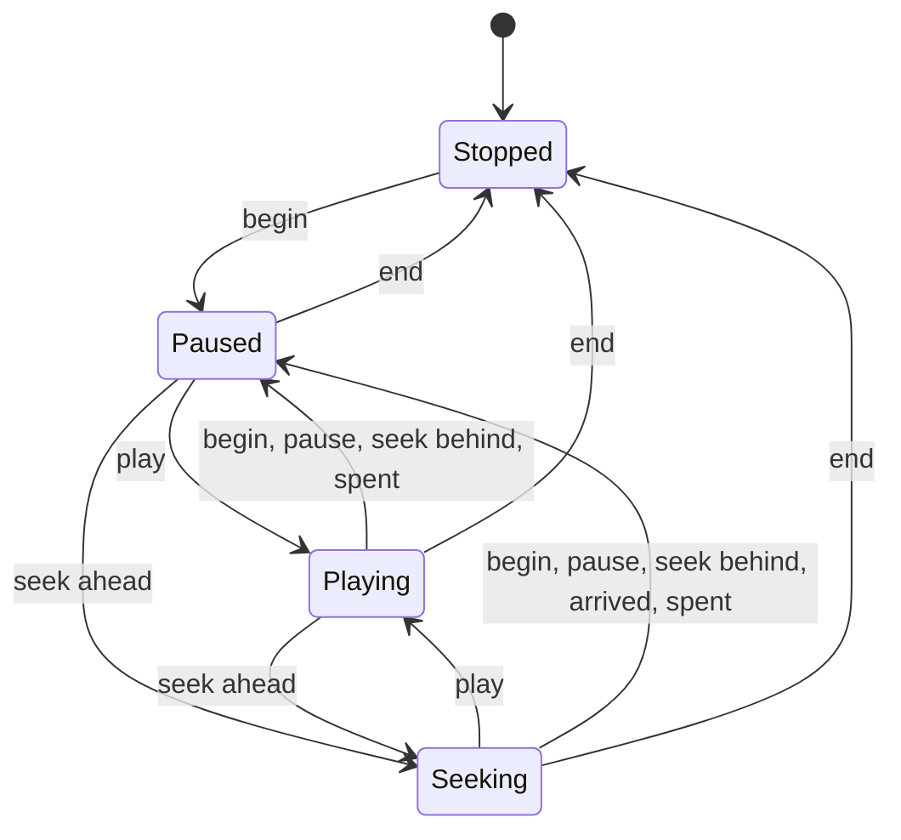

| State | What is true |
|---|---|
| `Stopped` (`"stopped"`, `replay.STATE_STOPPED`) | No session is loaded. The game runs live. `plan` answers `Live`. |
| `Playing` (`"playing"`, `replay.STATE_PLAYING`) | One recorded frame runs per `App::advance`. |
| `Paused` (`"paused"`, `replay.STATE_PAUSED`) | Nothing is fed, no fixed step runs and the tick stands still. Scripts in the debug scope are held too, or every script with none. |
| `Seeking` (`"seeking"`, `replay.STATE_SEEKING`) | Frames run until `seek_to`. `App::replay_frames` stops a call after one fixed step of wall time. |

| From | Trigger | To | What it does |
|---|---|---|---|
| any | `begin` | `Paused` | Loads the session. Sets cursor and `seek_to` to 0, `diverged` to `None`, `restart` to true and the replay hold on. |
| any with frames left | `replay.play`, Rust `play` | `Playing` | Plays from the cursor. |
| any with a session | `replay.pause` | `Paused` | Stops between frames. |
| any with a session, tick ahead | `replay.seek`, `ReplayPlayer::seek` | `Seeking` | Sets `seek_to`. |
| any with a session, tick at or behind | `replay.seek`, `ReplayPlayer::seek` | `Paused` | Sets `seek_to` and runs nothing. |
| `Playing`, `Seeking` | `after_frame`: session spent | `Paused` | Clears the feed. |
| `Seeking` | `after_frame`: `seek_to` reached | `Paused` | Clears the feed. |
| any | `end` (`replay.unload`) | `Stopped` | Drops the session and the feed. Sets the replay hold off and `ReplayMode` to `Off` if it was `Playing`. |

Starts in `Stopped`. Never ends.

Refused or ignored: with no session, `replay.play` errors "no recording is loaded", and Rust `play`, `replay.pause` and `replay.seek` do nothing. With no frames left, `play` does nothing. A seek runs forward only.

Held by a pause, a `process` mode or a parked scene: `App::advance` asks only `ReplayPlayer::plan`, so none of them stops the feed.

### Replay cursor

Where playback has reached in the session's frames. It is derived from `ReplayPlayer.cursor` and the frame count.

Source: `crates/balaur_core/src/replay.rs`, `ReplayPlayer.cursor`.

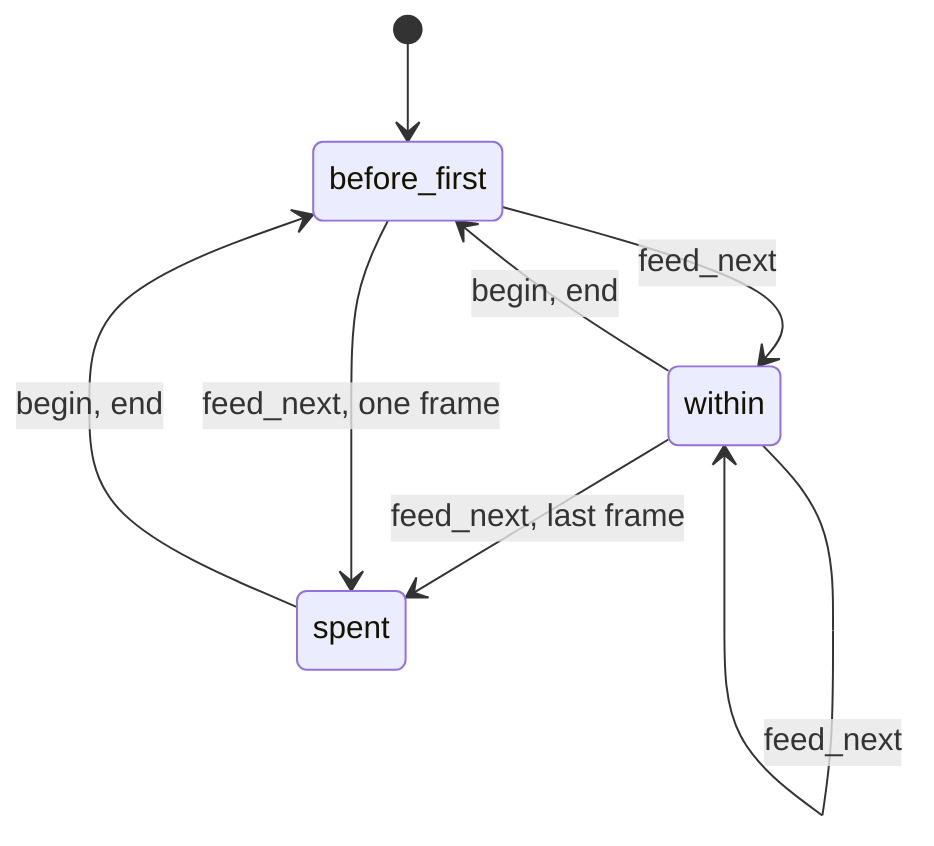

| State | What is true |
|---|---|
| `before_first` | `cursor` is 0. `position` is the tick before the session's first. |
| `within` | Some frames were fed and some are left. |
| `spent` | `cursor` reached the frame count. `remaining` is 0, `is_running` is false and `plan` answers `Hold`. |

| From | Trigger | To | What it does |
|---|---|---|---|
| any | `begin`, `end` | `before_first` | Sets `cursor` to 0. |
| `before_first`, `within` | `feed_next` | `within`, `spent` | Puts the frame in the feed, sets the clock to the tick before it and adds 1 to `cursor`. |

Starts in `before_first`. Never ends.

Refused or ignored: `feed_next` answers `None` with no session or no frame at the cursor, and `replay_frames` stops.

### Replay divergence

The first tick whose replay did not reproduce its recorded digest.

Source: `crates/balaur_core/src/replay.rs`, `ReplayPlayer.diverged`.

| State | What is true |
|---|---|
| `None` | Every compared digest matched. Script `replay.divergence_tick()` answers nil. |
| `Some(Divergence)` | Holds the tick and both digests. Script `replay.divergence_tick()` answers `{ tick, recorded, replayed }`. |

| From | Trigger | To | What it does |
|---|---|---|---|
| `None` | `after_frame`: the frame's digest differs from the live one | `Some` | Keeps the first difference only. |
| any | `begin`, `end` | `None` | Forgets it. |

Starts in `None`. Never ends.

Refused or ignored: a frame with no digest compares nothing, and a trailer's digest is never compared.

### Replay restart

Whether the app owes a replay a zeroed fixed-step accumulator.

Source: `crates/balaur_core/src/replay.rs`, `ReplayPlayer.restart`.

| State | What is true |
|---|---|
| `false` | Nothing is owed. |
| `true` | The next `App::replay_frames` zeroes the accumulator and calls `restart_steps`. |

| From | Trigger | To | What it does |
|---|---|---|---|
| `false` | `begin` | `true` | Asks for the zero. |
| `true` | `App::replay_frames` | `false` | Zeroes the accumulator and calls `restart_steps`. |

Starts in `false`. Never ends.

### Replay feed

The recorded input the next tick restores.

Source: `crates/balaur_core/src/replay.rs`, `ReplayFeed`.

| State | What is true |
|---|---|
| `None` | Live input stands. |
| `Some(sources)` | The first `Stage::First` system calls `replay::restore` with these, ahead of every plugin's own work. |

| From | Trigger | To | What it does |
|---|---|---|---|
| any | `feed_next` | `Some` | Holds the frame's sources. |
| `Some` | `after_frame` with the player `Paused` | `None` | Stops overwriting live input. |
| any | `end` | `None` | Stops overwriting live input. |

Starts in `None`. Never ends.

### Recorder

The session file being written. It is derived from `Recording.0` and `Recorder.header`, and it alone says whether a run records.

Source: `crates/balaur_core/src/replay.rs`, `Recording`, `Recorder`.

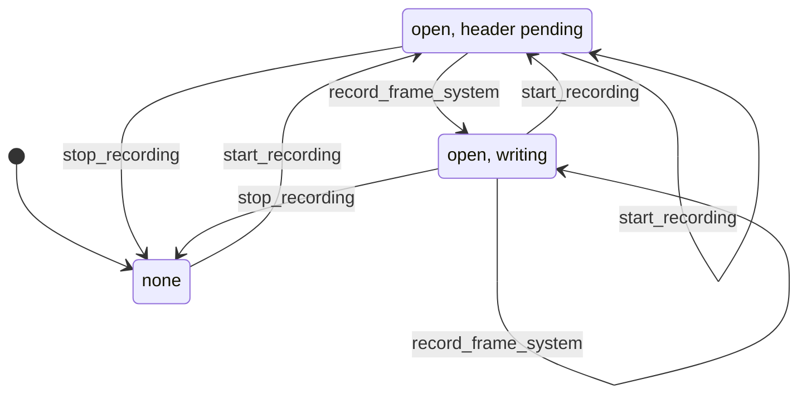

| State | What is true |
|---|---|
| `none` (`Recording(None)`) | Nothing is being written. `replay.recording()` answers nil. |
| open, header pending (`header: Some`) | The file is emptied and holds no line. `born` is the tick it opened on. `replay.recording()` answers the path. |
| open, writing (`header: None`) | The header and frames are on file, appended each frame. |

| From | Trigger | To | What it does |
|---|---|---|---|
| `none` | `start_recording` | open, header pending | Reads the header's origin, seed and setup. `Recorder::create` empties the file. |
| open | `record_frame_system` on the tick `born` | same | Clears `EventLog` and writes nothing. |
| open, header pending | `record_frame_system` on a later tick | open, writing | Settles the origin's tick and time from the clock, then writes the header and the frame. |
| open, writing | `record_frame_system` | open, writing | Writes the tick, step, sources, `frozen`, digest when asked, and events. |
| open | `stop_recording(reason)`: `replay.stop`, the end of `balaur run` | `none` | Writes a pending header, then a trailer with the reason, tick and digest. Sets `finished`. Answers the path. |
| open | `start_recording` | open, header pending | The old recorder drops. Its trailer says `quit`, tick 0, no digest. |
| open | the Engine drops the recorder without `finish` | `none` | `Drop` writes the same `quit` trailer and logs a failure. |

Starts in `none`. Never ends.

`balaur run --record` calls `stop_recording` with `"quit"` as the run ends, so its trailer holds the tick and digest.

Refused or ignored: `stop_recording` with nothing open answers `None`. A failed write logs an error and the next frame tries again.

Held by a pause, a `process` mode or a parked scene: `App::run_stages` calls `record_frame_system` every frame, after every stage and the scene switch. `Frame.frozen` records the debugger's hold, not a game pause.

### Recorder restart

Whether the app owes a new recording a zeroed fixed-step accumulator.

Source: `crates/balaur_core/src/replay.rs`, `Recorder.restart`.

| State | What is true |
|---|---|
| `true` | The next `App::advance` zeroes the accumulator and calls `restart_steps`. |
| `false` | Nothing is owed. |

| From | Trigger | To | What it does |
|---|---|---|---|
| `true` | `take_record_restart` in `App::advance` | `false` | Lets the recording start at a frame boundary. |

Starts in `true`. Ends in `false`.

Refused or ignored: `App::tick` never takes it, so a headless `--frames` run leaves it set.

### Recorder pause edge

Whether a script was stopped at the end of the last recorded frame.

Source: `crates/balaur_core/src/replay.rs`, `Recorder.was_paused`.

| State | What is true |
|---|---|
| `false` | No stop was seen last frame. |
| `true` | A stop was seen, and its event is already on file. |

| From | Trigger | To | What it does |
|---|---|---|---|
| `false` | `fresh_pause` finds a host stop | `true` | Adds one `debug.pause` event with the reason, path and line. |
| `true` | `fresh_pause` finds none | `false` | Adds nothing. |

Starts in `false`. Never ends.

### Recording file

A `.blr` file as a reader finds it. It is derived from the lines on disk.

Source: `crates/balaur_core/src/replay.rs`, `Session::read`, `Header`, `Frame`, `Trailer`.

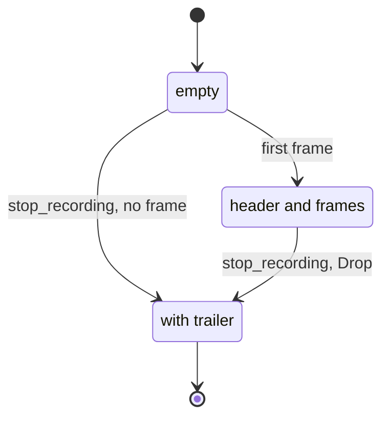

| State | What is true |
|---|---|
| `empty` | Created with no line. `Session::read` errors that it is empty, so `replay.load` and `replay.info` answer nil. |
| `header and frames` | `Session.trailer` is `None`. The editor's row calls it `crashed`. |
| `with trailer` | `Session.trailer` holds `reason`, `tick` and `digest`. |

| From | Trigger | To | What it does |
|---|---|---|---|
| `empty` | `Recorder::write` | `header and frames` | Appends the header, then the frame. |
| `header and frames` | `Recorder::write` | `header and frames` | Appends one line per frame. |
| `empty` | `Recorder::finish`, `Drop` | `with trailer` | Appends the header, then the trailer. |
| `header and frames` | `Recorder::finish`, `Drop` | `with trailer` | Appends the trailer. |

Starts in `empty`. Ends in `with trailer`.

Refused or ignored: `Session::read` errors on a `format` other than this build's. `replay.load` then logs a warn and answers nil, and `replay.info` answers nil. The editor's row calls such a file `unreadable`. A changed script fingerprint still plays.

## Rollback

### Rollback session

One local session that puts the world back and runs it forward when a late input disagrees. It is derived from `Session.dirty` and `Resimulating`.

Source: `crates/balaur_core/src/rollback.rs`, `Session`.

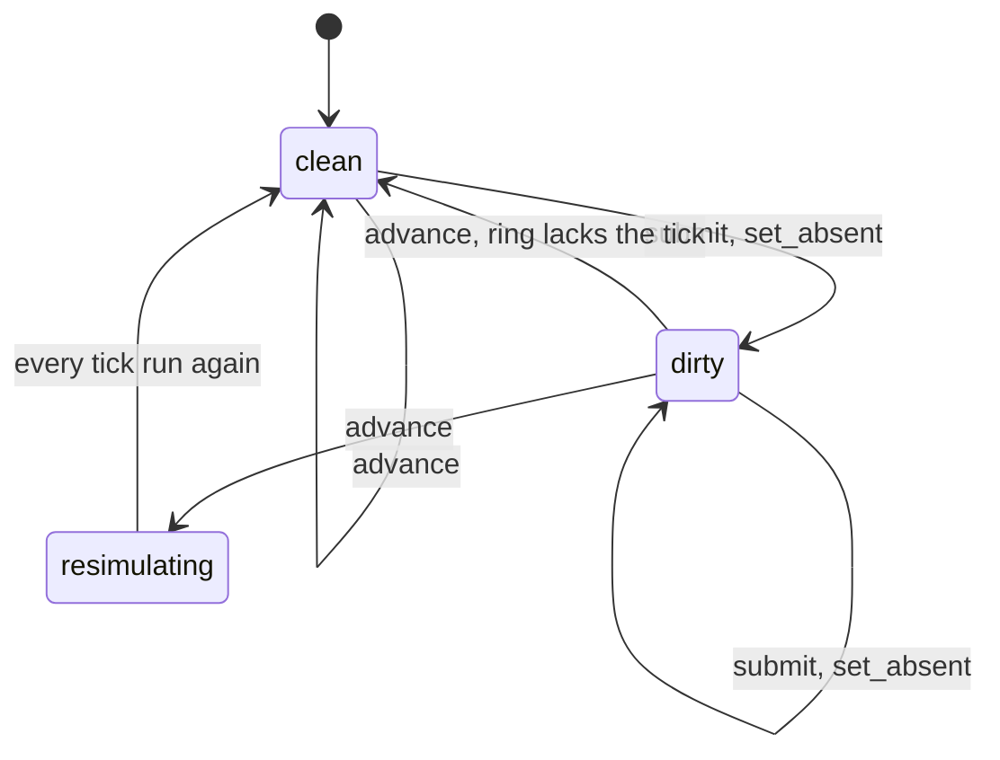

| State | What is true |
|---|---|
| `clean` (`dirty: None`) | No correction is pending. |
| `dirty` (`dirty: Some(tick)`) | That tick's inputs changed after it ran. `rerun_from` answers it. Digests from it on are stale. |
| `resimulating` (`Resimulating(true)`) | Inside `resimulate`: the snapshot is restored and ticks `from..next` run again. |

`next` is the tick `advance` runs and only grows. `stale_inputs` counts inputs that came too late to answer.

| From | Trigger | To | What it does |
|---|---|---|---|
| none | `Session::new(players, depth)` | `clean` | Sets `next` to 1 and makes the ring. |
| `clean`, `dirty` | `submit` for a past tick, value changed, ring holds it | `dirty` | Keeps the earliest tick. |
| `clean`, `dirty` | `submit` for a past tick below the ring | same | Adds 1 to `stale`. |
| `clean`, `dirty` | `submit` for a tick not run, or a matching value | same | Journals it. |
| `clean`, `dirty` | `set_absent`, a used non-nil input at or after `from` | `dirty` | Drops the player's arrived inputs from `from`. Below the ring it adds 1 to `stale` instead. |
| `dirty` | `advance`, ring holds the tick | `resimulating` | Takes `dirty`, calls `snapshot::restore`, sets the flag on and runs each tick. |
| `dirty` | `advance`, ring lacks the tick | `clean` | Adds 1 to `stale`, warns and re-runs nothing, then runs the next tick. |
| `resimulating` | last tick run again | `clean` | Sets the flag off, then runs the next tick. |
| `clean` | `advance` | `clean` | `run_tick(next)`, then adds 1 to `next`. |

`run_tick` pushes a snapshot, sets the clock, decides inputs, records them in `used`, writes `TickInputs`, calls `App::tick`, stores the digest and prunes the journal.

Starts in `clean`. Never ends: its owner drops it, such as `NetSession` in `balaur_net`. A drop after a tick ran resets `Clock`.

Refused or ignored: `submit` warns and drops an unknown player or a tick more than `INPUT_WINDOW` (120) ahead, and silently drops an absent player's input.

Held by a pause, a `process` mode or a parked scene: `advance` reads no pause or mode. `snapshot::capture` keeps parked scenes, and a restore that crosses a park respawns the node where the snapshot has it.

### Resimulating flag

Whether a tick is running for the second time.

Source: `crates/balaur_core/src/rollback.rs`, `Resimulating`.

| State | What is true |
|---|---|
| `false` | An ordinary tick. |
| `true` | `is_resimulating` and `suppressed` are true. `App::run_stages` skips `Stage::Render`. Script `rollback.is_resimulating()` answers true. |

| From | Trigger | To | What it does |
|---|---|---|---|
| `false` | `Session::resimulate` after the restore | `true` | Marks the re-run. |
| `true` | `Session::resimulate` after the last tick | `false` | Ends the re-run. |

Starts in `false`. Never ends.

Refused or ignored: while `true`, `ExternalIo::start` runs nothing. Gestures and haptics skip the tick.

### Rollback clock

The tick being run and the tick before which nothing can be taken back.

Source: `crates/balaur_core/src/rollback.rs`, `Clock`.

| State | What is true |
|---|---|
| default `{ tick: 0, settled: u64::MAX }` | No session has run a tick here, or the last one was dropped. Everything is final. |
| `{ tick, settled }` | `settled` is the ring's earliest tick. |

| From | Trigger | To | What it does |
|---|---|---|---|
| any | `Session::run_tick` | `{ tick, settled }` | Writes both values. |
| `{ tick, settled }` | `Drop for Session`, `ran_on` set | default | Everything is final again. |

Starts in the default. Never ends.

### Rollback session engine

The engine a session has run ticks on, whose clock it set.

Source: `crates/balaur_core/src/rollback.rs`, `Session.ran_on`.

| State | What is true |
|---|---|
| `None` | The session has run no tick. Dropping it touches no clock. |
| `Some(Engine)` | It ran a tick on this engine. Dropping it resets that engine's `Clock`. |

| From | Trigger | To | What it does |
|---|---|---|---|
| `None` | `Session::run_tick` | `Some` | Keeps a clone of `app.engine`. |

Starts in `None`. Ends with the session.

### Tick status

What a session knows of one tick. It is derived from `next`, `arrived`, `used`, `digests` and the ring.

Source: `crates/balaur_core/src/rollback.rs`, `Session::confirmed`, `Session::digest_at`.

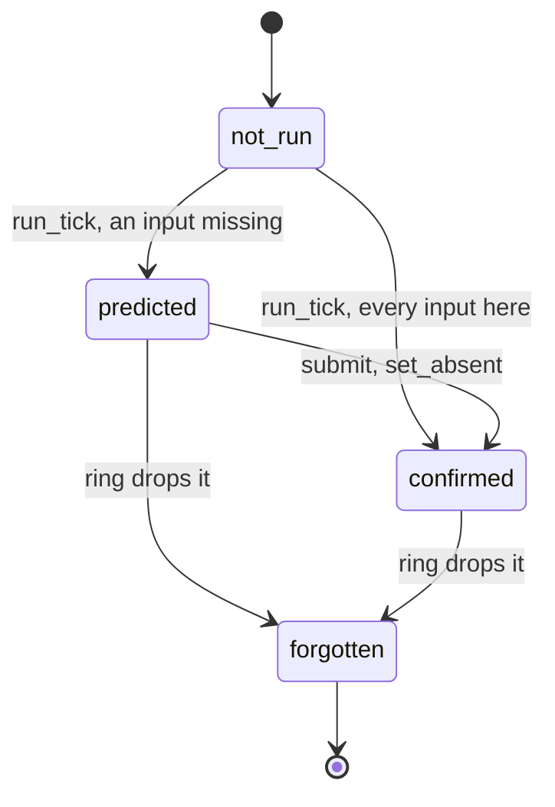

| State | What is true |
|---|---|
| `not_run` | `tick >= next`. An input is journaled and schedules nothing. |
| `predicted` | The tick ran, and `confirmed` is false. A missing input repeats that player's last arrived one, else nil. |
| `confirmed` | Every present player's input arrived. A digest is worth comparing. |
| `forgotten` | Below `ring.earliest()`. The digest is gone, and the journal keeps only each player's newest entry. |

| From | Trigger | To | What it does |
|---|---|---|---|
| `not_run` | `run_tick` | `predicted`, `confirmed` | Runs from `inputs_for`. |
| `predicted` | `submit` of the last missing input | `confirmed` | Schedules a re-run if the value differs from `used`. |
| `predicted` | `set_absent` of the last missing player | `confirmed` | A player who left no longer holds a tick back. |
| `predicted`, `confirmed` | `run_tick` of a later tick, ring moved on | `forgotten` | `prune` and `digests.retain` drop it. |

Starts in `not_run`. Ends in `forgotten`.

### Player presence

Whether a player still plays a given tick.

Source: `crates/balaur_core/src/rollback.rs`, `Session.absent`.

| State | What is true |
|---|---|
| present | `is_present` is true. The player has no entry, or the tick is before it. |
| absent | From the named tick on, the player runs with nil and no tick waits on them. |

| From | Trigger | To | What it does |
|---|---|---|---|
| present | `set_absent(player, from)` | absent | Records `from` and drops arrived inputs from it on. |

Starts in present. Ends in absent.

Refused or ignored: `set_absent` for an unknown player does nothing.

## Debugger

### Probe mode

What one runtime's `Debugger` watches for at each statement. There is one per file runtime.

Source: `crates/balaur_bs/src/runtime/debugger.rs`, `Mode`.

The `stop` box below is a probe that stopped, not a variant. The mode keeps its value until a `Command` answers.

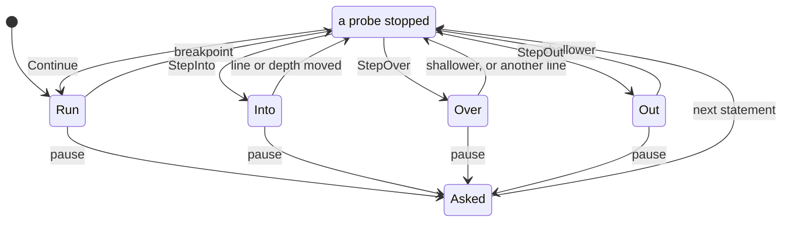

| State | What is true |
|---|---|
| `Run` | Stops only at breakpoints. The stepping value 1 of `__dbg_flags` is clear. |
| `Asked` | Stops at the next statement, wherever. |
| `Into { line, depth }` | Stops where the line or the depth differs. |
| `Over { line, depth }` | Stops when shallower, or at the same depth on another line. |
| `Out { depth }` | Stops when shallower. |

| From | Trigger | To | What it does |
|---|---|---|---|
| any | `Debugger::pause`, from `debug_request_break` | `Asked` | Marks the table dirty. |
| any, stopped and parked | `Debugger::unpark(cmd)`, from `Runtime::resume` or `resume_task` | `mode_after(cmd, line, depth)` | Answers the flags for `__dbg_flags`. |
| any, stopped, not parking | `on_probe` asks `on_pause` | `mode_after(cmd, line, depth)` | Writes the flags and any locals the handler changed. With no handler, `cmd` is `Continue`. |

A breakpoint on the first statement of its line stops in every mode. `should_stop` prefers `Breakpoint`, then `Asked`, then `Step`.

Starts in `Run`. Never ends.

Refused or ignored: a probe only runs in a file built with probes, and while a call is parked `on_probe` passes every probe by.

### Debugger stop

The stop a parked call is held at.

Source: `crates/balaur_bs/src/runtime/debugger.rs`, `Debugger.parked`.

| State | What is true |
|---|---|
| `None` | No call is held. |
| `Some(Parked { paused, depth })` | A call is held at this stop. `Debugger::parked` and `Runtime::paused` answer it. |

| From | Trigger | To | What it does |
|---|---|---|---|
| `None`, `Some` | `on_probe` with a stop and `park` true | `Some` | Stores the snapshot and depth. |
| `Some` | `Debugger::unpark` | `None` | Sets the mode and answers the flags. |

Starts in `None`. Never ends.

Refused or ignored: `unpark` with nothing held answers `None`, and `go_on` errors "no call is parked".

### Park permission

Whether a stop holds the running call or asks `on_pause`.

Source: `crates/balaur_bs/src/runtime/debugger.rs`, `Debugger.park`.

| State | What is true |
|---|---|
| `false` | A stop asks `on_pause` how to go on. |
| `true` | A stop parks the call. |

| From | Trigger | To | What it does |
|---|---|---|---|
| any | `Runtime::prepare` | a unit of the instance has probes and engine `can_park` | Set before a steppable call. |
| any | `Runtime::go_on` | `true` | Set before a resumed call goes on. |
| any | `Runtime::settle`, the call did not park | `false` | Set once the call is over. |

Starts in `false`. Never ends.

Refused or ignored: only `wasmi` answers `can_park` true. Elsewhere a stop is passed by.

### Breakpoint table

Whether the module's breakpoint table and flags are behind the `Debugger`.

Source: `crates/balaur_bs/src/runtime/debugger.rs`, `Debugger.dirty`.

| State | What is true |
|---|---|
| `true` | `take_table` builds a table on the next call. |
| `false` | The module is current. |

| From | Trigger | To | What it does |
|---|---|---|---|
| any | `set_breakpoint`, `clear_breakpoint`, `clear_breakpoints`, `keep_locals` with a change | `true` | Asks for a new table. |
| any | `pause` | `true` | Asks for new flags. |
| `true` | `take_table`, from `Runtime::sync_debugger` | `false` | Writes one byte per statement and the flags. |

Starts in `true`. Never ends.

### Keep locals

Whether every statement keeps its frame's variables current.

Source: `crates/balaur_bs/src/runtime/debugger.rs`, `Debugger.keep_locals`.

| State | What is true |
|---|---|
| `false` | Variables are stored only at a stop. |
| `true` | Each statement stores them, so a trap's stack shows them. The value 2 of `__dbg_flags` is set. |

| From | Trigger | To | What it does |
|---|---|---|---|
| any | `Debugger::keep_locals(on)`, from `BsHost::arm` and `debug_set_break_on_error` | `on` | Marks the table dirty on a change. |

Starts in `false`. Never ends.

### Steppable call

A call a stop may park, as its `Runtime` tracks it.

Source: `crates/balaur_bs/src/runtime/mod.rs`, `Runtime.parked_call`; `crates/balaur_bs/src/runtime/stepping.rs`, `ParkedCall`.

| State | What is true |
|---|---|
| `None` | No steppable call is in flight. |
| `Some(ParkedCall { ret, nself, poll })` | A steppable call started and has not finished. `poll` says a task's poll, not a method. |

| From | Trigger | To | What it does |
|---|---|---|---|
| `None` | `call_method_steppable` | `Some` | Calls `prepare`, then `call_resumable`, then `settle`. |
| `None` | `poll_steppable` | `Some` | The same for a task's poll. |
| `Some` | `settle` with `Done` or a trap | `None` | Hands back the results, or answers the error. |
| `Some` | `settle` with `Parked` | `Some` | Answers `Step::Paused`. |
| `Some` | `resume`, `resume_task` | `Some`, then `settle` | `go_on` calls `unpark`, writes the flags and resumes the engine. |

Starts in `None`. Never ends.

Refused or ignored: while `Some`, `invoke`, `call_method_steppable` and `poll_steppable` error "the script is stopped at a breakpoint". `go_on` errors "no method is parked" or "no poll is parked" when the kind differs.

### Parked engine call

The suspended Wasm call behind a stop.

Source: `crates/balaur_bs/src/runtime/wasmi_engine.rs`, `Wasmi.parked`.

| State | What is true |
|---|---|
| `None` | No call is suspended. |
| `Some((trap, results))` | The probe raised `Park` and the call waits inside wasmi. |

| From | Trigger | To | What it does |
|---|---|---|---|
| `None`, `Some` | `Wasmi::settle`, a host trap holding `Park` | `Some` | Answers `Outcome::Parked`. |
| `Some` | `Wasm::resume` | `None`, then `settle` | Resumes the trap with zeros for what the probe owes. |

Starts in `None`. Never ends.

Refused or ignored: `resume` with nothing parked errors "no call is parked". An engine that cannot park errors "this engine cannot carry on a parked call".

### Trap stack

The stack a debug build's last trapped call died with.

Source: `crates/balaur_bs/src/runtime/mod.rs`, `Runtime.error_stop`.

| State | What is true |
|---|---|
| `None` | No trap is kept. |
| `Some(Paused)` | Holds the frames with `StopReason::Error`. |

| From | Trigger | To | What it does |
|---|---|---|---|
| any | `Runtime::trapped` in a debug build | `Some` | Reads the shadow stack before `DBG_RESET` clears it. |
| `Some` | `Runtime::error_stop` | `None` | Answers it once. |
| `Some` | `invoke`, `prepare` | `None` | A new call forgets it. |

Starts in `None`. Never ends.

### Script stop

The one stop the Balaur Script host holds.

Source: `crates/balaur_script_bs/src/host/debug.rs`, `Held`, `Stop`, held in `Inner.stopped`.

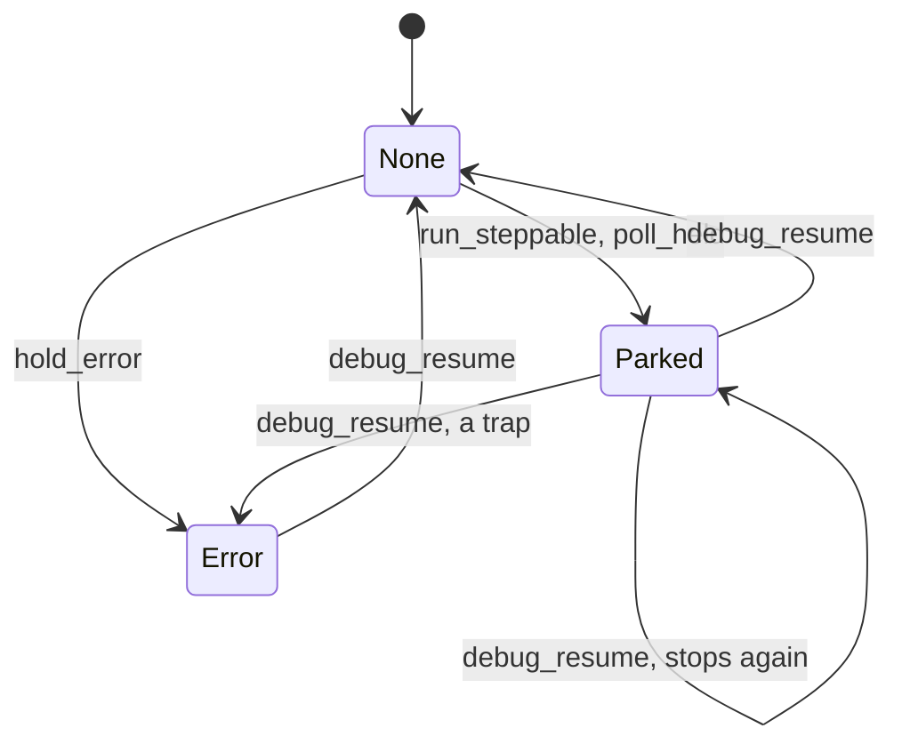

| State | What is true |
|---|---|
| `None` | Nothing is held. `debugger.stop_location()` answers nil. |
| `Some(Held { stop: Stop::Parked { obj, task } })`, `reason` `"breakpoint"`, `"step"` or `"pause"` | A call is parked at a line. `Held` owns its object, and its task when it is an async poll. |
| `Some(Held { stop: Stop::Error { paused, message } })`, `reason` `"error"` | A call trapped with break on error on. `Held` keeps its stack and message. |

| From | Trigger | To | What it does |
|---|---|---|---|
| `None` | `run_steppable` answers `Step::Paused` | `Parked` | `hold` keeps the object and calls `set_frozen(true)`. |
| `None` | `poll_held` answers `Step::Paused` | `Parked` | `hold_task` keeps the object and task, and calls `set_frozen(true)`. |
| `None` | `hold_error`, from `run_steppable` or `poll_held` | `Error` | Needs break on error on and a trap stack. Calls `set_frozen(true)`. |
| `Error` | `debug_resume` in any mode | `None` | Dismisses it and calls `set_frozen(false)`. |
| `Parked` | `debug_resume`, the file is gone | `None` | Calls `set_frozen(false)`. |
| `Parked` | `debug_resume`, `Step::Paused` | `Parked` | `hold` again. |
| `Parked` | `debug_resume`, `Step::Done` | `None` | Answers a task's waiter, releases the object and calls `set_frozen(false)`. |
| `Parked` | `debug_resume`, `Step::Waiting` | `None` | Files the task in `parked_tasks` if its node is parked, else in `tasks`. Releases the object and calls `set_frozen(false)`. |
| `Parked` | `debug_resume`, a trap, break on error on | `Error` | Logs it, releases the object and stays frozen. |
| `Parked` | `debug_resume`, a trap, break on error off | `None` | Logs it, releases the object and calls `set_frozen(false)`. |

`release_held` hands the object back to its instance, or frees it when the node has gone.

Starts in `None`. Never ends.

Refused or ignored: while held, `each`, `each_of`, `tell` and `run_tasks` pass over an instance under `frozen_root` or in the file `stopped_in` names. Any other instance runs on, so an editor outside the debug scope keeps running. `call_on` and `init` are not filtered, and where a call is parked `call_method_steppable` errors. `reload` of a parked file errors. `debug_resume` with nothing held returns. `hold_error` does nothing while a stop is held. `detach` does not clear it.

Held by a pause, a `process` mode or a parked scene: `each` skips a node `process::ticks` holds and `run_tasks` keeps its tasks, so its probes do not run. `set_parked` leaves `stopped` alone, and `release_held` looks in both `instances` and `parked`.

### Files built with probes

Which files the host compiles for the debugger.

Source: `crates/balaur_script_bs/src/host.rs`, `Inner.debugging`; `crates/balaur_script_bs/src/host/debug.rs`, `debug`.

| State | What is true |
|---|---|
| key absent | The file builds without probes, unless break on error is on. |
| key present | The file builds with probes. Its instance (`Place`) runs on `EngineKind::Wasmi`; without the `wasmi` feature it stays on `Auto` and a stop is passed by. |

| From | Trigger | To | What it does |
|---|---|---|---|
| absent | `debug_set_breakpoints` with lines | present | `rebuild_instance` if the instance is `stale`. Its scripts hear nothing. |
| absent | `debug_request_break` | present, every loaded file | `rebuild_stale`, then `Debugger::pause`; one that has to wait is paused as `arm` makes it (`pause_owed`). |
| present | `debug_set_breakpoints` with no lines, no call parked in the instance | absent | `rebuild_instance` if the instance is `stale`. Its scripts hear nothing. Break on error still builds it with probes. |

Starts absent. Never ends.

Refused or ignored: `debug_set_breakpoints` with no lines keeps the key while a call is parked in its instance. `rebuild_instance` waits, the keys in `rebuild`, while a call is parked in the instance or a script of it runs; a resume asked by a script of the instance waits for `pump_reloads` (`resume_owed`).

### Break on error

Whether a trap stops the game at its line.

Source: `crates/balaur_script_bs/src/host.rs`, `Inner.break_on_error`.

| State | What is true |
|---|---|
| `false` (`debugger.break_on_error()` false) | A trap logs and the game moves on. |
| `true` (`debugger.break_on_error()` true) | Every file builds with probes and keeps locals. A trap holds the game through `hold_error`. |

| From | Trigger | To | What it does |
|---|---|---|---|
| any | `debugger.set_break_on_error(on)`, DAP `setExceptionBreakpoints` | `on` | Turning on calls `rebuild_stale`, each file's unit built with probes. The code did not change, so no script hears `on_hot_reload`. Otherwise it calls `keep_locals(on)` where the runtime is free. |
| `true` | DAP `disconnect`, `terminate` | `false` | The adapter leaves the game as it found it. |

Starts in `false`. Never ends.

### Script profiling

Whether the host counts what scripts cost.

Source: `crates/balaur_script_bs/src/host.rs`, `Inner.profiling`; `crates/balaur_script_bs/src/host/profile.rs`, `profile_set`.

| State | What is true |
|---|---|
| `false` | Files build without counters, and `charge` adds nothing to the tally. `function_costs` answers an empty list. |
| `true` | Files rebuild with counters and the tally grows. |

| From | Trigger | To | What it does |
|---|---|---|---|
| any | `engine.set_script_profiling(on)`, value unchanged | same | Clears the tally. If on, clears each free runtime's profile. |
| any | `engine.set_script_profiling(on)`, value changed | `on` | Clears the tally and queues every loaded file in `rebuild` for `pump_reloads`. Its scripts hear nothing. |

The editor keeps its own copy in `State.script_profiling`, flipped by `dock::profiler_scripts`.

Starts in `false`. Never ends.

### Hot reload owed

Which files' instances still have to hear `on_hot_reload`.

Source: `crates/balaur_script_bs/src/host.rs`, `Inner.reload_owed`, `announce_reloads`; `crates/balaur_script_bs/src/host/engine_facing.rs`, `pump_reloads`, `reload`.

| State | What is true |
|---|---|
| key absent | No notice is owed. A build through `rebuild_key` alone tells no script. |
| key present | The file's code changed. Its instances hear `on_hot_reload` once no rebuild for the key is left. |

| From | Trigger | To | What it does |
|---|---|---|---|
| absent | `pump_reloads`: an edit, for the file and each file using it | present | Queues the build in this pump. |
| absent | `ScriptHost::reload` | present | Calls `rebuild_key`, then `announce_reloads`. |
| present | the build fails in `pump_reloads` or `reload` | absent | Logs or answers the error. No notice goes out. |
| present | `announce_reloads`, key still in `rebuild` | present | Waits for the next `pump_reloads`. |
| present | `announce_reloads`, key not in `rebuild` | absent | `tell` calls `on_hot_reload` on the file's instances. |

Starts absent. Never ends.

Held by a pause, a `process` mode or a parked scene: `tell` filters neither a pause nor a mode. It reads `instances`, so a parked instance hears nothing and catches up in `on_parked_changed`. It passes over an instance under `frozen_root` or in the stopped file, and that notice is not owed again.

### Debug adapter client

The one client the DAP server serves. It is derived from `connected`, `out` and `configured`.

Source: `crates/balaur_debug/src/dap.rs`, `Session`, `accept_loop`.

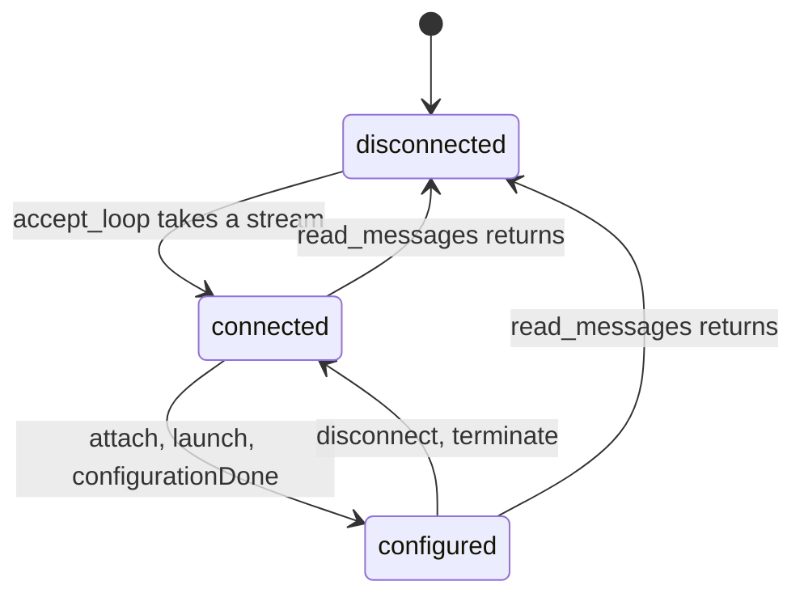

| State | What is true |
|---|---|
| `disconnected` | `connected` is false and `out` is `None`. `pump` tells nobody anything. |
| `connected` | `connected` is true and a writer thread runs. `configured` is false. |
| `configured` | The client sent `attach`, `launch` or `configurationDone`. `wait_for_attach` returns. |

| From | Trigger | To | What it does |
|---|---|---|---|
| `disconnected` | `accept_loop` takes a stream | `connected` | Starts `write_loop` and blocks in `read_messages` until the stream closes. |
| `connected`, `configured` | `read_messages` returns | `disconnected` | Clears `out`. The next `pump` clears `configured` and the stop. |
| `connected` | `attach`, `launch`, `configurationDone` | `configured` | Answers the request. |
| `connected`, `configured` | `initialize` | same | Answers the capabilities, then sends `initialized`. |
| `connected`, `configured` | `disconnect` | `connected` | Clears reported breakpoints, sets break on error off and resumes a stop. |
| `connected`, `configured` | `terminate` | `connected` | The same, then `request_quit`. |

Starts in `disconnected`. Never ends: the accept thread runs for the process.

Refused or ignored: a second connection waits until the first closes. An unknown command is answered as unsupported. A `Content-Length` over 16 MB, or none, drops the client. Past 256 queued messages, output lines are dropped and counted. `evaluate` answers only a local's name in a stopped frame.

### Debug adapter stop report

What the client has been told about a stop.

Source: `crates/balaur_debug/src/dap.rs`, `Session.reported_stop`, `Session.stop`, `Stop`.

| State | What is true |
|---|---|
| `reported_stop` false, `stop` `None` | The client believes the game runs. `stackTrace` answers no frames. |
| `reported_stop` true, `stop` `Some(Stop)` | The client was told. `Stop` holds the pause and a variable arena fresh for each stop. |

| From | Trigger | To | What it does |
|---|---|---|---|
| false | `report_stop`, host paused | true | Sends `stopped` with the reason. `Error` is sent as `"exception"`. |
| true | `report_stop`, host not paused | false | Sends `continued`. |
| true | `continue`, `next`, `stepIn`, `stepOut` | false | Clears first, then calls `host.resume`. `continue` also sends `continued`. |
| true | `disconnect`, `terminate` | false | Part of leaving the game. |
| true | `pump` with no client | false | Starts the next client clean. |

Starts with `reported_stop` false. Never ends.

### Debugger stop word

What the event pump last said about a stop.

Source: `crates/balaur_core/src/events.rs`, `EventState.stop_seen`, `DEBUGGER_STOPPED`.

| State | What is true |
|---|---|
| `None` | No stop was announced, or a resume forgot it. |
| `Some(Pause)` | This stop was announced as `debugger_stopped`. |

| From | Trigger | To | What it does |
|---|---|---|---|
| any | event pump, stop differs from `stop_seen` | new value | Queues `debugger_stopped` with the stop's map or nil, only if someone listens. |
| any | `debugger.resume`, through `events::resumed` | `None` | A stop on the same line after a resume is new. |

Starts in `None`. Never ends.

## Command line

`balaur_export` holds no state over time: `export` is one call on the caller's thread.

### A `balaur run`

One run from the command line to its exit. It has no variable of its own, and the phase names are this document's.

Source: `crates/balaur_cli/src/main.rs`, `main`, `dispatch`, `run_project`.

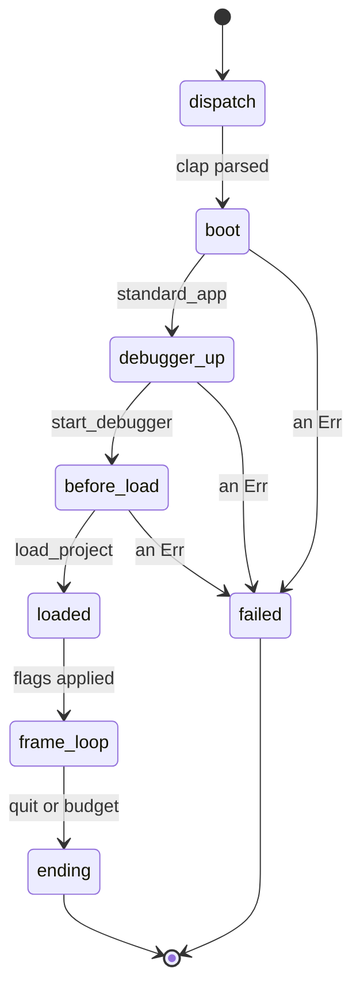

| State | What is true |
|---|---|
| `dispatch` | `mark_start` and log capture ran. `own_pack` finds a pack on the executable and boots it instead, without reading argv. |
| `boot` | `--size` is parsed, then `standard_app` builds the engine and its plugins. |
| `debugger_up` | `--debug` binds the adapter. `--debug-wait` blocks until a client configures or 120 s pass. |
| `before_load` | `--record` opens its recording. `--scene`, the dark mode fact and `--touch` are set, all before any script runs. |
| `loaded` | `load_project` ran each script's `init`. Then `--fixed-tick`, `--trace-digest` and `--timings` are applied. |
| `frame_loop` | The loop of the chosen display mode runs. |
| `ending` | `stop_recording` closes a recording with `"quit"`. The log is flushed, timings are printed and the exit code is applied. |
| `failed` | An `Err` reached `main`. |

| From | Trigger | To | What it does |
|---|---|---|---|
| `dispatch` | `Cli::parse_from` | `boot` | Parses argv and calls `run_project`. |
| `boot` | `standard_app` | `debugger_up` | Keeps the engine. |
| `debugger_up` | `start_debugger` | `before_load` | Holds the server for the run. |
| `before_load` | `App::load_project` | `loaded` | `instantiate_main_scene` builds the scene, scripts attach and `init` runs. |
| `loaded` | display chosen | `frame_loop` | See [LIFECYCLE.md](LIFECYCLE.md). |
| `frame_loop` | `--frames N` with a window or offscreen: `add_frame_budget` counts N in `Stage::Last` | `ending` | Asks for `--shot` at N-1, then `request_quit`. |
| `frame_loop` | `--frames N` headless: the loop ends | `ending` | Stops early if quit was requested. |
| `frame_loop` | window Close event | `ending` | `pump_input` announces `on_quit_requested`, then `request_quit`. |
| `frame_loop` | `engine.quit`, DAP `terminate` | `ending` | The frame in flight finishes. |
| `frame_loop` | `render_chains` answers not open | `ending` | The loop breaks. |
| `boot`, `debugger_up`, `before_load` | a bad `--size`, a bind failure, an attach timeout, a load failure | `failed` | `main` returns the error. |

Starts in `dispatch`. Ends in `ending` or `failed`.

Refused or ignored: `--shot` and `--size` do nothing in a headless run.

### A `balaur replay`

One headless playback of a recording. It has no variable of its own.

Source: `crates/balaur_cli/src/traces.rs`, `replay_session`.

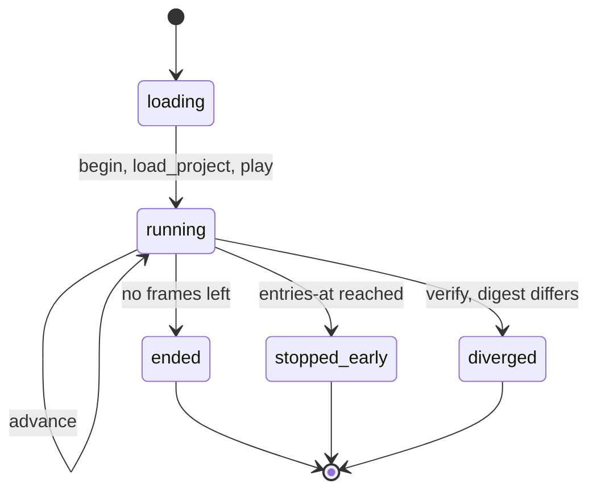

| State | What is true |
|---|---|
| `loading` | `Session::read` and `standard_app` ran. `begin` runs before `load_project`, so `init` is already suppressed. |
| `running` | `App::advance(fixed_dt)` runs while `is_running`. |
| `ended` | No frames are left. |
| `stopped_early` | `--entries-at` reached its tick. |
| `diverged` | `--verify` found `ReplayPlayer.diverged`. |

| From | Trigger | To | What it does |
|---|---|---|---|
| `loading` | `replay::play` | `running` | Plays from the first frame. |
| `running` | `App::advance` | `running` | Feeds frames. |
| `running` | tick reaches `--entries-at` | `stopped_early` | Prints every digest entry and returns `Ok`. |
| `running` | `--verify` and `diverged` set | `diverged` | Returns an error naming the tick and both digests. |
| `running` | `is_running` false | `ended` | With `--entries-at`, errors "the recording stops before that tick". With `--verify`, prints how many digests matched, or that none were carried. |

Starts in `loading`. Ends in `ended`, `stopped_early` or `diverged`.

### Import job

How far one import has got.

Source: `crates/balaur_cli/src/import_api.rs`, `JobState`, held in `ImportJob.state`.

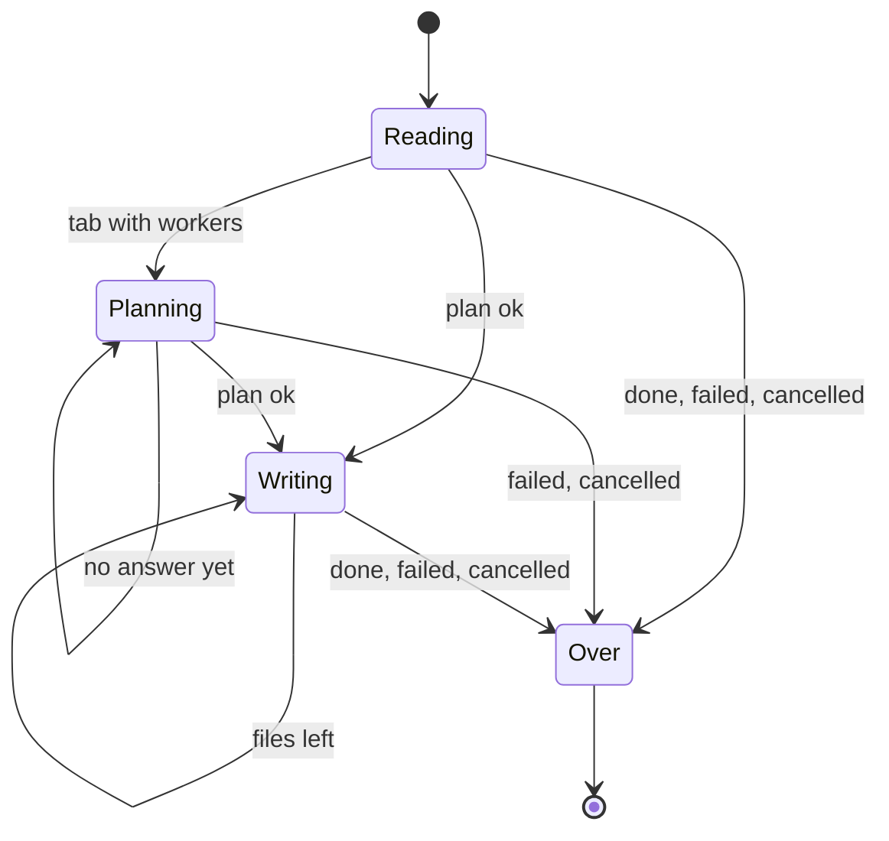

| State | What is true |
|---|---|
| `Reading` | Nothing is read yet. |
| `Writing { plan, sink, done, files }` | The plan is in hand. A slice writes up to 32 files. |
| `Planning(receiver)` | Only in a wasm build with atomics: a worker makes the plan. |
| `Over` | Finished. `step` answers `Progress::Done`. |

| From | Trigger | To | What it does |
|---|---|---|---|
| none | `ImportJob::new` | `Reading` | Holds the source, project and channels. |
| any | `step` finds `cancel` set | `Over` | Clears `cancel`. Reports `Cancelled` with `written`. Written files stay. |
| `Reading` | `begin`: no name, or the bytes cannot be read | `Over` | Reports `Failed`. |
| `Reading` | `begin`: the importer does not slice | `Over` | Reports `Started` with 0 files, then `Done` or `Failed` from `import_file`. Picked bytes report `Failed`. |
| `Reading` | `begin`: wasm with atomics and chosen bytes | `Planning` | `task::compute` runs `plan_bytes`. |
| `Reading` | `planned` with a plan | `Writing` | Reports `Started` with the file count. |
| `Reading` | `planned` with an error | `Over` | Reports `Failed`. |
| `Planning` | `await_plan`: no answer yet | `Planning` | Answers `Progress::More`. |
| `Planning` | `await_plan`: the worker ended | `Over` | Reports `Failed`. |
| `Planning` | `await_plan`: answered | `Writing`, `Over` | Hands the picked files back, then `planned`. |
| `Writing` | `write_slice`: files left | `Writing` | Reports `Wrote` per file. |
| `Writing` | `write_slice`: a write failed | `Over` | Reports `Failed`. |
| `Writing` | `write_slice`: plan empty | `Over` | Reports `Done` with the scene and note. |

`over` takes 1 from `running`, clears `cancel` if it was the last job, reports the event, sets `Over` and answers `Progress::Done`.

Starts in `Reading`. Ends in `Over`.

Refused or ignored: `import.start` answers false while `suppressed`, with `running` untouched. A build without the `import` feature answers false. On a desktop the job waits for a free thread on the stepped pool.

Held by a pause, a `process` mode or a parked scene: `jobs::pump` delivers through `call_on`, which no pause or mode filters. A listener in a parked scene is not found and hears nothing.

### Imports in flight

How many imports this plugin started and has not seen end.

Source: `crates/balaur_cli/src/import_api.rs`, `ImportState.running`.

| State | What is true |
|---|---|
| 0 | None runs. `import.running_count()` answers 0. |
| n | n jobs run. |

| From | Trigger | To | What it does |
|---|---|---|---|
| n | `start`, the tab's `read_then_import` | n+1 | Counted before the job is handed to `task::step`. |
| n | `ImportJob::over` | n-1 | Taken before the end is reported. The last job out clears `cancel`. |

Starts in 0. Never ends.

### Import cancel press

A press that stops one import.

Source: `crates/balaur_cli/src/import_api.rs`, `ImportState.cancel`.

| State | What is true |
|---|---|
| `false` | No press waits. |
| `true` | A job runs, and the next to reach the top of a slice is cancelled. |

| From | Trigger | To | What it does |
|---|---|---|---|
| any | `import.cancel()` with a job running | `true` | Sets the flag. |
| `true` | `ImportJob::step` | `false` | That job reports `Cancelled`. |
| `true` | `ImportJob::over` of the last job | `false` | A press no job read goes with it. |

Starts in `false`. Never ends.

Refused or ignored: `import.cancel()` with no job running does nothing.

### Export job

One export on its worker. It is derived from the `RUNNING` count and the events sent.

Source: `crates/balaur_cli/src/export_api.rs`, `start`, `RUNNING`; `crates/balaur_cli/src/web_export.rs`, `start`, `RUNNING`.

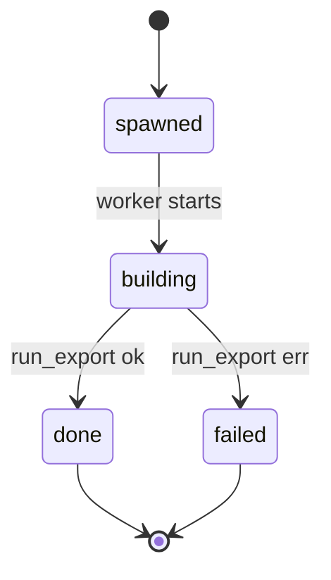

| State | What is true |
|---|---|
| `spawned` | `RUNNING` counts it. No event was sent. |
| `building` | `ExportEvent::Started` was sent. |
| `done` | `ExportEvent::Done` was sent, then `RUNNING` drops by 1. |
| `failed` | `ExportEvent::Failed` was sent, then `RUNNING` drops by 1. |

| From | Trigger | To | What it does |
|---|---|---|---|
| none | `export.start`, not suppressed | `spawned` | Adds 1 to `RUNNING`. Spawns a thread, or `spawn_local` in a tab. |
| `spawned` | worker starts | `building` | Reports `Started`. |
| `building` | `run_export` or the tab's `run` answers `Ok` | `done` | Reports `Done` with the path, or the download name in a tab. |
| `building` | same answers `Err` | `failed` | Reports `Failed` with the message. |

Starts in `spawned`. Ends in `done` or `failed`.

Refused or ignored: `export.start` answers false while `suppressed`. There is no cancel verb. `export.running_count()` reads `RUNNING`.

Held by a pause, a `process` mode or a parked scene: `jobs::pump` delivers through `call_on`, which no pause or mode filters. A listener in a parked scene is not found and hears nothing.

### Release check

One read of the release feed. It is derived from the worker and its report.

Source: `crates/balaur_cli/src/project_api/release.rs`, `check`.

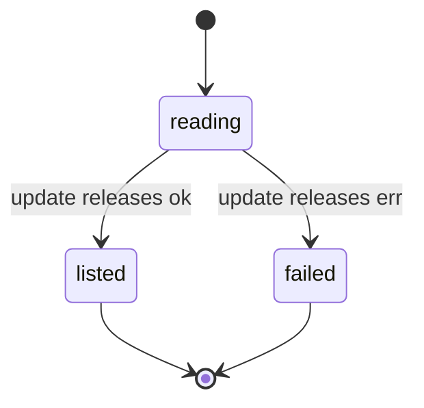

| State | What is true |
|---|---|
| `reading` | A thread reads the feed. |
| `listed` | `ReleaseEvent::Listed` was sent, each row ordered against this build. |
| `failed` | `ReleaseEvent::Failed` was sent with `job` `"check"`. |

| From | Trigger | To | What it does |
|---|---|---|---|
| none | `release.check`, not suppressed | `reading` | Spawns the thread. A tab runs it in the call. |
| `reading` | `update::releases` answers `Ok` | `listed` | Reports the rows. |
| `reading` | `update::releases` answers `Err` | `failed` | Reports the message. |

Starts in `reading`. Ends in `listed` or `failed`.

Refused or ignored: `release.check` answers false while `suppressed`.

Held by a pause, a `process` mode or a parked scene: `jobs::pump` delivers through `call_on`, which no pause or mode filters. A listener in a parked scene is not found and hears nothing.

### Engine install job

One replacement of this install from the editor. It is derived from the worker and its reports.

Source: `crates/balaur_cli/src/project_api/release.rs`, `install`; `crates/balaur_cli/src/update.rs`, `replace`.

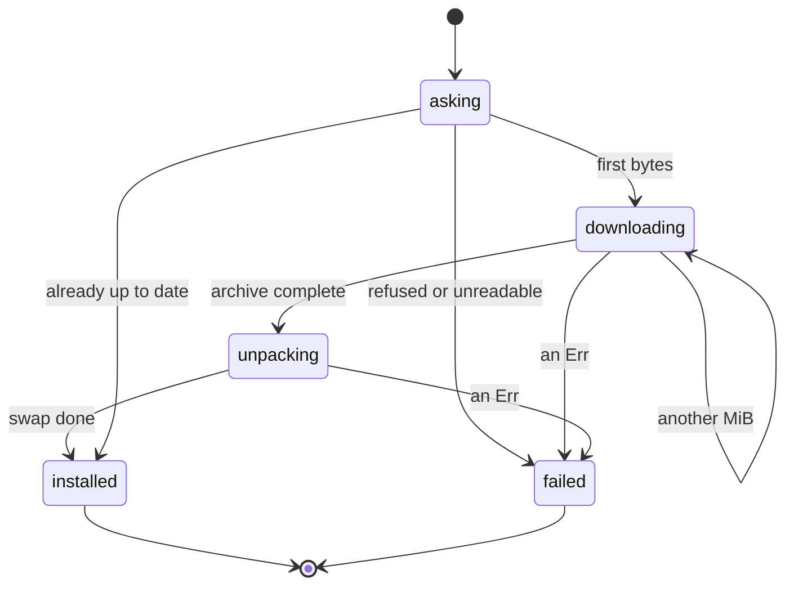

| State | What is true |
|---|---|
| `asking` | `replace` reads VERSION and checks the downgrade and `held` rules. No event is sent. |
| `downloading` | `ReleaseEvent::Downloading` is sent once per MiB and at the end. |
| `unpacking` | `ReleaseEvent::Unpacking` was sent. |
| `installed` | `ReleaseEvent::Installed` was sent with a note to show. |
| `failed` | `ReleaseEvent::Failed` was sent with `job` `"install"`. |

| From | Trigger | To | What it does |
|---|---|---|---|
| none | `release.install`, not suppressed | `asking` | Spawns the thread. |
| `asking` | `download_reporting` reports bytes | `downloading` | Maps `update::Step::Downloading`. |
| `downloading` | `progress(Step::Unpacking)` | `unpacking` | Maps `update::Step::Unpacking`. |
| `unpacking` | `swap_install` done | `installed` | The note says to restart. |
| `asking` | published id equals this build | `installed` | The note says it is up to date. |
| `asking`, `downloading`, `unpacking` | any `Err` from `replace` | `failed` | Reports the message. |

Starts in `asking`. Ends in `installed` or `failed`.

Refused or ignored: `release.install` answers false while `suppressed`. `replace` refuses a downgrade unless allowed, and refuses where `held` names a reason.

Held by a pause, a `process` mode or a parked scene: `jobs::pump` delivers through `call_on`, which no pause or mode filters. A listener in a parked scene is not found and hears nothing.

### Forge job

One search, add, fetch or copy against Forge. It is derived from the worker and its report.

Source: `crates/balaur_cli/src/project_api/forge.rs`, `run`.

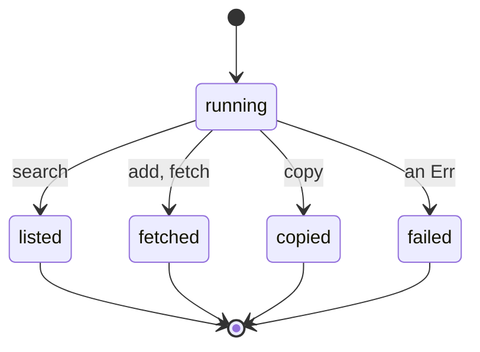

| State | What is true |
|---|---|
| `running` | A thread does the work. A tab runs it in the call. |
| `listed` | `ForgeEvent::Listed` was sent. |
| `fetched` | `ForgeEvent::Fetched` was sent. `alias` is empty when every dependency was fetched. |
| `copied` | `ForgeEvent::Copied` was sent with the new folder. |
| `failed` | `ForgeEvent::Failed` was sent with `job` `"search"`, `"add"`, `"fetch"` or `"copy"`. |

| From | Trigger | To | What it does |
|---|---|---|---|
| none | `forge.search`, `forge.add`, `forge.fetch`, `forge.copy`, not suppressed | `running` | Spawns the work. |
| `running` | `search` answers | `listed` | Reports the rows. |
| `running` | `add` or `fetch` answers | `fetched` | Reports the alias. |
| `running` | `copy` answers | `copied` | Reports the path. |
| `running` | the work errors | `failed` | Reports the job and message. |

Starts in `running`. Ends in `listed`, `fetched`, `copied` or `failed`.

Refused or ignored: each verb answers false while `suppressed`.

Held by a pause, a `process` mode or a parked scene: `jobs::pump` delivers through `call_on`, which no pause or mode filters. A listener in a parked scene is not found and hears nothing.

### Picture job

One picture written by a second `balaur run --offscreen --shot` process. It is derived from the worker and its report.

Source: `crates/balaur_cli/src/project_api/picture.rs`, `write`.

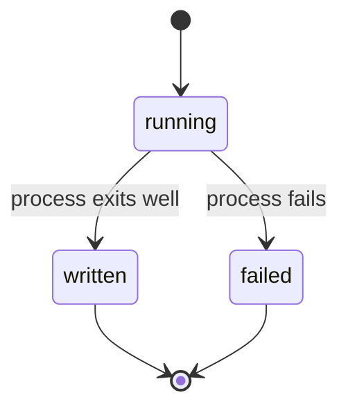

| State | What is true |
|---|---|
| `running` | A thread waits on the second process. |
| `written` | `PictureEvent::Written` was sent. |
| `failed` | `PictureEvent::Failed` was sent with the last line of stderr, or why the run could not start. |

| From | Trigger | To | What it does |
|---|---|---|---|
| none | `picture.write`, not suppressed | `running` | Answers where the PNG will be. |
| `running` | `command.output` with success | `written` | Reports the path. |
| `running` | `command.output` with failure, or an error | `failed` | Reports the path and message. |

Starts in `running`. Ends in `written` or `failed`.

Refused or ignored: `picture.write` answers nil while `suppressed` and in a tab.

Held by a pause, a `process` mode or a parked scene: `jobs::pump` delivers through `call_on`, which no pause or mode filters. A listener in a parked scene is not found and hears nothing.

### A `balaur update`

One replacement of this install from the command line. It has no variable of its own.

Source: `crates/balaur_cli/src/update.rs`, `run`, `replace`, `download_and_unpack`, `swap_install`.

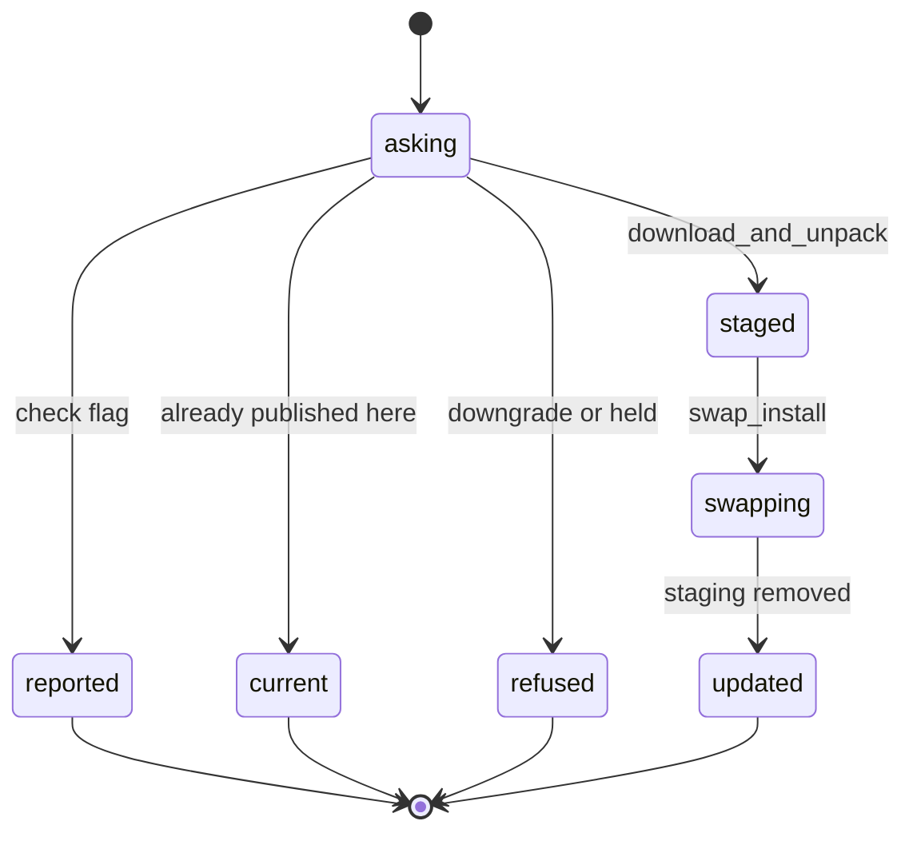

| State | What is true |
|---|---|
| `asking` | One VERSION read from a channel or tag. |
| `reported` | `--check` logged both ids and stopped. |
| `current` | The published id equals this build. |
| `refused` | An error: a downgrade not allowed, or `held` names a reason. |
| `staged` | `.balaur-update` in the install folder holds the unpacked bundle. |
| `swapping` | Each entry steps aside to `.old-<name>` and the new one moves in. |
| `updated` | Staging is removed. The note says to restart. |

| From | Trigger | To | What it does |
|---|---|---|---|
| `asking` | `run` with `--check` | `reported` | Logs and returns. |
| `asking` | `replace`, same id | `current` | Answers the up-to-date line. |
| `asking` | `replace`, an older build without `--allow-downgrade` | `refused` | Errors. |
| `asking` | `replace`, `held` answers a reason | `refused` | Errors for a macOS bundle or a cargo target directory. |
| `asking` | `download_and_unpack` | `staged` | Clears old staging, downloads, checks the hash when `SHA256SUMS` lists one, and unpacks. |
| `staged` | `swap_install` | `swapping` | Moves entries by rename. |
| `swapping` | `remove_dir_all` of staging | `updated` | Answers the line to show. |

Starts in `asking`. Ends in `reported`, `current`, `refused` or `updated`.

Refused or ignored: a wasm build errors "updating is not available in this build". A failed download or unpack ends the run with its error.

## Editor

### Play session

What the edited scene is doing. It is derived from `State.playing`, `State.played`, `State.release_at`, `physics::is_paused()` and `session.loaded`.

Source: `editor/scripts/shell.bs`, `toggle_play`, `begin_play`, `stop_play`, `release_world`; `editor/scripts/editor.bs`, `State`.

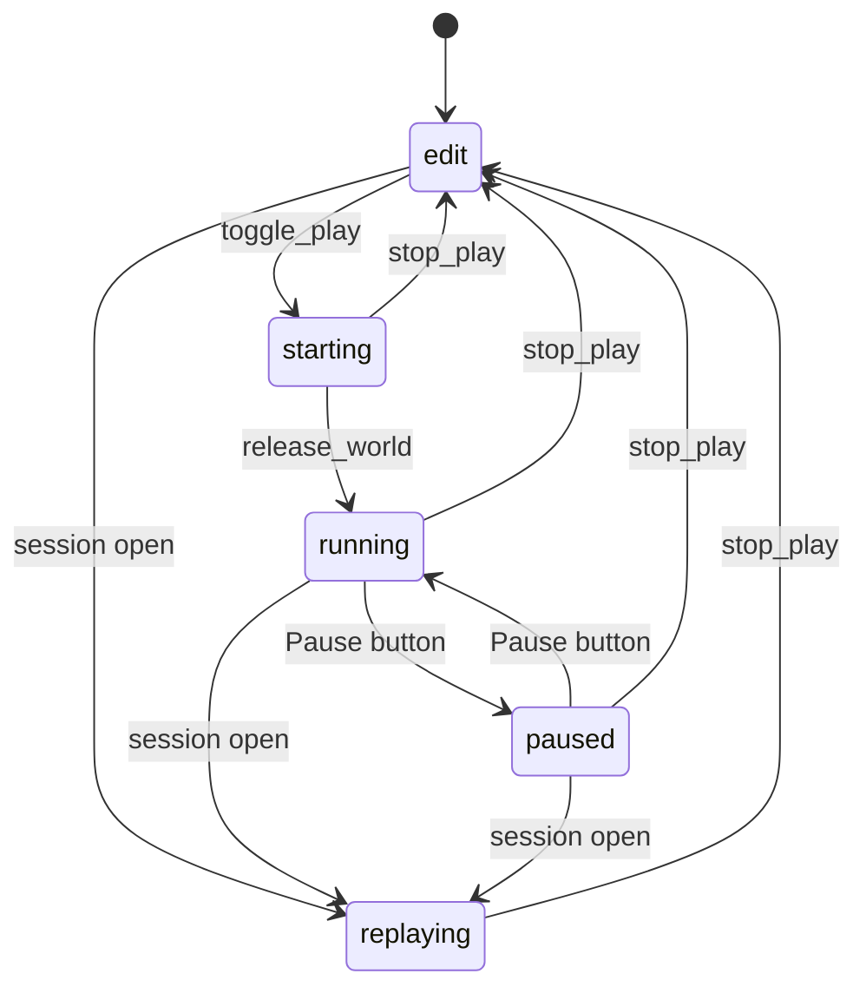

| State | What is true |
|---|---|
| `edit` | `playing` false, `played` "", `release_at` -1. The scene is built with no scripts, physics paused, players paused and game cameras held. |
| `starting` | `playing` true, `release_at` the next frame. Scripts are attached, the recording is open and the world does not step yet. |
| `running` | `playing` true, `release_at` -1. Physics and animation players run. |
| `paused` | `playing` true and `physics::is_paused()` true. Only physics stops. |
| `replaying` | `playing` true and `session.loaded` set. The bar's Pause and Stop act on the replay. |

| From | Trigger | To | What it does |
|---|---|---|---|
| `edit` | `toggle_play`: F5, the Play button, `--state play` | `starting` | `begin_play` commits history, keeps `played` and rebuilds. `session::start`, `attach_game_scripts`, `hold_game_cameras(true)`, `playing` true, output dock, `release_at` next frame. |
| `starting` | `release_world`, from the frame | `running` | `physics::set_paused(false)`, `anim::resume_all`. |
| `running` | `on_pause_pressed` | `paused` | `physics::set_paused(true)`. |
| `paused` | `on_pause_pressed` | `running` | `physics::set_paused(false)`. |
| any but `edit` | `toggle_play`, `stop_play`, `on_stop_pressed` | `edit` | Calls `debugger::resume(CONTINUE)` until `debugger::stop_location()` is nil. Then `release_at` -1, `session::end("stop")`, rebuild from `played`, `played` "", `playing` false, `theme::apply`, `apply_camera`. |
| any but `edit` | `shell::undo`, `shell::redo` | `edit` | `stop_for` logs and calls `stop_play`. |
| any but `edit` | suite `reopen` | `edit` | Calls `stop_play`. |
| any | `session::open` | `replaying` | See [Session replay](#session-replay). When `replay::load` answers nil it ends in `edit`, with `played` kept. |
| any | `model::build` | `edit` | Sets `playing` false, pauses physics and players and holds game cameras. `played` and `release_at` stay as they were. |

Starts in `edit`. Never ends.

Refused or ignored: autosave writes nothing while `playing`. The Play key is off while a script is stopped, and Break needs `playing` and no stop. A save or `reload_scripts` calls `session::end("reload")` and `playing` stays true.

Held by a pause, a `process` mode or a parked scene: the Pause button never calls `engine.set_paused`, so scripts keep their `update`. A game's own `engine.set_paused` covers the subtree `debugger::set_scope` names, which is the mirror. A script stop holds that subtree too, so `Editor.update` and `release_world` run on.

### Session recording

The recording the running play session writes into.

Source: `editor/scripts/session.bs`, `SessionState.recording`.

| State | What is true |
|---|---|
| `""` | Nothing is recording. |
| a path | This play session records into that file. |

| From | Trigger | To | What it does |
|---|---|---|---|
| `""` | `session::start`, from `toggle_play`, `replay::record` answers the path | a path | Passes the fingerprint and `verify` as `digest`. Marks the list stale. |
| `""` | `session::start`, `replay::record` answers nil | `""` | The verb logged a warn. Play goes on with no recording. |
| a path | `session::finish(reason)`, from `session::end` | `""` | `replay::stop(reason)`, then `prune` keeps the newest `editor/recordings/keep` files, 10 by default, and every `kept-*`. |

Starts in `""`. Never ends.

Refused or ignored: `finish` with nothing open returns. Reasons passed are `"stop"` and `"reload"`.

### Session replay

The recording playing in the editor. It is derived from `session.loaded` and `replay::state()`.

Source: `editor/scripts/session.bs`, `SessionState.loaded`, `open`, `release`, `seek`, `toggle_pause`, `scrubbing`.

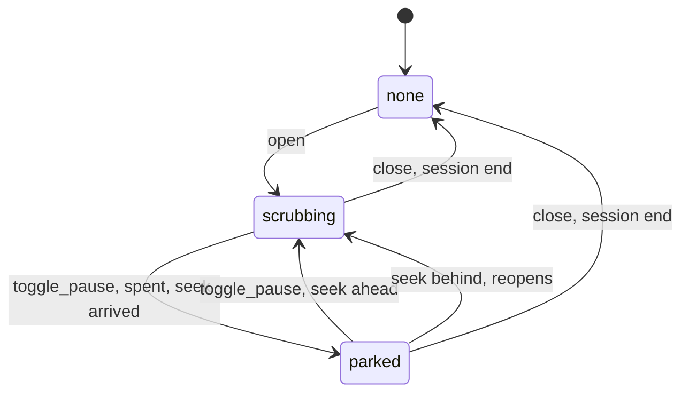

| State | What is true |
|---|---|
| `none` | `loaded` is `""`. |
| `scrubbing` | `loaded` is set and `replay::state()` is not `paused`. Recorded input is fed, so viewport tools stand aside and each frame asks for a repaint. |
| `parked` | `loaded` is set and `replay::state()` is `paused`. The pointer is the reader's again. |

`session.at` is the tick the detail list describes. `session.first`, `last`, `lanes` and `header` are filled once at `open`.

| From | Trigger | To | What it does |
|---|---|---|---|
| any | `session::open(name)`: Replay button | `scrubbing` | `stop_play`, `begin_play`, `replay::load`, header, span, lanes, caches cleared, stale warning, `attach_game_scripts`, `hold_game_cameras(true)`, `playing` true, recordings dock, `release_at` next frame, `replay::play`. |
| any | `session::open`, `replay::load` answers nil | `none` | The verb logged a warn. `open` returns after `begin_play`, so the scene is rebuilt, `playing` is false and `played` is kept. |
| `scrubbing` | `toggle_pause`: the bar's Pause, the lanes' Play | `parked` | `replay::pause`. |
| `parked` | `toggle_pause` | `scrubbing` | `replay::play`. |
| `scrubbing` | the player spends its frames | `parked` | `after_frame`. |
| `parked`, `scrubbing` | `seek(tick)`, tick at or past position: marks, scrubber, `step` | `scrubbing`, then `parked` | Sets `at`, calls `replay::seek`. |
| `parked`, `scrubbing` | `seek(tick)`, tick behind | `scrubbing`, then `parked` | Sets `at`, calls `open` again, then `replay::seek`. |
| `scrubbing` | `session::update`, each frame | same | Sets `at` to `replay::position()`. |
| `scrubbing`, `parked` | `session::close`, `stop_play` | `none` | `session::end`, then `release` clears the fields and calls `replay::unload`. |
| `scrubbing`, `parked` | `session::end("reload")`: `save_buffer`, `reload_scripts` | `none` | `release` runs and the game goes on live. |

Starts in `none`. Never ends.

Refused or ignored: `step`, `seek` and `update` do nothing with nothing loaded.

### Session list

The cached listing of recordings on disk.

Source: `editor/scripts/session.bs`, `SessionState.list`, `SessionState.listed_at`.

| State | What is true |
|---|---|
| `listed_at` -1.0 | Stale. The next `listing` reads the folder. |
| `listed_at` a time | `list` is reused for 0.5 s. |

| From | Trigger | To | What it does |
|---|---|---|---|
| any | `listing`, stale or older than 0.5 s | a time | Reads each header with `replay::info`, newest first. A nil answer lists as `unreadable`. |
| any | `start`, `finish`, `open`, `keep`, `remove` | -1.0 | Marks it stale. |

Starts in -1.0. Never ends.

### Session verify

Whether a recording hashes the world every tick.

Source: `editor/scripts/session.bs`, `SessionState.verify`.

| State | What is true |
|---|---|
| `false` | Recordings carry no per-tick digest. |
| `true` | `replay::record` is given `digest: true`. |

| From | Trigger | To | What it does |
|---|---|---|---|
| any | `dock::recordings_verify` | flipped | Tells the recordings panel. |
| `false` | `selftest::sessions` | `true` | The self-test checks the replay. |

Starts in `false`. Never ends.

### Session self-test

The `--state` driver that records, replays and closes a session.

Source: `editor/scripts/selftest.bs`, `Demo`, `sessions`, `session_step`; `editor/scripts/session.bs`, `SessionState.demo`.

| State | What is true |
|---|---|
| `nil` | Not running. |
| `Demo { frames, file, was }` | Running. `frames` counts up to 9 to stop, 10 to open and 28 to check. |

| From | Trigger | To | What it does |
|---|---|---|---|
| `nil` | `selftest::sessions` | `Demo` | Sets `verify`, then `toggle_play`. |
| `Demo` | `session_step`, frame 9 | same | `stop_and_check`. With no file listed it goes to `nil`. |
| `Demo` | `session_step`, frame 10 | same | `open_and_check`. A file that does not load goes to `nil`. |
| `Demo` | `session_step`, frame 28 | `nil` | `replayed_and_check`, `session::close`, removes the file. |

Starts in `nil`. Ends in `nil`.

### Editor debugger view

What the editor believes about a script stop.

Source: `editor/scripts/shell.bs`, `DebugState.paused`, `stopped`, `resume`, `on_pause`.

| State | What is true |
|---|---|
| `nil` | No stop. The dock says the game runs, or to set breakpoints. |
| a map | Stopped. `paused_rel` is the script and `frame` the picked frame. Continue and the step keys are on. |

| From | Trigger | To | What it does |
|---|---|---|---|
| `nil` | `on_debugger_stopped(map)` | a map | `on_pause` sets `paused_rel` and frame 0, selects the node, opens the Script workspace and the debugger dock, and logs. |
| a map | `on_debugger_stopped(map or nil)` | new value | Tells the debugger panel. |
| a map | `shell::resume(mode)`: keys, dock, showcase | `nil` | `debugger::resume(mode)`. |
| a map | `stop_play` | `nil` | Calls `debugger::resume` until the stop is gone, then clears `paused`. |

Starts in `nil`. Never ends.

Refused or ignored: Break calls `debugger::request_break` and changes nothing until a stop lands. `events::resumed` forgets the stop, so no `debugger_stopped` nil follows `stop_play`.

### Break self-test

The `breakdemo` driver that alternates a step and a continue on each stop.

Source: `editor/scripts/shell.bs`, `DebugState.demo`, `break_demo`.

| State | What is true |
|---|---|
| `nil` | Not running. |
| an int | The stops seen so far. |

| From | Trigger | To | What it does |
|---|---|---|---|
| `nil` | `break_demo` | 0 | Sets a breakpoint on the first scripted node's `update`, then `toggle_play`. |
| n | `shell::stopped` with a map | n+1 | Resumes with `STEP_OVER` on an odd count, `CONTINUE` on an even one. |

Starts in `nil`. Never ends.

### Start screen

Whether the project manager has the window. It is derived from `manager.on`, `manager.back` and `game_root`.

Source: `editor/scripts/manager.bs`, `ManagerState`, `showing`, `open`, `open_over`, `close`.

```mermaid
stateDiagram-v2
    [*] --> hidden
    [*] --> shown: no project, manager state
    hidden --> shown: open
    hidden --> over: open_over
    over --> hidden: close
    over --> shown: open
    shown --> over: open_over
    shown --> shown: close ignored
```

| State | What is true |
|---|---|
| `hidden` | `on` false and `game_root` set. `showing` is false and the frame runs the scene. |
| `shown` | `on` true and `back` false. `showing` is true. Nothing leads back. |
| `over` | `on` true and `back` true, over an open project. Esc and the Back button return. |

With `game_root` `""`, `showing` is true whatever `on` says. `edit_project` passes the `manager` start state in that case.

| From | Trigger | To | What it does |
|---|---|---|---|
| any | `open`, `open_examples`, `open_new`, `open_versions` | `shown` | Sets `read` false and tells the screen. In a tab it forces the `projects` tab. |
| any | `open_over`, palette, `pick` with no folder chosen | `over`, or `shown` with no project | `back` is `game_root != ""`. |
| `over` | `close`: Esc, `on_back_pressed` | `hidden` | Sets `on` and `back` false. |

Starts in `hidden`, or `shown` with no project. Never ends.

Refused or ignored: `close` does nothing without `back`. Esc does nothing while the New project sheet is up. While `showing`, the frame skips scene work and autosave writes nothing.

### Shell cover

Whether the shell under the start screen is hidden.

Source: `editor/scripts/manager.bs`, `ManagerState.covering`, `cover`.

| State | What is true |
|---|---|
| `false` | The shell is visible. |
| `true` | The shell is hidden. |

| From | Trigger | To | What it does |
|---|---|---|---|
| `false` | `fill`, `on` true | `true` | Sets `Editor/Shell` not visible. |
| `true` | `fill`, `on` false | `false` | Sets `Editor/Shell` visible and hides the screen. |

Starts in `false`. Never ends.

### Start screen tab

Which page the start screen shows.

Source: `editor/scripts/manager.bs`, `ManagerState.tab`.

```mermaid
stateDiagram-v2
    [*] --> projects
    projects --> examples: open_examples, page picked
    projects --> forge: page picked
    projects --> engine: open_versions, page picked
    examples --> projects: page picked
    forge --> projects: page picked
    engine --> projects: page picked
```

| State | What is true |
|---|---|
| `"projects"` | Recent projects. The only page in a tab. |
| `"examples"` | Examples shipped beside the editor. |
| `"forge"` | Public projects on Forge. The first look calls `forge::search`. |
| `"engine"` | This build and the release feed. |

| From | Trigger | To | What it does |
|---|---|---|---|
| any | `on_page_picked` | named page | Any page to any page. |
| any | `open_examples` | `"examples"` | Opens the screen. |
| any | `open_versions` | `"engine"` | Opens the screen. |
| any, in a browser tab | `open` | `"projects"` | The other pages are not offered there. |

The diagram draws `on_page_picked` only through `projects`. It goes from any page to any page.

Starts in `"projects"`. Never ends.

### Recent list

Whether the start screen has read what this machine has opened.

Source: `editor/scripts/manager.bs`, `ManagerState.read`, `refresh`.

| State | What is true |
|---|---|
| `false` | The next `fill` reads the list. |
| `true` | `recent`, `parent` and `follow` are filled. |

| From | Trigger | To | What it does |
|---|---|---|---|
| `false` | `refresh`, from `fill` | `true` | `project::recent`, and `parent` and `follow` where empty. |
| `true` | `open`, `on_forget_pressed` | `false` | Reads it again next time. |

Starts in `false`. Never ends.

### Editor release check

Whether the editor has asked the feed, and whether a read is out.

Source: `editor/scripts/manager.bs`, `ManagerState.asked`, `ManagerState.reading`, `check`, `heard`.

```mermaid
stateDiagram-v2
    [*] --> never
    never --> reading: check
    never --> asked_only: check refused
    reading --> answered: listed, failed
    asked_only --> reading: check
    answered --> reading: check
```

| State | What is true |
|---|---|
| `never` | `asked` false, `reading` false. About asks when it opens. |
| `asked_only` | `asked` true, `reading` false. `release::check` answered false while a recording plays. |
| `reading` | `asked` true, `reading` true. |
| `answered` | `asked` true, `reading` false. `releases` or `failed` holds the answer. |

| From | Trigger | To | What it does |
|---|---|---|---|
| any but `reading` | `manager::check`: Engine tab, About | `reading`, `asked_only` | `reading` takes the answer of `release::check`. |
| `reading` | `heard` `listed` | `answered` | Fills `releases`. |
| `reading` | `heard` `failed`, `job` not `install` | `answered` | Sets `failed`. |

Starts in `never`. Never ends.

Refused or ignored: `check` returns while `reading`.

### Editor engine install

The install the Engine tab and About show.

Source: `editor/scripts/manager.bs`, `ManagerState.installing`, `Installing`, `put`, `heard`, `installing`.

```mermaid
stateDiagram-v2
    [*] --> idle
    idle --> downloading: put
    downloading --> downloading: heard downloading
    downloading --> unpacking: heard unpacking
    unpacking --> idle: heard installed, failed
    downloading --> idle: heard installed, failed
```

| State | What is true |
|---|---|
| `idle` | `installing.tag` is `""`. |
| `downloading` | `tag` is set, `done` and `total` move and `unpacking` is false. |
| `unpacking` | `tag` is set and `unpacking` is true. |

| From | Trigger | To | What it does |
|---|---|---|---|
| `idle` | `put(channel, tag)` | `downloading` | `release::install` allowing a downgrade. Sets `note`. |
| `downloading` | `heard` `downloading` | `downloading` | Sets `tag`, `done` and `total`. |
| `downloading` | `heard` `unpacking` | `unpacking` | Sets `unpacking`. |
| any but `idle` | `heard` `installed` | `idle` | Sets `note`, clears `failed`, logs. |
| any but `idle` | `heard` `failed`, `job` `install` | `idle` | Sets `failed`. |

Starts in `idle`. Never ends.

Refused or ignored: `put` returns during an install. `put` says "nothing installs while a recording plays" when `release::install` answers false. `go` refuses to open a project during an install.

### Forge search asked

Whether the start screen has sent its first Forge search.

Source: `editor/scripts/manager.bs`, `ManagerState.forge_asked`.

| State | What is true |
|---|---|
| `false` | The next `forge_specs` calls `forge::search`. |
| `true` | A search was accepted. `forge` holds the last answer. |

| From | Trigger | To | What it does |
|---|---|---|---|
| `false` | `forge_specs` | answer of `forge::search` | False while a recording plays, so it asks again. |

Starts in `false`. Ends in `true`.

### Forge copy

A Forge project being copied into the projects folder.

Source: `editor/scripts/manager.bs`, `ManagerState.copying`, `copy_forge_project`, `forge_heard`.

| State | What is true |
|---|---|
| `""` | No copy runs. |
| a project | `forge::copy` was accepted for it. The page says so. |

| From | Trigger | To | What it does |
|---|---|---|---|
| `""` | `copy_forge_project`, `forge::copy` answers true | a project | Tells the screen. |
| a project | `forge_heard` `copied` | `""` | Calls `go` on the new folder. |
| any | `forge_heard` `failed`, `job` `copy` or `search` | `""` | Sets `failed`. |

Starts in `""`. Never ends.

Refused or ignored: `copy_forge_project` does nothing while one runs.

### Start screen error

The last failure the start screen's head shows.

Source: `editor/scripts/manager.bs`, `ManagerState.failed`.

| State | What is true |
|---|---|
| `""` | No error is shown. |
| text | The head shows this error. |

| From | Trigger | To | What it does |
|---|---|---|---|
| any | `heard` `failed`, `forge_heard` `failed` | text | Shows the job's message. |
| any | `open_example`, `create`, `go` with an `error` | text | Shows the verb's error. |
| any | `on_install_typed_pressed` with no tag | text | Asks for a tag. |
| any | `put` refused, `go` during an install | text | Says why. |
| any | `heard` `installed`, `create` ok, `put` ok, `go` ok | `""` | Clears it. |

Starts in `""`. Never ends.

### Start screen note

The last line about an install that the start screen's head shows.

Source: `editor/scripts/manager.bs`, `ManagerState.note`.

| State | What is true |
|---|---|
| `""` | No note is shown. |
| text | The head shows this note. |

| From | Trigger | To | What it does |
|---|---|---|---|
| any | `put` ok | text | Says what is installing. |
| any | `heard` `installed` | text | Holds the note the job sent, and logs it. |

Starts in `""`. Never ends.

### Open project

Which project this editor process edits. One process is one project.

Source: `editor/scripts/model.bs`, `load`; `editor/scripts/manager.bs`, `go`; `crates/balaur_cli/src/main.rs`, `edit_project`; `crates/balaur_cli/src/project_api.rs`, `open`, `relaunch`; `crates/balaur_cli/src/project_web.rs`, `open`.

| State | What is true |
|---|---|
| `game_root` `""` | No project. The start screen holds the window. `game_name` and `scene_rel` are empty. |
| `game_root` a path | The project is a second file root, its dependencies are installed and its `[input]` is declared. |

| From | Trigger | To | What it does |
|---|---|---|---|
| none | `edit_project`, `project.toml` found, then `model::load` | a path | Opens `main_scene`. |
| none | `edit_project`, no `project.toml`, then `model::load` | `""` | Adds the `manager` start state. |
| any | `manager::go`, desktop, a project folder | process ends | `remember`, spawns `<exe> edit <path>`, `request_quit`. |
| any | `manager::go`, browser tab, a kept project | page reloads | Leaves the id in `sessionStorage`, then loads the page again. |
| any | window Close | process ends | `pump_input` announces `on_quit_requested`, then `request_quit`. No editor script defines that hook. |
| any | suite `reopen`, `reboot` | same | `fresh_state`, then `boot` reads the project again. |

Starts in the state argv names. Ends with the process or the page.

Refused or ignored: `manager::go` shows an error for a folder with no `project.toml` or a tab's unknown id, and refuses during an install.

### Splash

Whether the shell has settled enough to drop the splash.

Source: `editor/scripts/editor.bs`, `State.formed`, `frame`.

| State | What is true |
|---|---|
| `false` | The splash is up and each frame asks for a repaint. |
| `true` | `ui::finish_loading` ran. A queued import may drip. |

| From | Trigger | To | What it does |
|---|---|---|---|
| `false` | `frame`: frame 3 or later and `layout::settled`, or frame 30 | `true` | Calls `ui::finish_loading`. |

Starts in `false`. Ends in `true`.

### Start states applied

Whether the `--state` list has run.

Source: `editor/scripts/editor.bs`, `State.states_applied`, `apply_start_states`.

| State | What is true |
|---|---|
| `false` | The list waits for its frame. |
| `true` | Each token ran once through `shell::apply_start_state`. |

| From | Trigger | To | What it does |
|---|---|---|---|
| `false` | `apply_start_states`, from `frame` | `true` | Runs each token. |
| `true` | `suite::step` starts the next item | `false` | Installs the next item's list. |

Starts in `false`. Never ends.

Refused or ignored: outside the start screen, the list waits for `platform_read`.

### Screen measured

Whether the editor has measured the room the shell has.

Source: `editor/scripts/editor.bs`, `State.platform_read`, `relayout`.

| State | What is true |
|---|---|
| `false` | The room is unknown. |
| `true` | Start states may run outside the start screen. |

| From | Trigger | To | What it does |
|---|---|---|---|
| `false` | `relayout`, room width above 0 | `true` | Allows `apply_start_states`. |

Starts in `false`. Ends in `true`.

### Suite run

Several start states in one run, each on a freshly opened editor.

Source: `editor/scripts/suite.bs`, `Run`, held in `State.suite`.

```mermaid
stateDiagram-v2
    state "Run, boot_due true" as boot_due
    state "Run, running" as running
    [*] --> nil
    nil --> running: begin, first step
    running --> running: state still busy
    running --> boot_due: state quiet, more queued
    boot_due --> running: reboot
    running --> nil: queue empty
```

| State | What is true |
|---|---|
| `nil` | No suite runs. |
| `Run`, running | `current` is set, `frames` and `quiet` count, `budget` is `@<frames>` or 0. |
| `Run`, `boot_due` true | A fresh state is in place and not booted yet. |

| From | Trigger | To | What it does |
|---|---|---|---|
| `nil` | `suite::begin`, from `suite:` | `Run` | Queues the items. |
| `Run` | `suite::step`, `waiting` true | same | Counts the frame and asks for a repaint. |
| `Run` | `suite::step`, quiet or at 900 frames, more queued | `Run` | Logs done or an error, calls `reopen` after the first, sets `start_states`, logs `suite: start`. |
| `Run`, `boot_due` | `suite::reboot` at the top of `update` | `Run`, running | `editor::boot` without listening again. |
| `Run` | `suite::step`, queue empty | `nil` | `engine::quit(0)`. |

Starts in `nil`. Ends in `nil`.

### Undo stack

The steps behind and ahead of the edited scene.

Source: `editor/scripts/history.bs`, `History.past`, `History.future`.

```mermaid
stateDiagram-v2
    [*] --> empty
    empty --> behind: record
    behind --> behind: record, undo, redo
    behind --> both: undo
    behind --> ahead: undo last
    ahead --> both: redo
    ahead --> behind: record, redo last
    both --> both: undo, redo
    both --> behind: record, redo last
    both --> ahead: undo last
    behind --> empty: reset
    ahead --> empty: reset
    both --> empty: reset
```

| State | What is true |
|---|---|
| `empty` | `past` and `future` are empty. `undo` and `redo` answer nil. |
| `behind` | `past` holds steps and `future` is empty. |
| `ahead` | `past` is empty and `future` holds steps. |
| `both` | Both hold steps. |

| From | Trigger | To | What it does |
|---|---|---|---|
| any | `reset`, from `open_scene` and `load` | `empty` | Discards `take_changes`. |
| any | `record` that opens a step | `behind` | Pushes a step with the selection and `[[assets]]`, empties `future`, tells the bars. Past 100 steps the oldest goes. |
| `behind`, `both` | `undo` | `behind`, `both`, `ahead` | `restore`: moves the top to `future` and writes its changes back, last first. Reselects and rebuilds if `[[assets]]` differ. |
| `ahead`, `both` | `redo` | `ahead`, `both`, `behind` | `restore`, the other way. |
| `behind`, `both` | `take` | same | Adds kept changes to the top of `past`. |

Starts in `empty`. Never ends.

Refused or ignored: `take` does nothing when nothing was kept or `past` is empty. `shell::undo` and `shell::redo` stop a running game first.

### Saved point

Where the last save sits in the undo stack. It is derived from `History.saved` and `past.len`.

Source: `editor/scripts/history.bs`, `History.saved`, `dirty`, `mark_saved`.

```mermaid
stateDiagram-v2
    [*] --> clean
    clean --> edited: record, undo, redo
    edited --> clean: mark_saved, undo or redo back
    edited --> lost: saved step falls off
    lost --> clean: mark_saved
    clean --> clean: reset
    edited --> clean: reset
    lost --> clean: reset
```

| State | What is true |
|---|---|
| `clean` | `saved` equals `past.len`. `dirty` is false. |
| `edited` | `saved` differs from `past.len`. `dirty` is true. |
| `lost` | `saved` is -1. `dirty` is true until the next save. |

| From | Trigger | To | What it does |
|---|---|---|---|
| any | `mark_saved`, from `model::write` | `clean` | Sets `saved` to `past.len`. |
| `clean` | `record` that opens a step | `edited` | `past` grows. |
| `edited` | `undo`, `redo` to the saved position | `clean` | Compares by position. |
| `clean`, `edited` | `undo`, `redo` away from it | `edited` | Compares by position. |
| any with `saved` 0 | `record` past 100 steps | `lost` | Sets `saved` to -1. |
| any with `saved` above 0 | `record` past 100 steps | same | Takes 1 from `saved`. |
| any | `reset` | `clean` | Sets `saved` to 0. |

Starts in `clean`. Never ends.

### Coalescing drag

The drag a new record may still fold into.

Source: `editor/scripts/history.bs`, `History.key`, `History.at`.

| State | What is true |
|---|---|
| `nil` | The next record opens its own step. |
| a key | A record with this key inside 0.4 s folds into the open step. |

| From | Trigger | To | What it does |
|---|---|---|---|
| any | `record` with a key that opens a step | a key | Sets `at`. |
| a key | `record`, same key inside 0.4 s | same | Moves `at` and opens no step. |
| any | `record` with `nil` | `nil` | Opens a step. |
| any | `commit`: selection moved, drag ended, `begin_play` | `nil` | Takes kept changes. |
| any | `restore`, `reset` | `nil` | Ends the run. |

Starts in `nil`. Never ends.

### Kept changes

The subtree whose writes the engine keeps for undo.

Source: `crates/balaur_core/src/changes.rs`, `Changes.keeping`; script `scene.keep_changes`, `scene.take_changes`.

| State | What is true |
|---|---|
| `None` | No change is kept. |
| `Some(root)` | Each change under `root` is kept with what it replaced. |

| From | Trigger | To | What it does |
|---|---|---|---|
| any | `scene.keep_changes(nil)`: start of `model::build`, end of `begin_play` | `None` | Clears what was kept. |
| any | `scene.keep_changes(root)`: end of `model::build` | `Some` | Clears what was kept. |
| `Some` | `scene.take_changes` | same | Answers and empties the list. |

Starts in `None`. Never ends.

During play the editor keeps nothing, because `begin_play` ends in `None`. `stop_play` rebuilds, which sets it again.

### Scene autosave

Whether an edit to the scene may be written now. It is derived each frame.

Source: `editor/scripts/autosave.bs`, `write_settled`, `step`, `waiting`, `scripted`.

```mermaid
stateDiagram-v2
    [*] --> scripted: start states
    [*] --> held
    held --> settling: edit made, gates open
    settling --> settling: another edit
    settling --> held: a gate closes
    settling --> written: 0.6 s pass
    written --> held: mark_saved
```

| State | What is true |
|---|---|
| `scripted` | `start_states` is set or a suite runs. `step` returns and no file is written. |
| `held` | History is not dirty, or a game plays, isolate is on, a gizmo drags, the start screen shows, or the scene is read-only. |
| `settling` | Every gate is open and under 0.6 s passed since `history.at`. `waiting` asks for frames. |
| `written` | `anim::save` and `model::write` ran. |

| From | Trigger | To | What it does |
|---|---|---|---|
| `held` | an edit with every gate open | `settling` | `history::dirty` turns true. |
| `settling` | `write_settled` with 0.6 s passed | `written` | Writes the scene. |
| `written` | `history::mark_saved`, inside `model::write` | `held` | `dirty` turns false. |
| `settling` | a gate closes | `held` | Waits. |

Starts in `held`, or `scripted` under `--state`. Never ends.

Held by a pause, a `process` mode or a parked scene: `state.playing` closes the gate whatever the game's pause says.

### Script buffer

Whether an open code buffer has text not yet written. It is held per path.

Source: `editor/scripts/editor.bs`, `State.script_dirty`; `editor/scripts/autosave.bs`, `write_typed`; `editor/scripts/shell.bs`, `save_buffer`.

| State | What is true |
|---|---|
| path absent | The buffer matches its file. |
| path present | Holds the wall-clock second it was last typed into. |

| From | Trigger | To | What it does |
|---|---|---|---|
| any | `center::code_typed`, `complete` insert, `refactor::apply`, `shell::format_active` | present | Updates the buffer and the time. |
| any | showcase `edit_source` | present | Updates the buffer and holds `true` in place of a time. |
| present | `write_typed`, 1.5 s rested | absent | `save_buffer`: writes, ends a session with `"reload"` for a script, and reloads it. |
| present | `shell::save_active` | absent | `save_buffer`, at once. |
| present | `carry_script_state`, a script renamed | absent | Moves the buffer to the new path. |

Starts absent. Never ends.

Refused or ignored: `write_typed` runs only through `step`, so a scripted run writes nothing. A shader is written without ending a session.

### Export sheet row

How the last export of one target went.

Source: `editor/scripts/exporter.bs`, `ExporterState.status`, `ExporterState.said`, `report`, `on_export_clicked`.

```mermaid
stateDiagram-v2
    state "no status" as none
    [*] --> none
    none --> started: export clicked
    started --> done: report done
    started --> failed: report failed
    done --> started: export clicked
    failed --> started: export clicked
```

| State | What is true |
|---|---|
| absent or `""` (`none` above) | Never exported in this run. |
| `"started"` | The row says building and offers no button. |
| `"done"` | `said` is the path and `landed` is set. |
| `"failed"` | `said` is the reason. |

| From | Trigger | To | What it does |
|---|---|---|---|
| any | `on_export_clicked`, `export::start` answers true | `"started"` | Passes `download: true`. |
| any | `report` `started` | `"started"` | Clears `said`. |
| any | `report` `done` | `"done"` | Sets `said` and `landed`, logs and reads the targets again. |
| any | `report` `failed` | `"failed"` | Sets `said` and warns. |

Starts absent. Never ends.

Refused or ignored: `report` drops an event with no target. When `export::start` answers false, `on_export_clicked` logs it and leaves the status alone.

### Import line

One import's line in the Assets bar.

Source: `editor/scripts/dropin.bs`, `State.jobs`, `new_job`, `report`, `ended`, `sweep`.

```mermaid
stateDiagram-v2
    [*] --> running
    [*] --> imported: done before started
    [*] --> stopped: cancelled before started
    [*] --> failed: failed before started
    running --> running: wrote
    running --> imported: done
    running --> stopped: cancelled
    running --> failed: failed
    imported --> [*]: sweep
    stopped --> [*]: sweep
    failed --> [*]: sweep
```

| State | What is true |
|---|---|
| `over` `""` (`running` above) | Running. `in_flight` counts it. |
| `over` `"imported"` (`imported` above) | Ended well. It stays listed. |
| `over` `"stopped"` (`stopped` above) | Cancelled. |
| `over` `"failed"` (`failed` above) | Failed, and the output dock opened. |

| From | Trigger | To | What it does |
|---|---|---|---|
| none | `report` `started` | `""` | `new_job`, keyed by source. |
| `""` | `report` `wrote` | `""` | Sets `done` and `files`. |
| any or none | `report` `done` | `"imported"` | `model::forget`, logs, and `instance_scene` when there is a scene. |
| any or none | `report` `cancelled` | `"stopped"` | Sets `done`, `model::forget`, logs. |
| any or none | `report` `failed` | `"failed"` | Logs an error and opens the output dock. |
| ended | `sweep`, 4 s after the batch's last end | removed | Takes down the whole list at once. |

Starts in `""`, or ended when a cancel or failure comes first. Ends removed.

Refused or ignored: `drop_import` logs a refusal when `import::start` answers false. The Import button cancels while one runs.

### Import queue

Files queued by the `imports:` start state or a showcase.

Source: `editor/scripts/editor.bs`, `State.import_queue`, `State.import_drip`; `editor/scripts/shell.bs`, `state_imports`.

```mermaid
stateDiagram-v2
    [*] --> idle
    idle --> dripping: state_imports
    dripping --> idle: queue empty
    dripping --> manual: drip_off
    manual --> idle: queue empty
```

| State | What is true |
|---|---|
| `idle` | `import_queue` is empty. |
| `dripping` | `import_drip` true and files left. One goes per frame once `formed`. |
| `manual` | `import_drip` false and files left. A showcase's `import_next` takes one per beat. |

| From | Trigger | To | What it does |
|---|---|---|---|
| any | `state_imports` | `dripping` | Fills the queue and shows the assets dock. |
| `dripping` | `frame` | `dripping`, `idle` | `dropin::take` of the next file. |
| `dripping` | showcase `drip_off` | `manual` | Sets `import_drip` false. |
| `manual` | showcase `import_next` | `manual`, `idle` | `dropin::take` of the next file. |

Starts in `idle`. Never ends.

## Not states

| Name | Source | Values | What it is |
|---|---|---|---|
| `replay::Step` | `crates/balaur_core/src/replay.rs` | `Live`, `Hold`, `Frames(n)` | What one `App::advance` does, answered by `ReplayPlayer::plan`. `Stopped` gives `Live`. No frames left or `Paused` gives `Hold`. `Playing` gives `Frames(1)`. `Seeking` gives `Frames(remaining)`. |
| `Trailer.reason` | `crates/balaur_core/src/replay.rs` | `"stop"`, `"reload"`, `"quit"` | Why a recording ended, written once at its end. |
| `stepping::Step` | `crates/balaur_bs/src/runtime/stepping.rs` | `Done(Value)`, `Waiting`, `Paused(Paused)` | How one steppable call came back. |
| `Outcome` | `crates/balaur_bs/src/runtime/engine.rs` | `Done(results)`, `Parked` | How one resumable Wasm call came back. |
| `StepMode` | `crates/balaur_script/src/debug.rs` | `Continue` (`"continue"`, `debugger.CONTINUE`), `Over` (`"over"`, `debugger.STEP_OVER`), `Into` (`"into"`, `debugger.STEP_INTO`), `Out` (`"out"`, `debugger.STEP_OUT`) | How a paused script leaves its pause. No argument means `Continue`. |
| `Command` | `crates/balaur_bs/src/runtime/debugger.rs` | `Continue`, `StepOver`, `StepInto`, `StepOut` | `StepMode` on the `balaur_bs` side. |
| `PauseReason` | `crates/balaur_script/src/debug.rs` | `Breakpoint` (`"breakpoint"`), `Step` (`"step"`), `Pause` (`"pause"`), `Error` (`"error"`) | Why a script stopped, as `stop.reason`. The DAP sends `Error` as `"exception"`. |
| `StopReason` | `crates/balaur_bs/src/runtime/debugger.rs` | `Breakpoint`, `Step`, `Asked`, `Error` | `PauseReason` on the `balaur_bs` side. `Asked` becomes `Pause`. |
| `Polled` | `crates/balaur_script_bs/src/host/tasks.rs` | `Waiting(p)`, `Done(v, done)`, `Stopped` | How one poll of a task came back to the host. |
| `ImportEvent` | `crates/balaur_cli/src/import_api.rs` | `Started { source, files }` (`"started"`), `Wrote { source, path, done, files }` (`"wrote"`), `Done { source, scene, note }` (`"done"`), `Failed { source, message }` (`"failed"`), `Cancelled { source, done }` (`"cancelled"`) | One step of an import, heard by `on_import_event`. |
| `ExportEvent` | `crates/balaur_cli/src/export_shared.rs` | `Started { target }` (`"started"`), `Done { target, path }` (`"done"`), `Failed { target, message }` (`"failed"`) | One step of an export, heard by `on_export_event`. |
| `ReleaseEvent` | `crates/balaur_cli/src/project_api/release.rs` | `Listed { rows }` (`"listed"`), `Downloading { tag, done, total }` (`"downloading"`), `Unpacking { tag }` (`"unpacking"`), `Installed { tag, note }` (`"installed"`), `Failed { job, message }` (`"failed"`) | One report of a feed read or an install, heard by `on_release_event`. |
| `ForgeEvent` | `crates/balaur_cli/src/project_api/forge.rs` | `Listed { rows }` (`"listed"`), `Fetched { alias }` (`"fetched"`), `Copied { path }` (`"copied"`), `Failed { job, message }` (`"failed"`) | One report of a Forge job, heard by `on_forge_event`. |
| `PictureEvent` | `crates/balaur_cli/src/project_api/picture.rs` | `Written { path }` (`"written"`), `Failed { path, message }` (`"failed"`) | How a picture went, heard by `on_picture_event`. |
| `update::Step` | `crates/balaur_cli/src/update.rs` | `Downloading(done, total)`, `Unpacking` | How far an install has got, passed to a progress callback. |
| `task::Progress` | `crates/balaur_core/src/task.rs` | `More`, `Done` | How far one slice of stepped work got. |
