# Lifecycle

How the app, its nodes and its scripts come to be, what states they pass through, and how they end. Every state is defined, in code's own spelling.

| Page | What it covers |
| --- | --- |
| This page | The app, a frame, what holds what, nodes, components, scripts, tasks, scene switches |
| [LIFECYCLE-runtime.md](LIFECYCLE-runtime.md) | Animation, audio, physics, input, widgets, the window |
| [LIFECYCLE-networking.md](LIFECYCLE-networking.md) | Links, multiplayer, sockets, HTTP, Gamend, the platform |
| [LIFECYCLE-tools.md](LIFECYCLE-tools.md) | Recording, replay, rollback, the debugger, jobs, the editor |

[generated/hooks.md](generated/hooks.md) lists every hook a script can declare. [DETERMINISM.md](DETERMINISM.md) has what a replay and a snapshot keep.

## How it fits

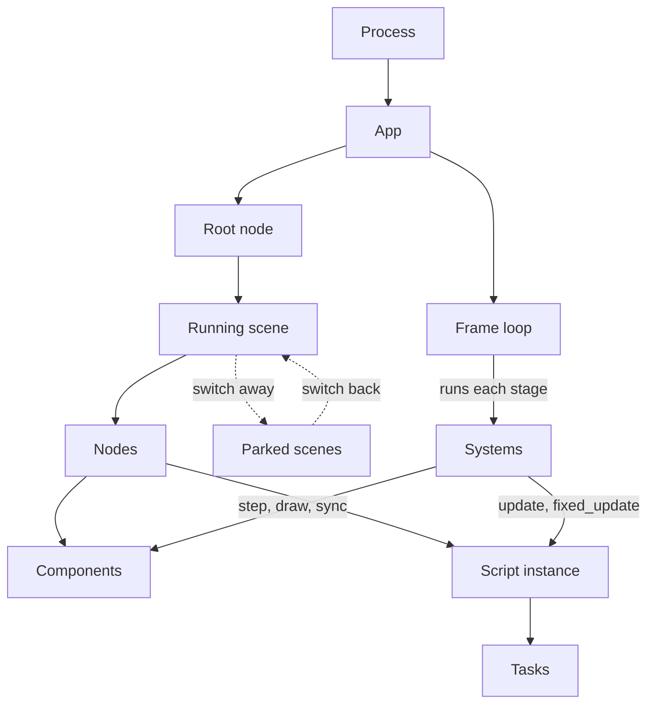

## The app

### From process start to exit

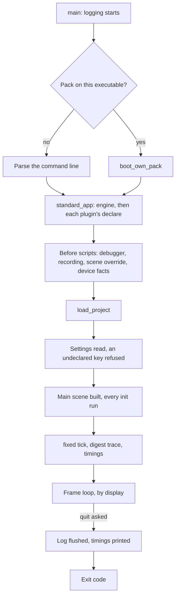

Scripts first run inside `load_project`, so what must see an `init` is set up before it: a recording, a debugger, the dark mode fact.

### Run state

Whether the app was asked to stop. Source: `balaur_core/src/engine.rs`, `quit` and `exit_code`.

| State | What is true |
| --- | --- |
| `quit` false | The frame loop runs. |
| `quit` true | The frame in flight finishes, then the loop ends. Nothing clears it. |

| From | Trigger | To | What it does |
| --- | --- | --- | --- |
| false | `engine.quit(code)` | true | Sets `exit_code` |
| false | Window close | true | `on_quit_requested` told to every script first, as a chance to save and not a veto |
| false | `--frames N` reached, windowed or offscreen | true | `--shot` taken on the frame before |
| false | Debug adapter's `terminate` | true | |

Starts false, `exit_code` 0. Ends true. A headless run with `--frames` ends when its count runs out, with `quit` still false. A window the backend lost ends the loop the same way.

### Display

Where a `balaur run` puts its frames, chosen once at start. Source: `balaur_cli/src/main.rs`, `Display`.

| State | Flag | What is true |
| --- | --- | --- |
| `Windowed` | none | A window and a GPU. Measured frame time, capped at 0.1 s, drives `App::advance`. A build without the `window` feature runs `App::run` instead. |
| `Headless` | `--headless` | No renderer. With `--frames`, `App::tick` at the fixed step that many times, with no replay plan. Without, `App::run`. |
| `Offscreen` | `--offscreen` | A GPU and no window. Every step is the fixed step, through `App::advance`. It wins when both flags are given, and a build with no renderer refuses it. |

### Rest

Whether a windowed loop under `[window] low_processor` may sleep before its next frame. Simulated time moves only on frames, so the loop asks before it sleeps. Source: `balaur_core/src/rest.rs`, `RestState.quiet_at` and `ProbeRegistry`; `balaur_render/src/kiss3d_backend.rs`, `sleep_until_owed`.

| State | What is true |
| --- | --- |
| Pending (`quiet_at` `None`) | A probe answers that its subsystem has work only frames finish, or the last frame ran for a reason of its own. Frames keep coming. |
| Settling (`quiet_at` `Some`, no fixed step since) | No probe answers. Frames keep coming until one runs a fixed step, which counts what the frame before it started. |
| At rest (`quiet_at` `Some`, a fixed step since) | The loop waits in the window system for input, `wake::wake` or a repaint falling due. |

| From | Trigger | To | What it does |
| --- | --- | --- | --- |
| any | `busy` finds a probe pending | Pending | |
| any | `disturb`: the loop runs a frame for input, a wake or a repaint | Pending | |
| Pending | `busy` finds no probe pending | Settling | Keeps the count of fixed steps run |
| Settling | `busy` finds none pending and the count moved | At rest | The loop sleeps |

Starts Pending. Never ends.

Each probe reads a count or a flag its subsystem's own step keeps:

| Probe | Pending while |
| --- | --- |
| `task` | A `task::seconds` or `task::frames` wait counts, an awaited call's result is owed, or a stepped job is parked |
| `timer` | A `timer` component is running |
| `replay` | The replay player has frames to feed |
| `preload` | A pack's scene is still to warm |
| `animation` | A clip plays, a tween runs, or a state machine has a travel, a jump or its start to take |
| `physics` | A dynamic body is awake, a kinematic one moves, or a soft body is not asleep, in either world |
| `particles` | An emitter emits, or the last particles it bore have lifetime left |
| `audio` | A sound that does not loop is playing, or a stopped one is fading out |
| `multiplayer` | The machine hosts, joins or plays a match |

Refused or ignored: `busy` answers false under a debugger stop, a held replay and a time scale of zero, since no fixed step runs. A loop without `low_processor`, an offscreen run and a headless run never ask. A looping sound is not pending: the device plays it on its own thread.

Held by a pause, a `process` mode or a parked scene: a held node's timer, clip, tween, machine, emitter and sound are not pending. A paused game holds every body and every `task` wait, and so does `physics::set_paused` for the bodies. A node under `debug_scope`, the scene an editor has open, is never pending: the editor asks for the frames it plays on.

### Exit codes

| Code | When |
| --- | --- |
| 0 | A clean end, or `engine.quit` with no code |
| N | `engine.quit(N)`. Only `balaur run` applies it. |
| 1 | `engine.quit` with an integer outside 32 bits, or any error returned from `main`: a bad `--size`, a port in use, a project that does not load |
| 2 | A command line clap cannot parse |

## A frame

`App::advance` runs one frame, and its first question is the replay player's plan.

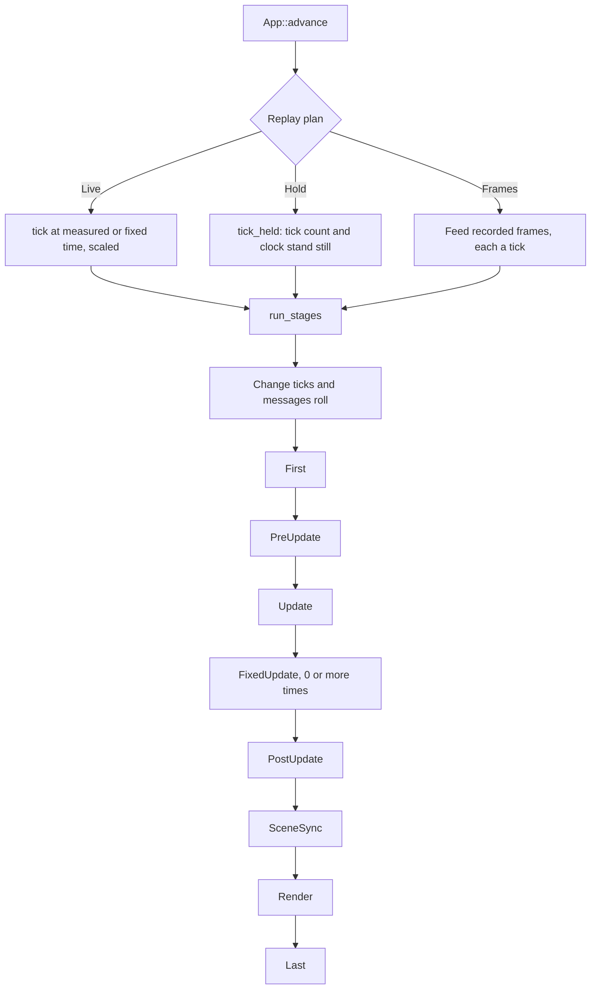

### Stages

`Stage` in `balaur_core/src/app.rs`. Systems run in the order added, and commands deferred by a stage are applied at its end.

| Stage | What runs |
| --- | --- |
| `First` | A fed replay frame restored, stepped jobs advanced, the clock read, device hooks announced, the pause announced, input and pads read |
| `PreUpdate` | Script hot reloads |
| `Update` | Queued events delivered, then every script's `update` |
| `FixedUpdate` | Task waits, `timer` components, every script's `fixed_update`, physics. Runs once per whole fixed step owed, and not at all under a debugger stop or a paused replay |
| `PostUpdate` | Audio sweeps, ragdoll blends |
| `SceneSync` | Transforms and appearance composed down the tree, cameras, screen notifiers, spatial audio |
| `Render` | Widgets and drawing. Skipped when a rollback re-runs a tick |
| `Last` | Queued frees, variable changes, then the scene switch |

The recorded frame is written after `Last`, once every stage has run, so it holds the frame's last state.

A frame owes the fixed stage its time through one accumulator. At most `MAX_SUBSTEPS` steps' worth is kept, scaled up under fast forward, and the rest is dropped. A debugger stop drops what is owed.

## What holds what

Eight things can stop part of the game. Each row reads as that one thing acting alone.

| Hold | Set by | Fixed stage | `update`, `fixed_update` | `task` waits | Physics | Animation, `timer` | Draws | Hooks and calls |
| --- | --- | --- | --- | --- | --- | --- | --- | --- |
| Game pause | `engine.set_paused(true)` | Runs | Held on `pausable` nodes | All held, `always` nodes too | Both worlds held | Held on `pausable` nodes | Yes | Reach it |
| `process = disabled` | Scene key, `node.set_process` | Runs | Held in the subtree | Count on, its tasks wait | Runs | Held in the subtree | Yes | Reach it, but `call_all` skips it |
| Parked scene | `scene.switch` away | Runs | Held | Task held | Bodies and colliders disabled | Held | No | None reach it |
| Debugger stop | A breakpoint, a step, a caught error | Skipped | `update` held in the debug scope, or everywhere with none, and in the stopped file. `fixed_update` goes with the stage | Held where `update` is | Held with the stage | Held | Yes | `announce` held there, `call_on` reaches it |
| Paused replay | `replay.pause` | Skipped | Held in the debug scope, or everywhere with none | Held with the stage | Held with the stage | Held | Yes | `announce` held there, `call_on` reaches it |
| `physics.set_paused(true)` | The editor, a script | Runs | Run | Run | Both worlds held | Run | Yes | Reach it |
| Time scale 0 | `engine.set_time_scale(0)` | Owed nothing | `update` runs with 0, `fixed_update` does not | Held with the stage | Held with the stage | Held with the stage | Yes | Reach it |
| Hidden | `node.set_visible(false)` | Runs | Run | Run | Runs | Run | No | Reach it |

`call_all` passes by whatever `update` passes by. `announce` reaches every instance but a parked one or one a debugger stop or a paused replay holds. A run driving at a fixed step ignores the time scale. Physics is one world, so a game pause holds an `always` node's bodies too.

A node's sound holds with its node: `hold_sounds` asks `process::ticks` and `frozen_root` every frame. So a game pause holds a `pausable` node's sound and an `always` node's plays on. A cue has no node and plays through all of them.

### Debugger stop and replay hold

The three holds on the whole simulation. Source: `balaur_core/src/engine.rs`, `frozen`, `replay_hold` and `opening_hold`. `Engine::frozen_root` answers all three: the debug scope while any is on, or the root with no scope.

| State | What is true |
| --- | --- |
| `frozen` false | No debugger stop holds the simulation. |
| `frozen` true | A script is stopped at a line or a caught error, or a replay is feeding a frame recorded during a stop. |
| `replay_hold` false | The player is stopped, or feeding frames. |
| `replay_hold` true | A replay is paused or out of frames. |
| `opening_hold` false | No recording started earlier in this frame. |
| `opening_hold` true | A recording started earlier in this frame. The rest of it is not recorded, so nothing may step in it. |

| From | Trigger | To | What it does |
| --- | --- | --- | --- |
| `frozen` false | A stop held by the script host | true | No fixed step runs, what is owed is dropped |
| `frozen` true | `debugger.resume` lets the call finish or wait | false | |
| `frozen` any | `App::replay_frames`, a frame recorded frozen | true for that tick | Put back after it |
| `replay_hold` any | `replay::begin`, or `App::advance` planning `Hold` | true | `tick_held` keeps the tick count and clock |
| `replay_hold` any | `replay::end`, or `App::advance` planning `Live` or `Frames` | false | |
| `opening_hold` any | `replay::start_recording` | true | Holds what is left of the frame, as `replay_hold` holds the frame `begin` runs in |
| `opening_hold` any | The next frame's stages start | false | |

All three start false and never end. [LIFECYCLE-tools.md](LIFECYCLE-tools.md) has the player and the stop itself.

### Process mode

When a node and its subtree tick. Source: `balaur_core/src/process.rs`, `ProcessMode`.

| State | Script spelling | Game running | Game paused |
| --- | --- | --- | --- |
| `Inherit` | `inherit` | The nearest ancestor's answer; `Pausable` with none | Same |
| `Pausable` | `pausable` | Ticks | Held |
| `Always` | `always` | Ticks | Ticks |
| `Disabled` | `disabled` | Held | Held |

Starts `Inherit`. `process::ticks` is the one question every subsystem asks. A debugger's scope (`Engine::debug_scope`) limits a pause to one subtree, which is how an editor keeps running around a paused game.

### Device facts

What the system says about the app, each change told to every script through `announce`, held ones too. Source: `balaur_core/src/facts.rs`, `DeviceFacts`.

| Fact | Values | Hook |
| --- | --- | --- |
| `focused` | true, false | `on_focused_changed` |
| `dark_mode` | true, false | `on_dark_mode_changed` |
| `suspended` | true, false: a hidden tab, a covered window, an app sent back | `on_suspended_changed` |
| `memory_warnings` | A count that only rises. It also frees every parked scene. | `on_low_memory` |
| `safe_area` | Four insets in pixels | `on_safe_area_changed` |
| Orientation, derived from the screen size | `portrait`, `landscape` | `on_orientation_changed` |

Device facts are recorded, so a replay hears each change on the frame the run did. While a replay plays, nothing writes them but the recording.

## Nodes

A node has no state field of its own. These states are derived from where it hangs and what is queued for it.

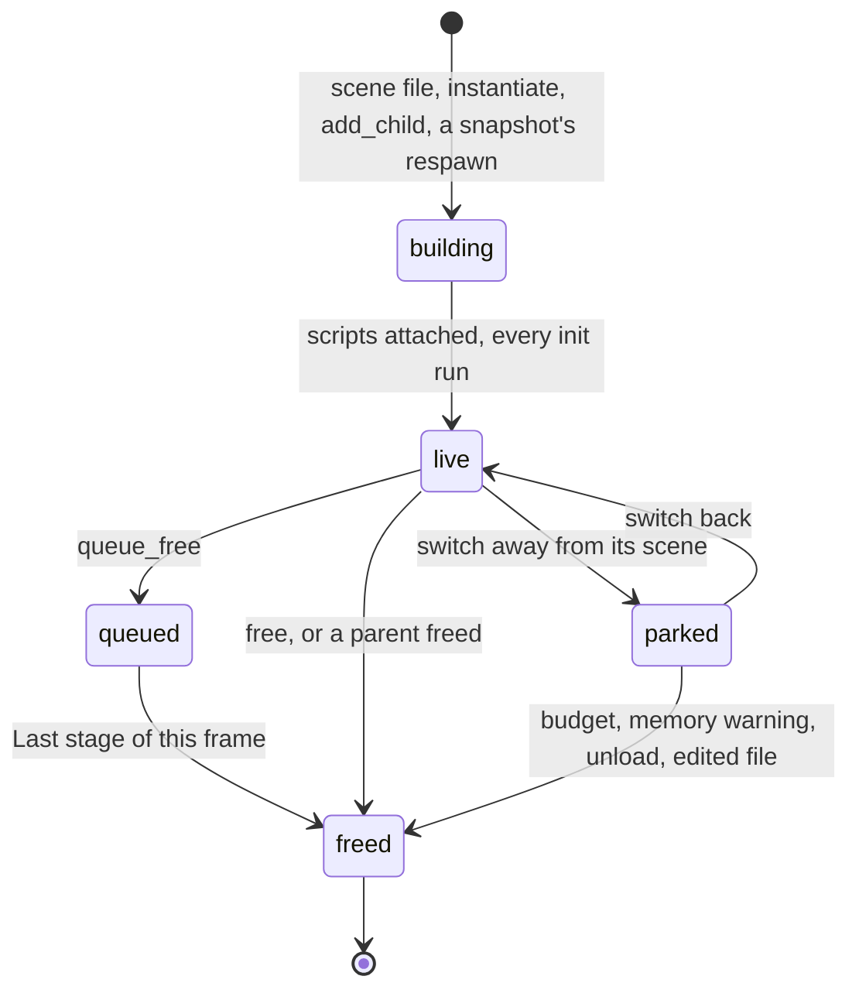

| State | What is true |
| --- | --- |
| `building` | The entity exists with its components. Its script is named, and no `init` in this scene has run. |
| `live` | Under the tree's root, reached by every pass. |
| `queued` | On the frame's free list, and still live until `Last`. |
| `parked` | Under a holder outside the tree, in a scene `scene.switch` left. It stays in the world, the digest and every snapshot. |
| `freed` | Despawned. A kept handle is stale. |

Refused while parked: `node.add_child`, `node.set_parent`, `node.attach_script` and `scene.instantiate` under it. Components can still be read and written through a kept handle.

### Two switches on a live node

| Key | Values | Reach |
| --- | --- | --- |
| `visible` | true, false | The subtree draws or does not, and a pick skips it. Its logic and physics go on. `visible_in_tree` folds in the ancestors. |
| `process` | See [Process mode](#process-mode) | Whether the subtree ticks. |

### Building a scene

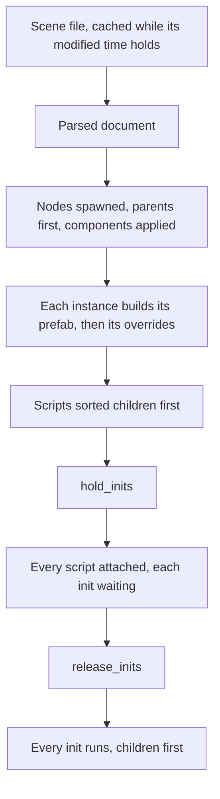

Every node exists before any `init` runs, so one script can reach another's node. Children go first, so a parent's `init` finds its children's scripts set up.

### Freeing a node

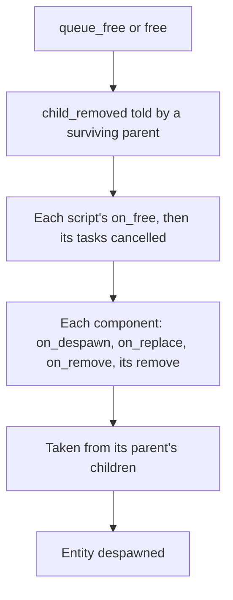

A batch of frees scans each parent's children once, so a frame freeing many siblings stays linear. A scene switch frees its tree with no `child_removed` from the root.

## Components

A component has no state value either. What a node holds of it moves through these hooks, declared on the component (`on_add`, `on_insert`, `on_replace`, `on_remove`, `on_despawn` in `components/derived.rs`).

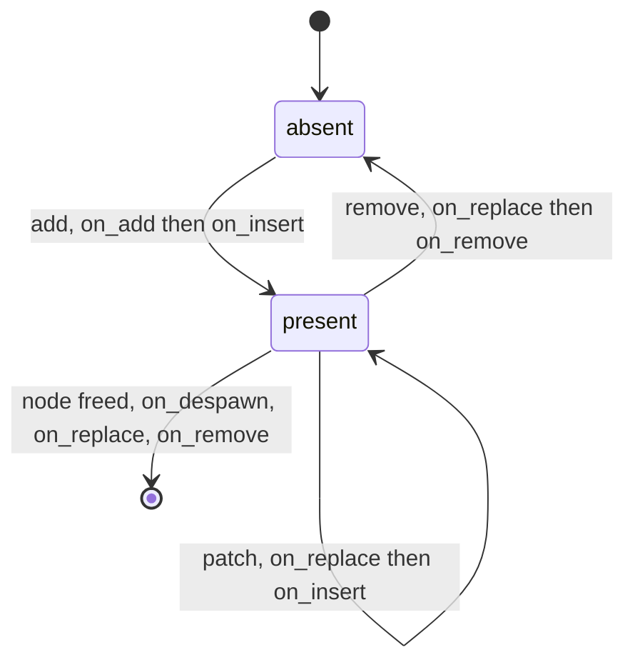

| State | What is true |
| --- | --- |
| `absent` | The node's `Attached` bit is clear. `components::has` says false. |
| `present` | The bit is set. `components::get` answers what the component holds. |

| Hook | When | What the component holds then |
| --- | --- | --- |
| `on_add` | First put on the node | Its first values |
| `on_insert` | After every write, the first included | The new values |
| `on_replace` | Before a write over it, or before it comes off | The old values |
| `on_remove` | Before it comes off | The old values |
| `on_despawn` | Its node is being freed, before any `on_replace` or `on_remove` | Everything on the node |

A write the component refuses is logged and answered with an error. If the component was already there, `on_insert` runs for the values put back. A component's `requires` are added first, at their defaults.

### `states` component

A node's named looks. Source: `balaur_core/src/states.rs`, `States`. The state names are the scene's own, with one fixed value.

| State | What is true |
| --- | --- |
| `current` empty | The pose the scene gave it. |
| `current` a name | That state's table was patched over the components it names. |

| From | Trigger | To | What it does |
| --- | --- | --- | --- |
| any | `node.states.set_state`, or a binding's `set_state`, with another name | that name | Each component patched, then the `state_changed` row and `on_state_changed(was, now)` |
| a name | The same name | unchanged | Nothing |
| any | A name not declared | unchanged | An error naming the states it has |

### `timer` component

Counts simulation time down. Source: `balaur_core/src/timer.rs`, `Timer`.

| State | What is true |
| --- | --- |
| `running` false | `left` is 0. |
| `running` true | `left` falls by each fixed step. |

| From | Trigger | To | What it does |
| --- | --- | --- | --- |
| false | `autostart` on being added, or `running` written true | true | `left` set to `wait_time` |
| true | `running` written false | false | `left` cleared |
| true | `left` reaches 0, `one_shot` | false | `timeout` announced |
| true | `left` reaches 0, not `one_shot` | true | `timeout` announced, the next wait counted on from where this one ended |

Starts false. Held by a pause, a `process` mode or a parked scene: the count stands.

## Script instances

The object a node's script runs on, one per node. Source: `balaur_script_bs/src/host.rs`, `Instance`, and the host's `instances`, `parked` and `held` lists.

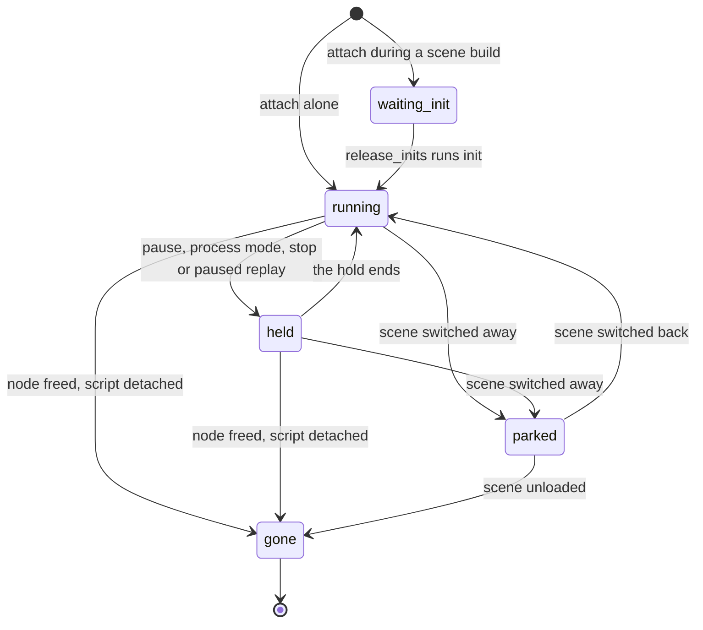

| State | What is true |
| --- | --- |
| `waiting_init` | In `instances`, its node in `held`. Exported properties are written, `init` has not run. |
| `running` | In `instances`, and nothing holds it. Gets `update`, `fixed_update`, `call_all`, `announce` and `call_on`. |
| `held` | In `instances`, and a pause, a `process` mode, a debugger stop or a paused replay holds it. A stop holds its debug scope and every instance of the file it stopped in, so an editor around the game runs on. `update`, `fixed_update` and `call_all` pass it by. `call_on` reaches it, and `announce` does under a pause or a mode. |
| `parked` | In `parked`. No pass or call finds it. `save_state` and a hot reload still do. |
| `gone` | Out of both lists, `gone` set, its object dropped. A pass begun before still holds it and calls nothing. |

`held` and `running` are not stored: each pass asks. While a method runs, the object is out of the instance (`obj` is none) and a call back in runs on a second holder (`lent`). That is a moment within `running`, not a state of its own.

| From | Trigger | To | What it does |
| --- | --- | --- | --- |
| none | `attach_with_props`, with `hold_inits` in force | `waiting_init` | Properties written |
| none | `attach_with_props`, no hold | `running` | `init` runs at once |
| `waiting_init` | Outermost `release_inits` | `running` | `init` runs, in attach order |
| `running`, `held` | `parked::park_current` | `parked` | `on_parked_changed(true)` first, then `set_parked` moves it and its tasks |
| `parked` | `parked::unpark` | `running` | `set_parked`, then `on_parked_changed(false)`. No `init`. |
| any | `detach` | `gone` | `on_free`, tasks cancelled |
| any | A reload of its file | same | Fields carried across by name, tasks ended with a warning, `on_hot_reload` told. A parked instance is carried and not told. |
| any | A rebuild for the debugger, breakpoints set or cleared | same | Fields carried across by name, tasks ended with a warning. The code did not change, so `on_hot_reload` is not told. |

### Tasks

An async method suspended on the engine. Source: `balaur_script_bs/src/host/tasks.rs`, `Pending`, and the host's `tasks` and `parked_tasks` lists. A task has no field for these. They are derived from the lists and the runtime.

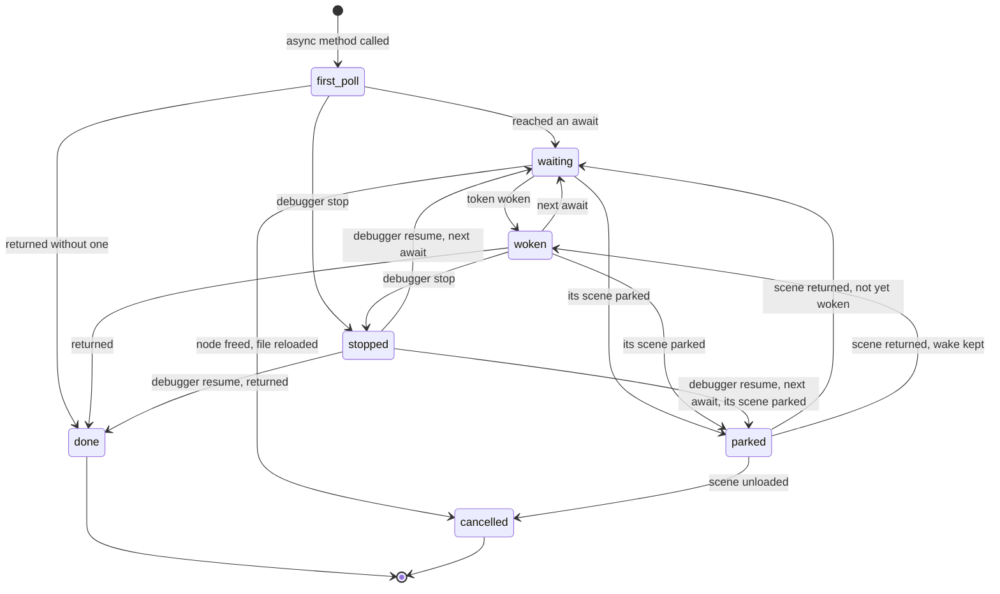

| State | What is true |
| --- | --- |
| `first_poll` | Inside `start`, running up to its first await. |
| `waiting` | In `tasks`, the runtime awaiting its token. Polling finds nothing to do. |
| `woken` | In `tasks`, its token's value kept in the runtime. The next `run_tasks` goes on, unless something holds its node or its file holds a debugger stop. |
| `parked` | In `parked_tasks`. Wakes are kept and nothing polls it. |
| `stopped` | Taken out of the lists and held by the debugger's stop with its object. |
| `done` | Returned. A caller awaiting it through `call_async` is woken on the next step. |
| `cancelled` | Dropped: its node was freed, or its file reloaded, which logs a warning. |

`run_tasks` runs from every `update` and from each wake. A wait from `task::frames` or `task::seconds` counts fixed steps, stops counting in a paused game, and its wake is kept for a task whose scene is parked.

## Scene switches

### The switch

What a `scene.switch` is doing. Source: `balaur_core/src/scene_switch.rs`, `Pending` and `Crossing`. Derived from `Pending.scene` and `Pending.crossing`.

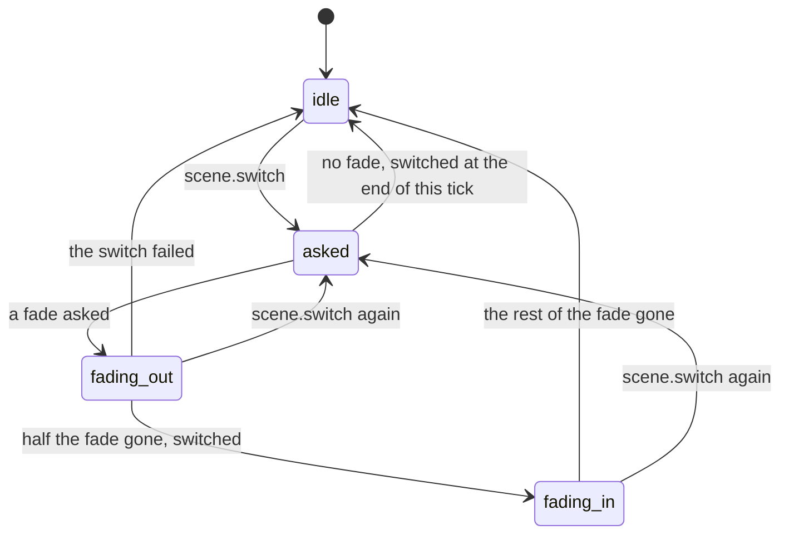

| State | What is true |
| --- | --- |
| `idle` | `scene` none, `crossing` none. |
| `asked` | `scene` holds the path. The last request in a tick is the one that happens. |
| `fading_out` | `crossing.scene` holds the path. The roots' tint alpha falls to 0. |
| `fading_in` | `crossing` holds no scene. The new roots' tint alpha rises to 1. |

The switch runs in `Last`, so a script asking inside `update` is not moving the tree it runs in. A failed build logs an error, with the scene left already parked or freed.

### A scene

What one scene file is to the engine. Derived from `SceneFiles` (`balaur_core/src/project.rs`) and `Parked` (`balaur_core/src/parked.rs`).

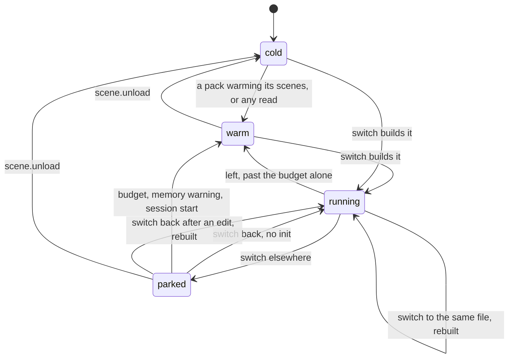

| State | What is true |
| --- | --- |
| `cold` | Nothing kept. A switch reads and parses the file and decodes its pictures on the frame. |
| `warm` | The file and its prefabs are parsed in `SceneFiles`, and pictures are decoding or uploaded. No node exists. |
| `running` | Its tree is under the root, and `Parked.current` names the file. |
| `parked` | Its tree hangs from a holder, listed in `Parked.scenes`. `scene.parked()` names it. |

| From | Trigger | To | What it does |
| --- | --- | --- | --- |
| `running` | Switch elsewhere | `parked` | `on_parked_changed(true)`, scripts and tasks moved, plugins told, roots handed to a new holder |
| `parked` | Switch back, files unchanged | `running` | Roots handed back, transforms composed, plugins and scripts told |
| `parked` | Switch back, a file changed | `running` | The kept tree freed and the file built, `init` running |
| `parked` | Parked nodes past `MAX_PARKED_NODES`, oldest scene first | `warm` | Freed, `on_free` running |
| `running` | Switch elsewhere, the tree alone past `MAX_PARKED_NODES` | `warm` | Freed instead of parked, `on_free` running. A tree built by hand, with no file to come back by, goes the same way. |
| `parked` | A system memory warning | `warm` | Every parked scene freed |
| `parked` | A multiplayer session starts | `warm` | Every parked scene freed |
| `parked`, `warm` | `scene.unload` | `cold` | Scene freed, parsed files dropped, pictures let go |

`MAX_PARKED_NODES` is 20,000. It counts nodes so that two machines park alike, since a parked tree is in the digest.

What each plugin does when a tree parks or returns:

| Plugin | Parks | Returns |
| --- | --- | --- |
| Physics | Colliders and bodies disabled, soft bodies too | Each back to what it asks for |
| Audio | The node's sound paused, a `listener` passed over | Back to its own `paused` |
| Touch controls, followers, vehicles, ragdolls, modifiers | Skipped each frame | Go on |
| Widgets, cameras, lights | Not reached from the root | Reached |
